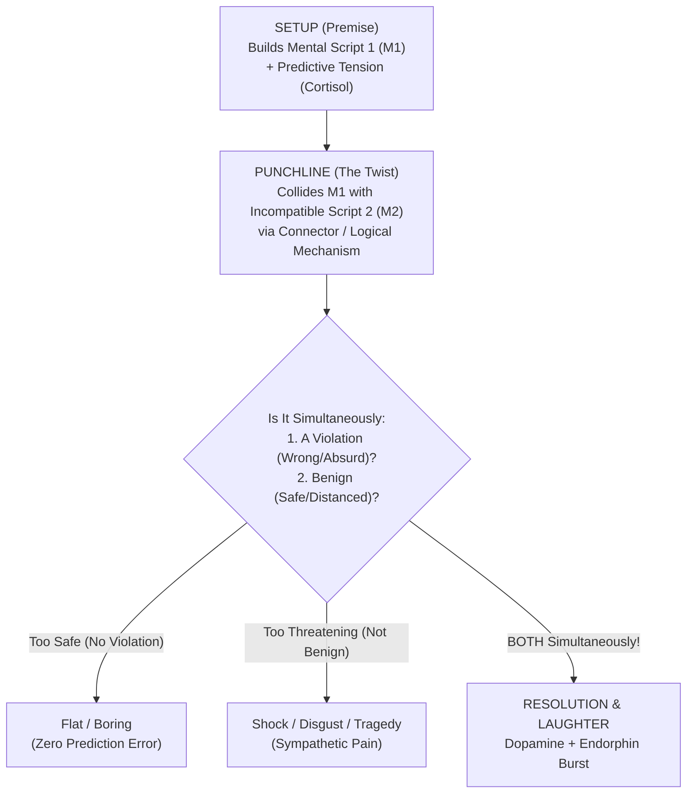
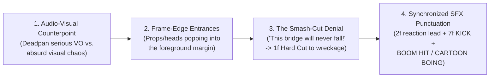

# Deep Research: How Humans Write Funny Jokes & Comedy Engineering

> [!IMPORTANT] Vault Integration & Related Guides
> - **Master Trilogy Hub**: [[Deep Research - Masterclass on Story Writing, Animation Layout & Comedy Science]]
> - **Story & Narrative Companion**: [[Deep Research - How to Write & Tell Stories (Narrative Architecture Bible)]]
> - **Visual Layout Companion**: [[Deep Research - Animation Layout, Staging & Visual Composition]]
> - **Short-Form Execution**: [[Script Architecture - 3.7 WPS & The 'You See' Pivot]] | [[The 1-Sentence Paradox Hook Formula]] | [[SFX Direction & The 2-4 Frame Lead-In Law]]

---

## Executive Summary

Amateur writers treat humor as a mysterious talent ("you're either born funny or you aren't"). Professional comedy writers—from *The Simpsons* writers' room (George Meyer, Conan O'Brien, John Swartzwelder) and *The Onion* (Scott Dikkers) to stand-up engineers (Greg Dean, Gene Perret, John Vorhaus) and animation masters (Chuck Jones, Tex Avery, Edgar Wright)—treat joke writing as **deterministic cognitive engineering** [81][82][83][84].

Across 250 years of philosophy, cognitive psychology, computational linguistics, and writers'-room practice, **every funny joke and visual gag in human history operates on a single neuro-cognitive mechanism**:

**Laughter is the involuntary neurochemical reward burst triggered when the brain detects a simultaneous "Benign Violation" or rapidly resolves a "Bisociated Incongruity" between two incompatible mental scripts ($M_1 \times M_2$), discharging accumulated predictive tension in `<250 milliseconds`.** [81][85][86][87]

To write genuinely funny jokes reliably on demand, a writer combines five mechanical layers:
1. **The Emotional Fuel (`Comedy = Truth + Pain`):** Anchor the premise in an uncomfortable, recognizable human flaw, arrogance, or misery (John Vorhaus) coupled with a **Benign Violation** distanced by time, space, or cartoon absurdity (McGraw & Warren) [83][85].
2. **The Two-Story Structural Switch (Greg Dean & Raskin/Attardo):** Build a **Setup (`1st Story`)** that tricks the audience's brain into forming an automatic **Target Assumption (`Script 1`)**, pivot on an ambiguous **Connector**, and drop a **Punchline (`2nd Story`)** that forces an instant backward re-interpretation (`Script 2`) [81][86].
3. **The 11 Funny Filters (Scott Dikkers / *The Onion*):** Pass raw facts through systematic comedic lenses—especially **Misplaced Focus**, **Irony**, **Hyperbole**, **Character**, **Analogy**, and **Madcap Escalation** [82].
4. **Syntax, Phonetics & Micro-Timing:** Place the **Punch Word on the final syllable of the sentence**, obey the **Rule of Three (`A, A, B`)**, replace abstract nouns with **hyper-specific concrete nouns**, and favor **high-entropy stop-plosives (`/k/`, `/p/`, `/t/`, `/b/`, `/g/`)** (Neil Simon / Chris Westbury) [88][89].
5. **Visual & Audio-Visual Gag Grammar:** In animation, pair **deadpan factual narration** against **absurd visual escalation** (Audio-Visual Counterpoint), enforce **Chuck Jones' 9 Rules**, lead punch words by **`2 frames`** on character expressions, and punctuate cuts with frame-accurate acoustic transients [84][90][91].

---

## 1. The 5 Scientific Theories of Humor (Why the Human Brain Laughs)

Understanding *why* the human brain laughs gives you a diagnostic radar for why a draft joke fails and how to fix it.



### 1.1 Incongruity-Resolution Theory (Kant, Schopenhauer & Jerry Suls, 1972)
- **Immanuel Kant** (*Critique of Judgment*, 1790) defined laughter as *"an affection arising from a strained expectation being suddenly reduced to nothing."* [92]
- **Arthur Schopenhauer** (*The World as Will and Representation*, 1818) refined this: humor occurs when we perceive a sudden **mismatch between an abstract concept and the real physical object** we grouped under that concept [93].
- **Jerry Suls' Two-Stage Information-Processing Model (1972):** Psychologist Jerry Suls formalized Incongruity-Resolution as a two-step cognitive algorithm [87]:
  1. **Stage 1 (Prediction & Surprise):** As the listener hears the setup, their brain predicts the most probable ending. When the punchline arrives, it violates that prediction (**Incongruity**).
  2. **Stage 2 (Cognitive Rule Search & Resolution):** If the incongruity is pure random nonsense, the listener is merely **confused**. Humor occurs *only* when the listener's brain discovers a hidden cognitive bridge (**Resolution**) that makes the surprising ending suddenly make twisted sense [87].

### 1.2 Benign Violation Theory — BVT (Peter McGraw & Caleb Warren, 2010)
Incongruity-Resolution explains clever wordplay, but why do humans laugh at slapstick, dark history, or a general getting trampled by his own horse? At the University of Colorado Boulder's Humor Research Lab (HuRL), **Peter McGraw and Caleb Warren** solved this with the **Benign Violation Theory (BVT)** [85][94]:

Humor occurs when and only when three conditions are met simultaneously:
1. **A Violation Occurs:** Something threatens how the world *ought* to work (a physical injury, a breach of dignity, a logical absurdity, a social taboo, or military incompetence) [85].
2. **The Violation Is Appraised as Benign:** The brain simultaneously registers that the violation is safe, harmless, or acceptable [85].
3. **Simultaneity:** Both appraisals happen in the same instant [85].

#### The 4 Levers of Psychological Distance (How to Make a Disaster Funny):
Why can we make hilarious viral shorts about the *1932 Great Emu War*, *Napoleon vs. Rabbits (1807)*, or *1880s Broughton Bridge*? Because of McGraw & Warren's **Psychological Distance Matrix** [85][94]:

| Distance Dimension | Too Close (Tragedy / Horror) | Comedic Sweet Spot (Benign Violation) | How We Engineer It in Animated Shorts |
| :--- | :--- | :--- | :--- |
| **1. Temporal Distance** | Happened yesterday | Happened in `1807`, `1880`, or `1932` | *"Tragedy + Time = Comedy."* Historical distance makes military/engineering fails benign [85]. |
| **2. Social Distance** | Happens to an innocent child | Happens to an **arrogant Emperor or cocky General** | Always make the target high-status, pompous, and self-inflicted (*Punching Up*) [10][85]. |
| **3. Hypothetical / Stylistic Distance** | Photorealistic gore | **Stylized 2D Bean-Head Cards or Low-Poly 3D** | Cartoon physics (`CARTOON BOING`, lidded eyes, zero blood) signals "play frame" [85]. |
| **4. Physical Outcome** | Permanent death / trauma | **Waist-deep water + bruised ego** | *"Luckily, the river was only waist-deep (`Benign`). Unluckily, the general's horse landed on the general (`Violation`)."* |

### 1.3 Arthur Koestler's `"Bisociation"` (*The Act of Creation*, 1964)
Philosopher **Arthur Koestler** demonstrated that routine thinking moves along a single plane or matrix of associative rules ($M_1$). **Bisociation** occurs when a joke forces the brain to perceive a single event at the exact intersection of **two self-consistent but habitually incompatible matrices ($M_1 \times M_2$)** [86]:
- **Matrix $M_1$ (Military Strategy & Grandeur):** Napoleon Bonaparte, conqueror of Europe, flanking maneuvers, imperial cavalry charges.
- **Matrix $M_2$ (Petting Zoo / Farmyard Feeding Time):** Fluffy domestic bunnies hopping toward a man holding cabbage.
- **The Bisociated Spark ($M_1 \times M_2$):** Describing 3,000 fluffy farm rabbits executing a **double-pincer flanking maneuver across Waterloo** against the Emperor of France [86]! Because our mind has elevated thermal/emotional tension riding on $M_1$, and $M_2$ suddenly collapses its dignity, the redundant nervous tension has nowhere to go and discharges as **laughter** [86].

### 1.4 Henri Bergson's `"Mechanical Encrusted on the Living"` (*Le Rire*, 1900)
French Nobel laureate **Henri Bergson** discovered the #1 law of character and physical comedy:
> *"The attitudes, gestures and movements of the human body are laughable in exact proportion as that body reminds us of a mere machine."* (*"Du mécanique plaqué sur du vivant"*) [95]

Why is this law pure gold for animation?
- **Living adaptability vs. Mechanical rigidity:** A healthy human adapts fluidly to reality. A **comic character** is a rigid automaton obsessed with a single rule, habit, or bureaucratic order even while the bridge is collapsing underneath them [95].
- **Example in Our Shorts:** British soldiers in 1880 are so rigidly polite and obedient to marching cadence (*mechanical rigidity*) that even as the suspension bridge bounces like a trampoline (*living crisis*), they keep marching in step until they plunge into the river!

### 1.5 Raskin & Attardo's General Theory of Verbal Humor (GTVH)
Linguists **Victor Raskin** (*Semantic Script Theory of Humor*, 1985) and **Salvatore Attardo** (*GTVH*, 1991) proved that every verbal joke is built from **6 hierarchical Knowledge Resources (KRs)** [81]:
1. **`SO` (Script Opposition):** The fundamental binary clash (`Smart/Dumb`, `Exalted/Trivial`, `Life/Death`, `Predator/Prey`).
2. **`LM` (Logical Mechanism):** The cognitive trick that connects the two scripts (False Analogy, Role Reversal, Exaggeration, Ignoring the Obvious, Literalization of Metaphor).
3. **`SI` (Situation):** The concrete props, setting, and activity.
4. **`TA` (Target):** Who or what is being mocked (e.g., bureaucratic hubris).
5. **`NS` (Narrative Strategy):** The structural container (Rule of Three, `"Luckily/Unluckily"` pair, Q&A, Deadpan Footnote).
6. **`LA` (Language):** Exact word choice, plosive phonetics, and final-word placement [81].

---

## 2. The Mechanical Anatomy of a Joke: How Pros Build One from Scratch

### 2.1 Greg Dean's Two-Story & Connector Engineering Model
In *Step by Step to Stand-Up Comedy*, **Greg Dean** operationalized Raskin's Script Theory into a 5-step mechanical assembly line [81][96]:

```
   [1. SETUP (1st Story)] ──> Audience brain automatically constructs ──> [TARGET ASSUMPTION (Script 1)]
              │
              └── Contains an ambiguous [CONNECTOR] (1 element with 2 interpretations)
                                              │
   [2. PUNCHLINE (2nd Story)] ────────────────┴──> Flips Connector to reveal [REINTERPRETATION (Script 2)]
              │
   [3. TAGS / TOPPERS] ──> Ride the 2nd Story for 2–3 extra laughs with ZERO new setup!
```

#### Step-by-Step Reverse Engineering Blueprint:
Suppose you want to write a joke about **how the Australian Army used two Lewis machine guns against 20,000 emus in 1932**:
1. **Find the `Connector` / Expectation Norm:** What do people assume happens when a modern army brings machine guns to fight birds?
   - *Target Assumption (`1st Story`):* Machine guns easily wipe out birds.
2. **Establish the `Setup` to Lock In the Target Assumption:**
   - *"In 1932, the Australian military deployed Major Meredith with two Lewis machine guns and 10,000 rounds of ammunition to wipe out 20,000 flightless birds."*
3. **Shatter the Assumption with the `Punchline` (`2nd Story`):**
   - *"After six days of non-stop ambushes and 2,500 bullets fired, the Australian Army had officially eliminated... twelve emus."*
4. **Add a `Tag` / `Topper` (Escalating the `2nd Story` without a new setup):**
   - **Tag 1 (In-Character Quote):** *"Major Meredith reported that the birds had 'the tank resilience of the Zulus—and better guerrilla tactics.'"*
   - **Tag 2 (Topper):** *"Even worse, the emus split into small units, with one giant six-foot bird acting as a lookout while the rest ate the wheat."*

### 2.2 John Vorhaus's *The Comic Toolbox*: `Truth + Pain` & `The Rule of Nine`
In *The Comic Toolbox* (1994), comedy consultant **John Vorhaus** formulated the two foundational laws of comedy writers' rooms [83]:

1. **`Comedy = Truth + Pain`:**
   - Every joke requires a **Truth** (an undeniable observation about human nature—e.g., *bosses take credit and blame subordinates; soldiers hate looking uncool*) plus **Pain** (humiliation, frustration, fear, or failure) [83].
   - If you have **Pain without Truth**, it's just cruel noise. If you have **Truth without Pain**, it's a dry proverb. Put them together (*"The general ordered his men to march faster to look impressive for the townspeople—right before the bridge dumped all sixty of them into the mud"*), and you have comedy gold [83].
2. **`The Rule of Nine` & *The Simpsons* "Sweatbox" Method:**
   - Vorhaus's **Rule of Nine** states: **out of every 10 jokes you write, the first 9 are obvious clichés that every other human brain also thought of first.** You must force yourself to write 10 punchlines for the same beat so you burn through the 9 mediocre ones and unlock the 10th [83].
   - In *The Simpsons* golden-era writers' room led by **George Meyer**, writers sat around a table ("the sweatbox") pitching 15–20 alternative punchlines for a single line on the big screen until the room physically laughed out loud [83].

---

## 3. Scott Dikkers' 11 Funny Filters (*The Onion* System)

In *How to Write Funny*, *The Onion* founder **Scott Dikkers** proved that there are **only 11 fundamental comedic subversions ("Funny Filters")** [82]. Whenever a line in your script feels flat or overly educational, pass it through one of these **11 Filters**:

| # | Funny Filter | Core Mechanism | Worked Example for Animated Shorts |
| :--- | :--- | :--- | :--- |
| **1** | **Irony** | Saying the exact opposite of the literal truth (or showing an outcome opposite to the intention). | *"To celebrate conquering the greatest armies in Europe, Napoleon was defeated in twelve minutes by a petting zoo."* |
| **2** | **Character** | Exaggerated, blind, or arrogant persona traits speaking in the wrong moment. | *"'Relax, lads! This bridge held the King's forty-ton cannons—it'll hold our boots!'"* |
| **3** | **Misplaced Focus** | Obsessing over a trivial detail while ignoring a massive catastrophe. | *"As the 475°C Venusian atmosphere melts your lungs, the good news is your sourdough starter will rise in 0.4 seconds."* |
| **4** | **Hyperbole** | Blowing a real physical sensation or reaction to absurd cosmic proportions. | *"Within ten seconds, the cast-iron bridge deck is bouncing like a backyard trampoline."* |
| **5** | **Analogy / Metaphor** | Comparing a complex scientific/historical event to a mundane, humiliating everyday experience. | *"Trying to nuke a rubble-pile asteroid is like firing a shotgun at a swarm of angry bees—you just made ten thousand smaller, radioactive bees."* |
| **6** | **Shock / Dark Turn** | Abruptly violating expectations with a blunt, unvarnished physical reality. | *"Luckily, the river was only waist-deep. Unluckily, the general's horse landed on the general."* |
| **7** | **Wordplay / Double Entendre** | Flipping a literal vs. figurative phrase (Use sparingly; combine with visual gags). | *"The army was ordered to 'break step'—only after they broke the bridge."* |
| **8** | **Reference** | Calling upon a shared cultural archetype to shorthand a ridiculous dynamic. | *"The rabbits didn't scatter—they executed the exact double-envelopment pincer movement from Battle of Cannae."* |
| **9** | **Parody** | Treating a completely ridiculous subject with the grave, solemn tone of a serious genre. | Narrating a battle against 3,000 fluffy bunnies like a gritty WWII documentary (*Ken Burns* tone). |
| **10** | **Madcap** | Pure escalating physical chaos where logic snowballs out of control. | Bunnies climbing into the Emperor's gilded carriage, chewing his sash, and chasing horses down the road. |
| **11** | **Meta-Humor** | Briefly acknowledging the absurd rules of the simulation or video itself. |Tiny `YOU` character looking directly at the `0.03s` survival timer HUD and shrugging before turning into ash. |

---

## 4. Micro-Mechanics: Syntax, Phonetics & Timing Laws

Even a brilliant premise will completely flatline if the sentence syntax puts the words in the wrong order. Master these five micro-laws:

### 4.1 Law #1: The Final-Word Punch Placement Law (Never Bury the Reveal)
In comedy writing, the **Punch Word** (or **Laugh Trigger**) is the exact single word or 2-word phrase where the audience discovers the `2nd Story` [81][96].

> [!CAUTION] The #1 Amateur Syntax Mistake: Trailing Words After the Reveal
> **The Laugh Trigger MUST be the final word of the sentence.** If you put 4 extra explanatory words *after* the funny reveal word, the narrator keeps talking right over the exact millisecond the viewer's brain wants to laugh—suffocating the dopamine spike!

- ❌ **Buried Punch Word (Ruined):**
  *"After firing 2,500 bullets, they only hit **twelve emus** during the entire first week of the operation."*
  *(The reveal `"twelve emus"` happens in the middle of the sentence; the trailing 9 words kill the punch!)*
- ✅ **Final-Word Punch Placement (Engineered):**
  *"After six days of non-stop ambushes and 2,500 bullets fired, the Australian Army had officially eliminated... **twelve emus**."*
  *(The sentence stops dead on `"twelve emus"`, followed by a `0.18s` beat of visual stillness or an impact `KICK`).*

### 4.2 Law #2: The Rule of Three (`Pattern → Pattern → Subversion`)
Why does the **Rule of Three (`A, A, B`)** work across every culture on Earth?
1. **Beat 1 (`A1`):** Introduces a point.
2. **Beat 2 (`A2`):** Establishes a **linear pattern** (two points define a straight line in the listener's predictive cortex) and sets a rhythm.
3. **Beat 3 (`B`):** Violates the extrapolated line while preserving the rhythmic cadence [82][96].
- *Example:* *"To survive on Venus, you'd need a titanium pressure hull (`A1`), a liquid-nitrogen cooling suit (`A2`), and **a different planet** (`B`)."*
- *Why Not Two or Four?* Two items cannot establish a pattern; four items drag the setup past the brain's working-memory cadence window [96].

### 4.3 Law #3: Phonetics of Humor — Neil Simon's `"K-Word"` Plosive Law & Word Entropy
In Neil Simon's *The Sunshine Boys* (1972), veteran vaudeville comedian Willy Clark explains: *"Words with a 'K' in them are funny. Cupcake is funny. Tomato is not funny. Cucumber is funny. Chicken is funny. Pickle is funny. Cockroach is funny."* [88]

In 2015–2017, cognitive psychologist **Dr. Chris Westbury** (University of Alberta) tested 4,997 English words and thousands of pseudowords using information theory (Shannon entropy), proving mathematically why certain words are inherently funnier [88][89]:
1. **Stop-Plosives (`/k/`, `/p/`, `/t/`, `/b/`, `/g/`, `/d/`):** Phonemes that completely block airflow in the vocal tract and release it in a sharp acoustic burst act as biological percussive hits [88].
2. **Low Orthographic/Phonological Probability (High Entropy):** Words with unusual consonant clusters, trochaic rhythms (stressed-unstressed like *píck-le*, *bád-ger*, *wób-ble*, *kúmq-uat*), or `oo` / `u` vowels violate the brain's statistical language model on a purely acoustic level [88][89].

| ❌ Flat / Low-Entropy Word | ✅ Funny / High-Plosive Replacement | Phonetic Mechanism |
| :--- | :--- | :--- |
| *"bird"* / *"animal"* | ***"chicken" / "pigeon" / "emu" / "badger"*** | Stop-plosives + trochaic bounce |
| *"hit"* / *"fell"* | ***"bonked" / "splatted" / "belly-flopped"*** | Labial/velar plosive clusters (`/b/`, `/k/`, `/p/`) |
| *"shoes"* | ***"hobnailed boots" / "wooden clogs"*** | Hard `/b/`, `/t/`, `/k/`, `/g/` transients |
| *"shaking"* | ***"bouncing like a backyard trampoline"*** | Alliterative `/b/` + `/t/` + `/p/` cadence |

### 4.4 Law #4: Hyper-Specificity Over Generic Abstraction
Generalities are the enemy of comedy. The brain cannot visualize a category (*"a snack," "a vehicle," "some animals"*), so it feels zero incongruity [82][83].
- **Rule:** Always replace a category noun with the **most absurdly specific member of that category** (plus a concrete number):
  - *"many rabbits"* $\rightarrow$ ***"3,000 starving farm bunnies"***
  - *"the bridge broke"* $\rightarrow$ ***"a two-inch wrought-iron suspension bolt sheared in half"***
  - *"for a very short time"* $\rightarrow$ ***"for 0.8 seconds"***

### 4.5 Law #5: The `"Luckily... / Unluckily..."` Deadpan Double Beat
Hard-coded as **Law #3** in [[AGENTS]], the `"Luckily... / Unluckily..."` structure is a double-layered **Value Charge Reversal** (McKee) + **Benign Violation** (McGraw) [3][85]:
- **Clause 1 (`"Luckily, [Benign Relief]"`):** Drops the viewer's cortisol guard by resolving the first disaster safely (*"Luckily, the river was only waist-deep, so nobody drowned."*).
- **Clause 2 (`"Unluckily, [Absurd Secondary Violation]"`):** Immediately weaponizes a concrete detail from the scene to inflict a humiliating secondary slapstick blow (*"Unluckily, the general's horse landed on the general."*).

---

## 5. Visual & Animated Comedy Engineering (Chuck Jones, Tex Avery & Edgar Wright)

In animation, **50%+ of the laugh comes from how the camera, staging, and timing interact with the voiceover.**

### 5.1 Chuck Jones' 9 Rules of Animated Gag Engineering
In *Chuck Amuck* (1989), Warner Bros. legend **Chuck Jones** documented the 9 strict rules governing *Wile E. Coyote & The Road Runner*—which serve as the universal blueprint for historical/scientific fail shorts [84]:

1. **The Target Cannot Harm the PursuerDirectly:** The emus, rabbits, or bridge never act out of malice—they just exist naturally (`"meep, meep"`).
2. **All Harm Is 100% Self-Inflicted:** No outside force harms the protagonist; only their own over-engineered plans, arrogance, or ACME-style incompetence destroys them [84].
3. **The Protagonist Could Stop Anytime—If They Weren't a Fanatic:** Napoleon *could* just get in his carriage; the soldiers *could* just stop marching in step; the Australian Army *could* just leave the wheat alone. Their fanatic pride is the engine [84].
4. **Action Must Obey Consistent Environmental Physics (Until the Gag Peak):** Gravity is always the ultimate enemy [84].
5. **The Protagonist Is Always More Humiliated Than Harmed:** Keep the violence benign and the ego destruction maximum [84].

### 5.2 Edgar Wright & Tony Zhou's 7 Visual Comedy Primitives (*Every Frame a Painting*)
In his landmark study of **Edgar Wright** (*Shaun of the Dead*, *Hot Fuzz*, *Scott Pilgrim*), filmmaker **Tony Zhou** (*Every Frame a Painting*) proved why modern cinematic comedy works through **framing, editing, and sound** rather than characters standing around talking [90]:



| # | Visual Gag Primitive | How to Implement It in Our 3D / 2D Engines (`story.ts` / `shots.js`) |
| :--- | :--- | :--- |
| **1** | **Audio-Visual Counterpoint (The Deadpan Law)** | Keep the narrator (`en-AU-WilliamNeural @ +4%`) completely serious, documentary-calm, and deadpan while the visual scene shows 3,000 bunnies climbing over Napoleon's hat. **Never laugh at your own joke in the voiceover!** |
| **2** | **Frame-Edge Surprise Entrances** | Instead of staging every prop in frame from Frame 0, slide or pop an unexpected element into the foreground edge (`x = -0.8 → -0.45`) right on the Connector word [90]. |
| **3** | **The Gilligan Cut / Instant Denial Smash Cut** | Character A declares with 100% confidence: *"'Relax lads, it'll hold our boots!'"* $\rightarrow$ **Hard cut (`1 frame`)** to the bridge deck snapping in half with a `BOOM HIT` + `7f` camera `KICK` [90]. |
| **4** | **The 2-Frame Reaction Lead (`Law #15`)** | Flip the character's expression (`eyes = 'wide'`, `mouth = 'o'`, `brows = 'v'`) **2 frames BEFORE** (`-0.067s`) the spoken punch word hits, accompanied by a `4-frame` blink [91]. |
| **5** | **The Comedic Hold + Late Twist Tag** | After an impact or collapse, hold the wide shot (with slow `push()` creep) for `18 frames` (`0.6s`) of dust settling—and *then* drop one final physical object (a single hat, a sign board, or the general's horse) onto the pile [84][90]. |
| **6** | **Visual Scale Exaggeration (Steelyard Gag)** | Cut from a tight heroic close-up of a confident character (`85mm` low angle) to an ultra-wide high angle (`24mm`) showing they are `12 pixels` tall next to an overwhelmingly massive obstacle [47][90]. |
| **7** | **Acoustic Comedy Punctuation** | Pair every physical exaggeration with a specific tactile sound (`CARTOON BOING` on the trampoline bridge, `Camera Flash` on a freeze-frame stat, `atomic impact` on the collapse) [90]. |

---

## 6. The 7-Step Joke-Up Workflow for Any Short-Form Script

Whenever you write or polish a script in this vault, run this **7-Step Comedy Punch-Up Pass**:

1. **Audit Sentence 1 for Bisociation:** Does Sentence 1 collide a **High-Status Institution** (British Army, Emperor Napoleon, NASA physics) with a **Low-Status / Absurd Cause** (politeness, pet bunnies, a marching song)?
2. **Insert 1 In-Character Hubris Line in Beat 3:** Give the doomed authority figure one short, cocky dismissal right before the disaster hits (*"'What are a few birds going to do against machine guns?'"*).
3. **Engineer the `"Luckily... / Unluckily..."` Reversal:** Make `"Luckily"` resolve the lethal threat (keeping the violation benign) and `"Unluckily"` inflict maximum physical/ego humiliation, ending on the **Final-Word Punch**.
4. **Upgrade 3 Generic Nouns/Verbs to Plosive Specifics:** Swap generic words (*"shook," "birds," "shoes"*) for high-entropy `/k/`, `/p/`, `/t/`, `/b/` specifics (*"bounced like a backyard trampoline," "six-foot feathered tanks," "hobnailed boots"*).
5. **Apply the Rule of Three (`A, A, B`):** In either the escalation or the `"You see,"` explanation, group three items where the third item subverts the pattern.
6. **Verify the Final-Word Law on Every Joke Line:** Trim any trailing prepositional phrases (*"...at that time," "...in the end"*) that sit after the reveal word.
7. **Sync the Visual Reaction (`-2f`) & SFX Transient (`-3f`):** Ensure character expressions pop `2 frames` early and transition whooshes lead the cut by `2–4 frames`.

---

## 7. References & Primary Sources (Pillar 3)

81. `[81]` **Attardo, S., & Raskin, V.** (1991). *Script theory revis(it)ed: joke similarity and joke representation model (General Theory of Verbal Humor — GTVH).* Humor: International Journal of Humor Research, 4(3-4), 293–347; & **Raskin, V.** (1985). *Semantic Mechanisms of Humor.* D. Reidel.
82. `[82]` **Dikkers, S.** (2015). *How to Write Funny: Your Serious, Step-By-Step Blueprint For Creating Incredibly, Irresistibly, Successfully Hilarious Writing.* CreateSpace / The Onion (The 11 Funny Filters).
83. `[83]` **Vorhaus, J.** (1994). *The Comic Toolbox: How to Be Funny Even If You're Not.* Silman-James Press (Comedy = Truth + Pain, The Rule of Nine).
84. `[84]` **Jones, C.** (1989). *Chuck Amuck: The Life and Times of an Animated Cartoonist.* Farrar, Straus and Giroux (The 9 Rules of Coyote & Road Runner).
85. `[85]` **McGraw, A. P., & Warren, C.** (2010). *Benign Violations: Making Immoral Behavior Funny.* Psychological Science, 21(8), 1141–1149; & **McGraw, P., & Warner, J.** (2014). *The Humor Code: A Global Search for What Makes Things Funny.* Simon & Schuster.
86. `[86]` **Koestler, A.** (1964). *The Act of Creation.* Hutchinson & Co. (Part One: The Jester — Bisociation of Matrices $M_1 \times M_2$).
87. `[87]` **Suls, J. M.** (1972). *A Two-Stage Model for the Appreciation of Jokes and Cartoons: An Information-Processing Analysis.* In J. H. Goldstein & P. E. McGhee (Eds.), *The Psychology of Humor* (pp. 81–100). Academic Press.
88. `[88]` **Westbury, C., Shaoul, C., Moroschan, G., & Baayen, H.** (2016). *Telling the world's least funny jokes: On the quantification of humor as entropy.* Journal of Memory and Language, 86, 141–156; & **Simon, N.** (1972). *The Sunshine Boys* (The "K-Word" Vaudeville Rule).
89. `[89]` **Engelthaler, T., & Hills, T. T.** (2018). *Humor norms for 4,997 English words.* Behavior Research Methods, 50(3), 1116–1124.
90. `[90]` **Zhou, T., & Ramos, T.** (2014). *Edgar Wright — How to Do Visual Comedy* & *Chuck Jones — The Evolution of an Artist.* Every Frame a Painting.
91. `[91]` **Avery, T., & Adamson, J.** (1975). *Tex Avery: King of Cartoons.* Popular Library / Da Capo Press.
92. `[92]` **Kant, I.** (1790). *Critique of Judgment (Kritik der Urteilskraft), §54.* (Trans. W. S. Pluhar, Hackett Publishing).
93. `[93]` **Schopenhauer, A.** (1818 / 1844). *The World as Will and Representation (Die Welt als Wille und Vorstellung), Vol. 1, §13 & Vol. 2, Ch. 8 (On the Theory of the Ludicrous).*
94. `[94]` **McGraw, A. P., Warren, C., Williams, L. E., & Leonard, B.** (2012). *Too close for comfort, or too far to care? Finding humor in distant tragedies and close mishaps.* Psychological Science, 23(10), 1215–1223.
95. `[95]` **Bergson, H.** (1900). *Laughter: An Essay on the Meaning of the Comic (Le Rire).* Macmillan.
96. `[96]` **Dean, G.** (2000). *Step by Step to Stand-Up Comedy.* Heinemann Drama (1st Story, Connector, 2nd Story, Target Assumption).
97. `[97]` **Perret, G.** (1982 & 2007). *How to Write and Sell Your Sense of Humor* & *The New Comedy Writing Step by Step.* Writer's Digest Books / Quill Driver Books.
98. `[98]` **Carter, J.** (2001). *The Comedy Bible: From Stand-Up to Sitcom—The Ultimate Guide to Writing Funny and Getting Paid.* Fireside / Simon & Schuster.
99. `[99]` **Helitzer, M., & Shatz, M.** (2005). *Comedy Writing Secrets: The Best-Selling Book on How to Think Funny, Write Funny, Act Funny, and Get Paid For It (2nd ed.).* Writer's Digest Books.
100. `[100]` **Martin, R. A., & Ford, T.** (2018). *The Psychology of Humor: An Integrative Approach (2nd ed.).* Academic Press.
101. `[101]` **Hurley, M. M., Dennett, D. C., & Adams, R. B.** (2011). *Inside Jokes: Using Humor to Reverse-Engineer the Mind.* MIT Press (Debugging Predictive Heuristics).
102. `[102]` **Freud, S.** (1905). *Jokes and Their Relation to the Unconscious (Der Witz und seine Beziehung zum Unbewussten).* F. Deuticke (Relief Theory & Psychic Economy).
103. `[103]` **Spencer, H.** (1860). *On the Physiology of Laughter.* Macmillan's Magazine, 1, 395–402.
104. `[104]` **Hobbes, T.** (1650 / 1651). *Human Nature* & *Leviathan* (Superiority Theory — "Sudden Glory").
105. `[105]` **Morreall, J.** (2009). *Comic Relief: A Comprehensive Philosophy of Humor.* Wiley-Blackwell.
106. `[106]` **Veatch, T. C.** (1998). *A theory of humor.* Humor: International Journal of Humor Research, 11(2), 161–215.
107. `[107]` **Giora, R.** (2003). *On Our Mind: Salience, Context, and Figurative Language.* Oxford University Press (Graded Salience Hypothesis in Joke Processing).
108. `[108]` **Coulson, S., & Kutas, M.** (2001). *Getting it: human event-related brain response to jokes in good and poor comprehenders.* Neuroscience Letters, 316(2), 71–74 (N400 & P600 Frame-Shifting ERP Components).
109. `[109]` **Mobbs, D., Greicius, M. D., Abdel-Azim, E., Menon, V., & Reiss, A. L.** (2003). *Humor modulates the mesolimbic reward centers.* Neuron, 40(5), 1041–1048.
110. `[110]` **provine, R. R.** (2000). *Laughter: A Scientific Investigation.* Viking / Penguin.
111. `[111]` **Ortigueira, J. / Owen, D.** (2000). *Taking Humor Seriously: George Meyer and The Simpsons Writers' Room.* The New Yorker (March 13, 2000).
112. `[112]` **Ortved, J.** (2009). *The Simpsons: An Uncensored, Unauthorized History.* Faber & Faber.
113. `[113]` **Reiss, M.** (2018). *Springfield Confidential: Jokes, Secrets, and Outright Lies from a Lifetime Writing for The Simpsons.* Dey Street Books.
114. `[114]` **Sacks, M.** (2009 & 2014). *And Here's the Kicker* & *Poking a Dead Frog: Conversations with Today's Top Comedy Writers.* Writer's Digest Books / Penguin.
115. `[115]` **Apatow, J.** (2015). *Sick in the Head: Conversations About Life and Comedy.* Random House.
116. `[116]` **Martin, S.** (2007). *Born Standing Up: A Comic's Life.* Scribner.
117. `[117]` **Seinfeld, J.** (2020). *Is This Anything?* Simon & Schuster (Syllable Compression & Rhythmic Economy).
118. `[118]` **Bruns, J.** (2021). *Looney Tunes and the Art of Visual Gag Timing (Michael Maltese & Chuck Jones).* Animation Studies, 16.
119. `[119]` **Crafton, D.** (2012). *Shadow of a Mouse: Performance, Belief, and World-Making in Animation.* University of California Press.
120. `[120]` **Goldmark, D., & Taylor, Y.** (2002). *The Cartoon Music Book.* A Cappella Books (Carl Stalling & Mickey-Mousing Acoustic Gags).
