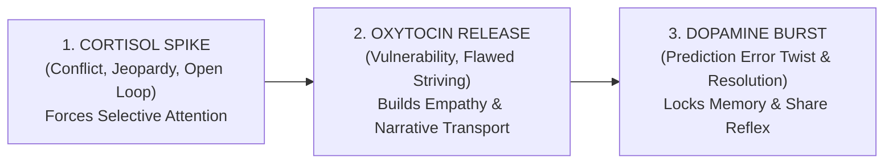
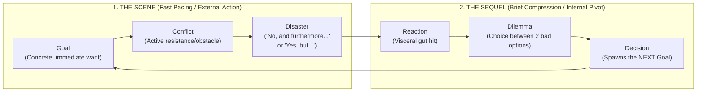

# Deep Research: How to Actually Write & Tell Stories (Narrative Architecture Bible)

> [!IMPORTANT] Vault Integration & Related Guides
> - **Master Trilogy Hub**: [[Deep Research - Masterclass on Story Writing, Animation Layout & Comedy Science]]
> - **Visual Staging Companion**: [[Deep Research - Animation Layout, Staging & Visual Composition]]
> - **Comedy & Joke Companion**: [[Deep Research - How Humans Write Funny Jokes & Comedy Engineering]]
> - **Short-Form Execution**: [[Script Architecture - 3.7 WPS & The 'You See' Pivot]] | [[The 1-Sentence Paradox Hook Formula]] | [[Deep Research - Viral Shortform Hooks, Storytelling & 1M+ Algorithm]]

---

## Executive Summary

Why do some stories hold a human brain in a state of involuntary trance while others—even those with explosions, high-budget animation, or dramatic facts—feel like a boring list of events? Across 2,300 years of dramatic theory (from Aristotle's *Poetics* to Pixar's Braintrust), modern computational linguistics (Reagan & Dodds' SVD analysis of 1,327 novels), and functional MRI neuroscience (Uri Hasson's Princeton lab and Paul Zak's neuroeconomics), the answer converges on a single engineering truth:

**A story is not "a sequence of things that happen." A story is a causal pressure-system designed to synchronize two human brains by trapping a flawed agent inside an escalating gap between expectation and reality.** [1][2][3][4]

Writing a story (**Narrative Architecture**) and telling that story (**Narrative Delivery & Pacing**) are two distinct mechanical skills:
1. **How to Write a Story (Structure & Causality):** Builds the engine. It requires a **flawed worldview/desire** colliding with an **inciting disruption**, linked beat-by-beat exclusively via **"Therefore"** (consequence) and **"But"** (complication)—never *"And Then"* [5][6]. Every scene operates on Robert McKee's **Gap** (Action $\rightarrow$ Expected Result $\neq$ Actual Result) and Dwight Swain's **Scene & Sequel** (`Goal → Conflict → Disaster` followed by `Reaction → Dilemma → Decision`) [3][7].
2. **How to Tell a Story (Orality, Rhythm & Subtext):** Controls the information valve. Great storytellers weaponize **Andrew Stanton's "2 + 2" Law** (never hand the audience `4`; force them to deduce it) [8], **Ira Glass's Bait + Anecdote + Reflection loop** [9], **Keith Johnstone's Status Transactions** [10], **Ernest Hemingway's Iceberg Subtext** [11], and **Gary Provost's Syntactic Music** [12] to trigger **cortisol** (attention), **oxytocin** (empathy), **neural coupling** (DMN brain-to-brain sync), and **dopamine** (Reward Prediction Error) [1][2][13].

---

## 1. The Neuroscience of Why Humans Need Stories

Before examining structural frameworks, a writer must understand the biological hardware running the story. When you present raw facts or bullet points, the human brain activates only **Broca's area** and **Wernicke's area** (language decoding) [1][2]. When you tell a causal story, the listener's brain reacts as if *they are physically inside the event*:

### 1.1 Uri Hasson's fMRI "Neural Coupling" (Brain-to-Brain Synchrony)
At Princeton University, neuroscientist **Dr. Uri Hasson** placed a storyteller inside an fMRI scanner recording a real-life story, and then scanned listeners hearing that story [1][14].
- **Mirroring Across the Cortex:** Not only did sensory and motor cortices fire identically (when the speaker described kicking a ball, the listener's motor cortex fired; when describing a velvet coat, the sensory cortex fired), but high-order regions—including the **Default Mode Network (DMN)**, precuneus, and dorsolateral prefrontal cortex—synchronized with a **1-to-3 second lag** [1][14].
- **Predictive Anticipation:** In the highest-retention stories, the listener's brain activity actually **preceded** the speaker's brain activity by milliseconds: the narrative structure was so tight that the audience's brain was actively predicting the next causal turn [1][14].
- **When Coupling Breaks:** The moment a speaker shifts from causal narrative into abstract jargon, unmotivated "and then" lists, or confusing exposition, **neural coupling collapses back to baseline auditory noise** [1].

### 1.2 Paul Zak's Neurochemical Triad: Cortisol, Oxytocin & Dopamine
Neuroeconomist **Dr. Paul Zak** (Claremont Graduate University) measured blood neurochemistry before and after subjects watched narrative arcs (such as the famous *Ben's Story* study) [2][15]:



| Neurochemical | Trigger in the Script | Biological Function | What Happens If Missing |
| :--- | :--- | :--- | :--- |
| **Cortisol** | Specific jeopardy, ticking clock, paradox hook, or status threat [2][15] | Focuses attention; signals *"There is a survival problem here"* [2] | Viewer feels zero urgency; swipes away in `<1.5s` |
| **Oxytocin** | Character trying against odds, specific vulnerability, relatable pain [2][8] | Generates empathy, trust, and **Narrative Transport** (loss of self-awareness) [2][16] | Viewer watches coldly without caring who wins or loses |
| **Dopamine (RPE)** | Information gaps (`"Wait—how?"`), reversals (`"Unluckily..."`), earned twist [13][17] | Fires on **Reward Prediction Error** ($\text{Actual} - \text{Expected}$) [13] | Predictable middle causes dopamine baseline drop (boredom) |

---

## 2. The Atomic Particle of Story: Causality vs. Chronology

English novelist **E.M. Forster** (*Aspects of the Novel*, 1927) gave the single clearest definition of plot in literary history [18]:
- **Chronology (Not a Plot):** *"The king died, and then the queen died."* (Time passes, zero causal tension).
- **Plot (Causal Engine):** *"The king died, and then the queen died of grief."* (Cause and effect).
- **Mystery/Suspense Plot:** *"The queen died, no one knew why, until it was discovered that it was through grief at the death of the king."* [18]

### 2.1 Trey Parker & Matt Stone's `"Therefore / But"` Law
In their famous lecture at NYU's Tisch School of the Arts, *South Park* creators **Trey Parker and Matt Stone** revealed how they rescue scripts during their 6-day production crunch [5][6]:

> [!CAUTION] The `"And Then"` Diagnostic Rule
> Take your outline or script beat sheet and look at the invisible conjunction connecting Beat $N$ to Beat $N+1$.
> - If the word between two beats is **"AND THEN"**, **your story is broken**. You have written a chronological laundry list.
> - Every single beat in a functional story MUST be connected by either **"THEREFORE"** (logical consequence of the character's choice) or **"BUT"** (an unexpected obstacle, complication, or reversal that blocks the expectation) [5][6].

**Worked Comparison (Napoleon vs. Rabbits, 1807):**
- ❌ **Broken (`And Then` Writing):**
  *"In 1807, Napoleon signed the Treaty of Tilsit. **And then** he wanted to celebrate with a rabbit hunt. **And then** his chief of staff Berthier bought 3,000 rabbits. **And then** the cages were opened. **And then** the rabbits attacked Napoleon."*
- ✅ **Engineered (`Therefore / But` Writing):**
  *"In 1807, Napoleon conquered Europe, **THEREFORE** he demanded a grand imperial rabbit hunt to flex his power. **THEREFORE** his desperate Chief of Staff bought 3,000 rabbits in a single afternoon, **BUT** to save time he bought tame farm rabbits instead of wild hares. **THEREFORE**, when the cages opened, the rabbits didn't see a predator—they saw a guy with lettuce. **BUT** Napoleon thought he could whip them back, **THEREFORE** the 3,000 starving bunnies flanked his carriage in the exact wing-formation he used at Waterloo."*

### 2.2 Robert McKee's `"The Gap"` & Value Charge Reversals
In *Story: Substance, Structure, Style, and the Principles of Screenwriting* (1997), **Robert McKee** identifies **"The Gap"** as the microscopic fission reactor where drama is born [3]:

1. **Subjective Expectation:** A character wants something (**Desire**) and takes a minimal conservative action (**Action**) expecting the world to react in a specific way (**Expected Result**).
2. **Objective Reality:** The world reacts more powerfully or differently than expected (**Unanticipated Result**).
3. **The Gap:** The chasm between what the character expected and what actually happened [3].
4. **Risk Escalation:** Because the first action failed across The Gap, the character must now take a **second, riskier action** demanding more willpower—which opens a wider Gap, until the final crisis leaves no safety net [3].

#### McKee's Law of Value Charge Polarity (`+` ↔ `-`)
McKee proves that **if the emotional/situational value charge at the end of a scene is the same as it was at the beginning, the scene is a non-event and must be cut** [3]. Every scene must flip a human value from positive to negative or negative to positive:

| Scene Type | Opening Value | Closing Value | Example |
| :--- | :--- | :--- | :--- |
| **Simple Positive Turn** | Ignorance (`-`) | Knowledge (`+`) | Hero discovers why the bridge sways |
| **Simple Negative Turn** | Safe / Confident (`+`) | In Danger (`-`) | Soldiers march onto the bridge (`+`) $\rightarrow$ iron bolt snaps (`-`) |
| **Double Irony (`++` to `--`)** | Triumph (`+`) | Catastrophe (`--`) | *"Luckily, the river was waist-deep (`+`). Unluckily, the general's horse landed on the general (`--`)."* |

### 2.3 Dwight Swain's `Scene & Sequel` Micro-Cycle
In *Techniques of the Selling Writer* (1965), **Dwight V. Swain** codified the six-part alternating heartbeat that prevents stories from feeling either like breathless chaos (all action, no meaning) or a boring diary (all feelings, no action) [7]:



> [!TIP] The 4 Possible Outcomes of Any Scene ("Yes/No" Matrix)
> Never end an early or mid-story scene with a clean **"Yes"** (the hero gets what they want with no complication)—that kills narrative tension [7]. Use the 4-state matrix:
> 1. **`Yes, BUT...`** — The hero gets the key, *but* setting off the alarm traps them inside.
> 2. **`No, AND FURTHERMORE...`** — The hero fails to stop the bridge swaying, *and furthermore* the main suspension chain snaps.
> 3. **`No, BUT...`** — The hero loses the battle, *but* spots the enemy's fatal blind spot.
> 4. **`Yes` (Reserved for the Climax Only)** — Earned only after maximum sacrifice.

### 2.4 Aaron Sorkin's `"Intention and Obstacle"`
Screenwriter **Aaron Sorkin** (*The Social Network*, *A Few Good Men*, *The West Wing*) strips all dramatic theory down to eight words: **"Somebody wants something, and something is standing in their way."** [10][19]
- **The Sorkin Diagnostic:** Before writing any scene, answer three questions in plain verbs:
  1. *Whose scene is it?*
  2. *What do they want right now (Intention)?* (Must be concrete—e.g., *"Get her to sign the NDA before the flight boards,"* never vague like *"Be respected"*).
  3. *What is stopping them (Obstacle), and what **tactics** do they cycle through when their first tactic fails?* [19]

### 2.5 George Saunders' `"Linear Patterning"` & Always Be Escalating (ABE)
In *A Swim in a Pond in the Rain* (2021), **George Saunders** demonstrates how master storytellers (Chekhov, Gogol, Turgenev, Tolstoy) construct narratives not from top-down outlines, but through **Iterative Patterning and Escalation** [12][20]:
- **A Story is a Staircase, Not a Treadmill:** Once you establish a fact or character trait (e.g., *"The general is arrogant"*), repeating a second scene that merely proves *"The general is still arrogant"* is a flat treadmill. The second beat must **escalate the cost** of that arrogance [20].
- **Conservation of Narrative Elements (Efficiency):** Every element introduced in the first 25% of a story creates an unspoken contract with the audience (**Chekhov's Gun**: *"If in the first act you have hung a pistol on the wall, then in the following one it should be fired. Otherwise don't put it there."*) [20]. As Saunders notes, a great story feels like a circus rider jumping from horse to horse, until by the finale all the horses are galloping side-by-side and the rider uses every single one to reach the finish line [20].

---

## 3. Macro-Story Architectures: The 7 Great Blueprints Compared

Different story lengths and genres call for different macro-skeletons. Below is the complete engineering breakdown of the **7 foundational macro-structures** and how they map onto one another.

### 3.1 Master Cross-Framework Alignment Matrix

| Story % | Aristotle (*Poetics*) | Dan Harmon (8-Step Circle) | Blake Snyder (*Save the Cat!* 15 Beats) | John Truby (22 Steps Condensed) | Kishōtenketsu (4-Act East Asian) | Short-Form 6-Beat Spine (`45s`) |
| :--- | :--- | :--- | :--- | :--- | :--- | :--- |
| **0% – 10%** | **Prologue / Equilibrium** | **1. You** (Zone of comfort) | 1. Opening Image<br>2. Theme Stated<br>3. Set-Up | Ghost, World, Weakness & Moral Need | **Ki (起 — Introduction):** Establish world & baseline | **Beat 1 (0–3.5s):** Paradox Hook<br>**Beat 2 (3.5–9s):** Present-Tense Setting |
| **10% – 25%** | **Inciting Incident (*Desis*)** | **2. Need** (Want something)<br>**3. Go** (Enter unfamiliar situation) | 4. Catalyst (10%)<br>5. Debate (10–20%)<br>6. Break into Two (20%) | Inciting Event $\rightarrow$ Concrete Desire $\rightarrow$ Initial Plan | **Shō (承 — Development):** Deepen characters & texture without villainous war | **Beat 3a (9–14s):** Escalation + In-Character Cocky Doubt |
| **25% – 50%** | **Rising Complication** | **4. Search** (Adapt, struggle, trials) | 7. B-Story (22%)<br>8. **Fun and Games** (20–50%: Promise of the Premise) | Ally, Opponent, Fake-Ally Opponent, First Revelation & Drive | *(Continuation of Shō)* | **Beat 3b (14–20s):** `"Luckily... / Unluckily..."` Reversal + Disaster |
| **50% – 60%** | **Peripeteia (Reversal of Fortune)** | **5. Find** (Get what they wanted—false victory or realization) | 9. **Midpoint** (50%: False victory/defeat; clocks start; stakes double) | Midpoint Counterattack & Audience Revelation | **Ten (轉 — The Twist):** Sudden perspective shift or reframing | **Beat 4 (20–24s):** `"Wait—how...?"` Mystery Question |
| **60% – 80%** | **Unraveling (*Lusis*)** | **6. Take** (Pay a heavy price for it) | 10. Bad Guys Close In (50–75%)<br>11. **All Is Lost** (75%: Whiff of death)<br>12. Dark Night of the Soul | Attack by Ally $\rightarrow$ **Apparent Defeat** $\rightarrow$ Gate / Gauntlet / Visit to Death | *(Integration of Ten's surprise with Ki/Shō)* | **Beat 5 (24–38s):** `"You see,"` Pivot + Everyday Physical Analogy |
| **80% – 100%** | **Anagnorisis (Recognition) & Catharsis** | **7. Return** (Back to familiar world)<br>**8. Change** (Master of two worlds) | 13. Break into Three (80%)<br>14. **Finale** (80–99%: 5-Point Finale)<br>15. Final Image (Mirror of #1) | Battle $\rightarrow$ **Self-Revelation** $\rightarrow$ Moral Decision $\rightarrow$ New Equilibrium | **Ketsu (結 — Conclusion):** Harmonious synthesis & lingering resonance | **Beat 6 (38–45s):** Callback Twist on the Final Word |

---

### 3.2 Deep Dive 1: Dan Harmon's 8-Step Story Circle (The Universal Compression Loop)
Distilled by **Dan Harmon** (*Community*, *Rick and Morty*) from Joseph Campbell's 17-stage *Hero with a Thousand Faces* (1949) and Carl Jung's conscious/unconscious duality, the **Story Circle** is the most versatile macro-tool for animation because it scales seamlessly from a 22-minute episode down to a 45-second short [4][21]:

```
                  [CONSCIOUS / ORDER / KNOWN WORLD]
                         1. YOU (Establish)
                    8. CHANGE          2. NEED (Asymmetry)
            ═══════════════════════════════════════════════  <-- THE THRESHOLD
                    7. RETURN          3. GO (Cross Over)
                         6. TAKE     4. SEARCH (Adapt)
                              5. FIND (The Pivot)
                 [UNCONSCIOUS / CHAOS / UNKNOWN WORLD]
```

- **Vertical Symmetry:** Step 1 (*You*) mirrors Step 5 (*Find*: the core confrontation with what you thought you wanted). Step 3 (*Go*) mirrors Step 7 (*Return*). Step 2 (*Need*) is resolved by Step 6 (*Take*: paying the price). Step 4 (*Search*: trial-and-error adaptation) produces Step 8 (*Change*) [4][21].

### 3.3 Deep Dive 2: John Truby's Moral Architecture (`Need` vs. `Desire`)
Why do some protagonists feel three-dimensional while others feel like cardboard avatars? In *The Anatomy of Story* (2007), **John Truby** proves that every great character is driven by **two conflicting engines** [7]:

1. **The External Desire (The Plot Engine):** What the character *consciously wants* to achieve in the physical world (e.g., *"Win the Piston Cup,"* *"Destroy the emus,"* *"Build the unbreakable bridge"*).
2. **The Internal Weakness & Moral Need (The Character Engine):** A flawed worldview born from a past wound (**The Ghost**) that is actively hurting both the hero and others (e.g., *"I don't need anyone else; winning is everything"*).
3. **The Designing Principle of the Antagonist:** Truby's Golden Rule of Opposition states: **Never invent a random villain. Design the Opponent so they want the exact same goal as the Hero, and attack the Hero's specific internal weakness.** [7]
4. **The Crisis of Choice (Michael Arndt & Truby):** At the climax (Step 20–21: *Self-Revelation & Moral Decision*), the writer forces the protagonist into a binary fork where **they cannot have both their External Desire and their Moral Need** [7][8]. As Pixar screenwriter **Michael Arndt** (*Toy Story 3*) explains: when Lightning McQueen stops inches from the finish line of the Piston Cup to push the crashed Strip "The King" Weathers across the line, he **sacrifices his Desire (the trophy) to fulfill his Need (human connection)**—triggering instant audience catharsis [8].

### 3.4 Deep Dive 3: East Asian `Kishōtenketsu` (起承転結) & Miyazaki's `Ma` (間)
Not every story requires a Western antagonist or violent conflict. Originating in classical Chinese four-line poetry (*Jueju*) and perfected in Japanese manga, *yonkoma* (4-panel strips), and Studio Ghibli films, **Kishōtenketsu** generates profound narrative engagement **through structural juxtaposition and perspective shifts rather than combat** [22]:

- **Ki (起 — Introduction):** Establish the baseline situation (e.g., *Two sisters move to a country house while their mother is in the hospital*).
- **Shō (承 — Development):** Follow the natural consequences and details of *Ki* without introducing a villain (*They explore the camphor tree and meet forest spirits*).
- **Ten (轉 — The Twist / Re-contextualization):** Cut to something seemingly unrelated, or introduce a sudden non-antagonistic perspective shift (*A telegram arrives from the hospital; little Mei runs away holding an ear of corn*).
- **Ketsu (結 — Reconciliation):** Unify *Ki/Shō* with *Ten*, revealing the deeper connection between them [22].

> [!NOTE]Why Kishōtenketsu Is Secretly Behind Our Viral Science/History Shorts
> Look closely at our vault's 6-Beat Short-Form Spine ([[Script Architecture - 3.7 WPS & The 'You See' Pivot]]):
> - **Ki + Shō (`0–20s`):** Historical story setup and escalation (*60 soldiers march across Broughton Bridge and it collapses*).
> - **Ten (`24–35s`):** The **`"You see,"` Analogy Cut** — we suddenly cut away from 1880s soldiers to a **modern playground swing**! That abrupt shift to an entirely different visual world is a pure **Ten (転)** beat.
> - **Ketsu (`35–45s`):** We reconcile the playground swing back with the 1880s bridge and modern military law (*"Which is why to this day, every army on Earth is legally required to break step on bridges"*).

### 3.5 Deep Dive 4: Kurt Vonnegut & Reagan/Dodds' 6 Computational Emotional Arcs
In 2016, **Andrew J. Reagan, Peter Sheridan Dodds, et al.** at the University of Vermont's Computational Story Lab used Singular Value Decomposition (SVD) and hierarchical clustering on the sentiment trajectories of **1,327 stories** from Project Gutenberg, mathematically proving Kurt Vonnegut's "Shapes of Stories" thesis [23]:

| Arc Code | Name | Trajectory (Fortune $Y$ over Time $X$) | Best Use Case in Animation & Shorts |
| :--- | :--- | :--- | :--- |
| **`SV1 (+)`** | **Rags to Riches** | $\nearrow$ Continuous Rise | Inspirational underdog biographies, invention breakthroughs |
| **`SV1 (-)`** | **Riches to Rags (Tragedy)** | $\searrow$ Continuous Fall | Hubris disasters (*Titan Sub*, *Chernobyl*, *Venus Survival*) |
| **`SV2 (-)`** | **Man in a Hole** | $\searrow \nearrow$ Fall $\rightarrow$ Rise | Rescue stories, survival challenges, engineering saves (*Apollo 13*) |
| **`SV2 (+)`** | **Icarus** | $\nearrow \searrow$ Rise $\rightarrow$ Catastrophic Fall | Military/historical arrogance (*Napoleon vs. Rabbits*, *Emu War*) |
| **`SV3 (+)`** | **Cinderella** | $\nearrow \searrow \nearrow$ Rise $\rightarrow$ Crush $\rightarrow$ Triumph | Heroic storytime (*1918 Cher Ami Pigeon*, sports comebacks) |
| **`SV3 (-)`** | **Oedipus** | $\searrow \nearrow \searrow$ Fall $\rightarrow$ False Hope $\rightarrow$ Ruin | Dark twists, horror storytime, `"Luckily... / Unluckily..."` tragedies |

---

## 4. Pixar's 22 Rules of Storytelling (Operationalized for Production)

Compiled by former Pixar Story Artist **Emma Coats** (2011–2012) from mentors **Pete Docter, Andrew Stanton, Lee Unkrich, Brad Bird, and Bob Peterson**, here are the **22 Pixar Rules** translated into concrete engineering checks for scripts [8][24]:

| # | Pixar Rule (Emma Coats) | Engineering Translation for Our Scripts |
| :--- | :--- | :--- |
| **1** | *You admire a character for trying more than for their successes.* | Show the character straining, sweating, or over-planning before they fail. |
| **2** | *Keep in mind what's interesting to you as an audience, not what's fun to do as a writer.* | Cut self-indulgent lore or textbook definitions; keep only visceral stakes. |
| **3** | *Trying for theme is important, but you won't see what the story is actually about until you're at the end of it. Now rewrite.* | Write draft 1 for causal momentum; rewrite draft 2 so Frame 0 mirrors the final line. |
| **4** | **The Pixar Spine:** *"Once upon a time there was ___. Every day, ___. One day ___. Because of that, ___. Because of that, ___. Until finally ___."* | The mandatory macro-skeleton. Notice the two **"Because of that"** (`Therefore`) bridges! |
| **5** | *Simplify. Focus. Combine characters. Hop over detours.* | In a 45s short, never name more than **1–2 characters**. Merge committees into 1 cocky general. |
| **6** | *What is your character good at, comfortable with? Throw the polar opposite at them.* | Napoleon is the master of European artillery $\rightarrow$ throw 3,000 affectionate farm bunnies at him. |
| **7** | *Come up with your ending before you figure out your middle. Endings are hard, get yours working up front.* | Write **Beat 6 (The Callback Twist)** *before* writing Beats 2–5 so every earlier beat plants the setup. |
| **8** | *Finish your story, let go even if it's not perfect. In an ideal world you have both, but move on.* | Ship, run `short_qa.py`, inspect stills, and iterate on the next short. |
| **9** | *When you're stuck, make a list of what WOULDN'T happen next.* | Your brain's first 3 ideas are clichés (Vorhaus's *Rule of Nine*). Rejection lists unlock originality. |
| **10** | *Pull apart the stories you like. What you like in them is a part of you; you've got to recognize it before you can use it.* | Why we maintain `20 Reference Teardowns/` in this vault. |
| **11** | *Putting it on paper lets you start fixing it. If it stays in your head, a perfect idea, you'll never share it with anyone.* | Write the beat table immediately. |
| **12** | *Discount the 1st thing that comes to mind. And the 2nd, 3rd, 4th, 5th – get the obvious out of the way.* | Never accept the first generic adjective or joke. |
| **13** | *Give your characters opinions. Passive/malleable might seem likable to you as you write, but it's poison to the audience.* | Give characters cocky, stubborn, active stances (*"'Relax lads, it held the King's cannons!'"*). |
| **14** | *Why must you tell THIS story? What's the belief burning within you that your story feeds off of?* | Anchor every explainer or storytime in a universal human truth or irony. |
| **15** | *If you were your character, in this situation, how would you feel? Honesty lends credibility to unbelievable situations.* | Ground absurd premises in hyper-realistic emotional reactions. |
| **16** | *What are the stakes? Give us reason to root for the character. What happens if they don't succeed? Stack the odds against.* | Quantify stakes immediately (`10,000 bullets vs. 20,000 emus`; `6 seconds on Venus`). |
| **17** | *No work is ever wasted. If it's not working, let go and move on – it'll come back around to be useful later.* | Save cut gags or hooks into `Idea Bank.base`. |
| **18** | *You have to know yourself: the difference between doing your best & fussing. Story is testing, not refining.* | Test big structural turns first before polishing word choice. |
| **19** | **The Coincidence Law:** *Coincidences to get characters INTO trouble are great; coincidences to get them OUT of trouble are cheating.* | *Deus ex machina* destroys dopamine RPE. Rescues must be earned through planted mechanics. |
| **20** | *Exercise: take the building blocks of a movie you dislike. How d'you rearrange them into what you DO like?* | Re-sequence chronological failures into *In Medias Res* paradoxes. |
| **21** | *You gotta identify with your situation/characters, can't just write 'cool'. What would make YOU act that way?* | Replace "cool action" with relatable human motives (laziness, pride, panic). |
| **22** | *What's the essence of your story? Most economical telling of it? If you know that, you can build out from there.* | Must pass the **10–16 Word Paradox Hook Test** in Sentence 1. |

---

## 5. How to Actually *Tell* the Story: Voice, Pacing, Subtext & Delivery

Having a great story structure (`What happens`) is only 50% of the equation. **Storytelling** (`How and in what order you reveal it to the audience`) determines whether the audience leans in or tunes out.

### 5.1 Andrew Stanton's `"Unifying Theory of 2 + 2"`
In his landmark 2012 TED Talk (*The Clues to a Great Story*), Pixar director **Andrew Stanton** (*Finding Nemo*, *WALL-E*) formulated the #1 rule of audience engagement [8]:
- **Never give the audience `4`. Give them `2 + 2`.**
- Humans are biological pattern-completion machines. When a narrator explains the emotion explicitly (*"The king was very sad and lonely"* = giving them `4`), the audience's brain goes passive. When you instead show two concrete pieces of evidence (*"The king set two plates at the banquet table every night, and stared at the empty chair until the candles burned out"* = `2 + 2`), the audience's brain fires a dopamine burst as **they supply the `4` themselves** [8].

### 5.2 Ira Glass's 3-Part Audio Storytelling Engine (`Anecdote` + `Bait` + `Reflection`)
In his masterclass on narrative broadcasting, *This American Life* creator **Ira Glass** explained why spoken stories hold millions of listeners [9]:
1. **The Anecdote (The Train Track):** Spoken in tight, active, chronological mini-beats (*"First X happens, which causes Y..."*). Even the most mundane anecdote creates momentum because the human brain naturally rides a causal train [9].
2. **Continuous Bait (Raising Questions):** Along the train track, you constantly drop "bait"—unanswered questions that force the listener to stay until the next stop (*"And that was when he noticed something strange about the rabbits' ears..."*) [9].
3. **The Moment of Reflection (The Payoff):** An anecdote without reflection is just barroom gossip. At the climax, you step back for 1–2 sentences to state the universal human irony or rule proven by the anecdote [9].

### 5.3 Brandon Sanderson's `"Promise, Progress, Payoff"` & Laws of Resolution
Bestselling author **Brandon Sanderson** (BYU Creative Writing Lectures) diagnoses story failure through three sequential contracts [25]:
- **1. The Promise (Tone + Direction):** Your first 3 seconds make an implicit promise about **Tone** (Is this dry deadpan comedy? Hard survival science? Emotional tragedy?) and **Resolution** (What question will be answered by the end?). Never open with a comedic hook if the payoff is a dry textbook lecture [25].
- **2. The Progress (Measurable Signposts):** Audiences hate feeling lost in a middle that doesn't move the needle. Use **quantified signposts** (countdowns, escalating distances, temperatures: *"At 50 km altitude... At 20 km... At surface level..."* or *"Day 1... Day 3... Day 6..."*) so the viewer feels unmistakable forward progress every 3 seconds [25].
- **3. Sanderson's First Law of Resolution:** *"An author's ability to solve conflict with a mechanism is directly proportional to how well the audience understands that mechanism beforehand."* [25] Never solve a mystery with a fact you didn't plant or explain visually!

### 5.4 Keith Johnstone's `"Status Transactions"` & Reincorporation
In *Impro: Improvisation and the Theatre* (1979), **Keith Johnstone** discovered why most amateur dialogue feels dead: **amateurs write dialogue about information, whereas masters write dialogue as a war of Status** [10]:

- **Every Interaction Is a Status See-Saw:** In every scene with two entities (Napoleon vs. Rabbits, General Meredith vs. Emus, Soldier vs. Officer), assign one character **High Status** (takes up space, speaks slowly, holds eye contact, expects obedience) and the other **Low Status** (fidgets, speaks rapidly, yields space)—and then **flip the see-saw during the scene** [10]!
- **The Comedy & Drama of the Status Tilt:** Nothing delights a human brain faster than watching an ultra-High-Status figure (an Emperor, an Army General with machine guns, an "unsinkable" ship) get systematically stripped to Low Status by a Low-Status force (fluffy bunnies, flightless birds, a marching song) [10].

### 5.5 Ernest Hemingway's Iceberg Theory & Subtext
In *Death in the Afternoon* (1932), **Ernest Hemingway** formulated the **Theory of Omission (The Iceberg Theory)**: only **1/8th** of the story (concrete physical actions and spoken words) should sit above the water; the remaining **7/8ths** (emotional weight, fear, subtext) must remain beneath the surface, felt through what the characters *refuse* to say [11].
- **On-the-Nose Dialogue (Bad):** *"'I am terrified that this bridge is going to collapse and kill us all!'"*
- **Subtextual / Ironic Dialogue (Good):** *"'Relax, lads—it held the King's forty-ton cannons. What's a few pairs of boots?'"* (Spoken 2 seconds before the iron bolt shears).

### 5.6 Concrete Sensory Specifics vs. Abstract Labels (*Show, Don't Tell*)
Attributed to Anton Chekhov (*"Don't tell me the moon is shining; show me the glint of light on broken glass"*), the rule of **Concrete Particulars** is backed by fMRI neuroimaging: abstract words (*"disaster," "fast," "hot," "many"*) fail to activate the visual or somatosensory cortex, whereas concrete sensory nouns and active verbs (*"molten lead," "snapped like a dry twig," "3,000 starving bunnies"*) trigger immediate mental simulation [1][20].

| ❌ Weak / Abstract ("Wikipedia Slop") | ✅ Strong / Concrete Sensory Particular | Why It Works Neurologically |
| :--- | :--- | :--- |
| *"It is extremely hot on Venus."* | *"It's 475°C—hot enough to melt a block of lead on your dashboard."* | Fires visual + thermal somatosensory simulation |
| *"Many soldiers marched on the bridge."* | *"Sixty riflemen planted their hobnailed boots in unison."* | Specific count (`60`) + tactile sound (`hobnailed boots`) |
| *"The bridge started shaking a lot."* | *"Within ten seconds, the iron deck was bouncing like a trampoline."* | Everyday kinetic muscle memory (*trampoline*) |
| *"The army failed to shoot the birds."* | *"After firing 9,860 machine-gun rounds, they had hit... twelve birds."* | Quantified expectation (`9,860`) vs. absurd result (`12`) |

### 5.7 Gary Provost's Syntactic Music (Sentence Length & Cadence Engineering)
In *100 Ways to Improve Your Writing* (1985), **Gary Provost** wrote the most famous demonstration of prose rhythm in the English language [12]:

> *"This sentence has five words. Here are five more words. Five-word sentences are fine. But several together become monotonous. Listen to what is happening. The writing is getting boring. The sound of it drones. It's like a stuck record. The ear demands some variety.*
> *Now listen. I vary the sentence length, and I create music. Music. The writing sings. It has a pleasant rhythm, a lilt, a harmony. I use short sentences. And I use sentences of medium length. And sometimes, when I am certain the reader is rested, I will engage him with a sentence of considerable length, a sentence that burns with energy and builds with all the impetus of a crescendo, the roll of the drums, the crash of the cymbals—sounds that say listen to this, it is important."* [12]

#### The 3-Tier Cadence Formula for Voiceover Scripts:
1. **The Hook (`Sentence 1`):** `10–16 words`, balanced two-clause paradox (`[Specific Setup] + [Because + Absurd Cause]`).
2. **The Escalation Build (`Beats 2–3`):** Compound crescendo sentence (`18–26 words`) stacking clauses as chaos accelerates, followed immediately by a **3-to-6 word staccato punch** (*"It didn't."* / *"Then the bolt snapped."*).
3. **The `"Luckily / Unluckily"` Parallel Pair:** Strict syntactic parallelism (`"Luckily, [8 words]. Unluckily, [8 words]."`). The identical grammatical frame makes the semantic reversal hit twice as hard.

---

## 6. Complete Diagnostic Checklist Before Approving Any Script

Use this 10-point engineering gate on every script in this vault:

- [ ] **1. The 1-Sentence Paradox Gate:** Does Sentence 1 state an impossible outcome and its absurd/counter-intuitive cause as plain fact in `10–16 words` without *"Did you know"* or *"Today we'll explore"*?
- [ ] **2. The `"Therefore / But"` Audit:** Can you place `THEREFORE` or `BUT` between every single beat from Beat 1 to Beat 6? Are there zero `"AND THEN"` transitions?
- [ ] **3. Quantified Stakes & Specific Numbers:** Are there at least **3 concrete numbers** (`3,000 rabbits`, `9,860 rounds`, `475°C`) anchoring the first 15 seconds?
- [ ] **4. McKee's Gap & Polarity Flip:** Does every beat flip the value charge (`+` Confident $\rightarrow$ `-` Disastrous) across an unanticipated gap between expectation and reality?
- [ ] **5. Keith Johnstone's Status Inversion:** Is there a clear High-Status vs. Low-Status power dynamic that violently inverts during the story?
- [ ] **6. The `"Luckily... / Unluckily..."` Double Beat:** Is there a dry deadpan two-step reversal where temporary relief immediately turns into worse disaster?
- [ ] **7. The `"Wait—how...?"` Mystery Question:** Right at the 45–55% mark, does the narrator voice the exact mechanism question the viewer's brain is asking?
- [ ] **8. The `"You see,"` Everyday Analogy Pivot:** Does the explanation avoid textbook jargon and translate the mechanism into a physical childhood sensation (e.g., playground swing, soda can, garden hose)?
- [ ] **9. Gary Provost Rhythm Check:** Read the script aloud at `3.7 words/sec`. Do long crescendo sentences alternate with sharp 3–6 word staccato punches?
- [ ] **10. Zero-Outro Callback Twist:** Does the final sentence callback to Beat 1's premise and end immediately on the punch word with `<0.08s` tail silence?

---

## 7. References & Primary Sources (Pillar 1)

1. `[1]` **Hasson, U., Ghazanfar, A. A., Galantucci, B., Garrod, S., & Keysers, C.** (2012). *Brain-to-brain coupling: a mechanism for creating and sharing a social world.* Trends in Cognitive Sciences, 16(2), 114–121. / Stephens, G. J., Silbert, L. J., & Hasson, U. (2010). *Speaker–listener neural coupling underlies successful communication.* PNAS, 107(32), 14425–14430.
2. `[2]` **Zak, P. J.** (2015). *Why Inspiring Stories Make Us React: The Neuroscience of Narrative.* Cerebrum: The Dana Forum on Brain Science, 2015, cer-02-15.
3. `[3]` **McKee, R.** (1997). *Story: Substance, Structure, Style, and the Principles of Screenwriting.* ReganBooks / HarperCollins.
4. `[4]` **Harmon, D.** (2011). *Story Structure 101–106: Super Basic Shit & The Story Circle.* Channel 101 Tutorials.
5. `[5]` **Parker, T., & Stone, M.** (2011). *6 Days to Air / NYU Tisch School of the Arts Masterclass on "Therefore / But" Causality.* MTVU Stand In.
6. `[6]` **Snyder, B.** (2005). *Save the Cat! The Last Book on Screenwriting You'll Ever Need.* Michael Wiese Productions.
7. `[7]` **Truby, J.** (2007). *The Anatomy of Story: 22 Steps to Becoming a Master Storyteller.* Faber & Faber; & **Swain, D. V.** (1965). *Techniques of the Selling Writer.* University of Oklahoma Press.
8. `[8]` **Stanton, A.** (2012). *The Clues to a Great Story.* TED2012 Official Talk; & **Arndt, M.** (2013). *Endings: The Good, the Bad, and the Insanely Great.* Pandemonium Inc. Lectures.
9. `[9]` **Glass, I.** (2009). *Ira Glass on Storytelling (Parts 1–4: The Anecdote, Bait, and Moment of Reflection).* Current TV / This American Life.
10. `[10]` **Johnstone, K.** (1979). *Impro: Improvisation and the Theatre.* Faber & Faber (Status Transactions & Reincorporation).
11. `[11]` **Hemingway, E.** (1932). *Death in the Afternoon.* Charles Scribner's Sons (The Iceberg Theory of Omission).
12. `[12]` **Provost, G.** (1985). *100 Ways to Improve Your Writing.* Mentor Books ("This sentence has five words" rhythm study).
13. `[13]` **Schultz, W.** (2015). *Neuronal Reward and Decision Signals: From Theories to Data.* Physiological Reviews, 95(3), 853–951.
14. `[14]` **Yeshurun, Y., Nguyen, M., & Hasson, U.** (2021). *The default mode network: where the idiosyncratic self meets the shared social world.* Nature Reviews Neuroscience, 22, 181–192.
15. `[15]` **Barraja, J. A., & Zak, P. J.** (2009). *Empathy-inducing narratives increase oxytocin and charitable giving.* Annals of the New York Academy of Sciences, 1167, 182–193.
16. `[16]` **Green, M. C., & Brock, T. C.** (2000). *The role of transportation in the persuasiveness of public narratives.* Journal of Personality and Social Psychology, 79(5), 701–721.
17. `[17]` **Loewenstein, G.** (1994). *The Psychology of Curiosity: A Review and Reinterpretation.* Psychological Bulletin, 116(1), 75–98.
18. `[18]` **Forster, E. M.** (1927). *Aspects of the Novel.* Edward Arnold (The King and Queen causality paradigm).
19. `[19]` **Sorkin, A.** (2016). *Aaron Sorkin Teaches Screenwriting: Intention and Obstacle.* MasterClass Official Curriculum.
20. `[20]` **Saunders, G.** (2021). *A Swim in a Pond in the Rain: In Which Four Russians Give a Master Class on Writing, Reading, and Life.* Random House.
21. `[21]` **Campbell, J.** (1949). *The Hero with a Thousand Faces.* Pantheon Books / Bollingen Series.
22. `[22]` **Maynard, S. K.** (1997). *Japanese Communication: Language and Thought in Context (Kishōtenketsu 4-Act Structure).* University of Hawaii Press; & **Ebert, R. / Miyazaki, H.** (2002). *Interview on Ma (Negative Space in Time).*
23. `[23]` **Reagan, A. J., Mitchell, L., Kiley, D., Danforth, C. M., & Dodds, P. S.** (2016). *The emotional arcs of stories are dominated by six basic shapes.* EPJ Data Science, 5(1), 31 (arXiv:1606.07772).
24. `[24]` **Coats, E.** (2011). *Pixar's 22 Rules of Storytelling.* Storyboard Artist Archive / Pixar Animation Studios.
25. `[25]` **Sanderson, B.** (2020). *Brandon Sanderson's BYU Creative Writing Lectures: Promise, Progress, Payoff & Sanderson's Laws.* Brigham Young University.
26. `[26]` **Aristotle.** (~335 BCE). *Poetics* (trans. S. H. Butcher / Malcolm Heath). Oxford University Press.
27. `[27]` **Yorke, J.** (2013). *Into the Woods: A Five-Act Journey Into Story.* Penguin Books.
28. `[28]` **Storr, W.** (2019). *The Science of Storytelling: Why Stories Make Us Human and How to Tell Them Better.* Abrams Press.
29. `[29]` **Cron, L.** (2012). *Wired for Story: The Writer's Guide to Using Brain Science to Hook Readers from the Very First Sentence.* Ten Speed Press.
30. `[30]` **Mamet, D.** (1991). *On Directing Film & The Dramatic Memo to the Writers of The Unit.* Viking Penguin.
31. `[31]` **Vogler, C.** (1992). *The Writer's Journey: Mythic Structure for Writers.* Michael Wiese Productions.
32. `[32]` **Field, S.** (1979). *Screenplay: The Foundations of Screenwriting.* Dell Publishing.
33. `[33]` **Egri, L.** (1946). *The Art of Dramatic Writing: Its Basis in the Creative Interpretation of Human Motives.* Simon & Schuster.
34. `[34]` **Polti, G.** (1895). *The Thirty-Six Dramatic Situations.* Mercure de France.
35. `[35]` **Propp, V.** (1928). *Morphology of the Folktale.* University of Texas Press (31 Narratemes).
36. `[36]` **Freytag, G.** (1863). *Die Technik des Dramas (Freytag's Pyramid).* S. Hirzel.
37. `[37]` **Zeigarnik, B.** (1927). *Über das Behalten von erledigten und unerledigten Handlungen.* Psychologische Forschung, 9, 1–85.
38. `[38]` **Boyd, B.** (2009). *On the Origin of Stories: Evolution, Cognition, and Fiction.* Harvard University Press.
39. `[39]` **Gottschall, J.** (2012). *The Storytelling Animal: How Stories Make Us Human.* Houghton Mifflin Harcourt.
40. `[40]` **Oatley, K.** (2016). *Fiction: Simulation of Social Worlds.* Trends in Cognitive Sciences, 20(8), 618–628.
