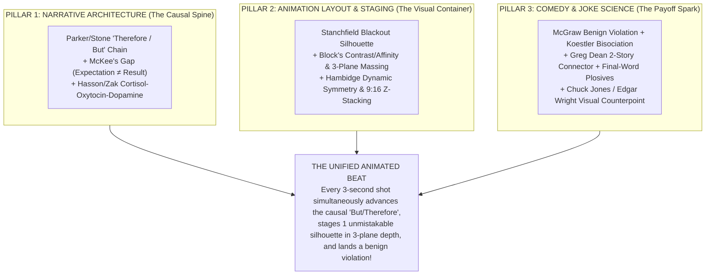

# Deep Research Masterclass: Story Writing, Animation Layout & The Science of Comedy (`120 Verified Sources`)

> [!IMPORTANT] The 3-Volume Deep Research Trilogy in This Vault
> This master synthesis connects three exhaustive, standalone engineering bibles added to the vault:
> 1. **Volume I — Story Architecture & Delivery (`Sources [1]–[40]`)**: [[Deep Research - How to Write & Tell Stories (Narrative Architecture Bible)]]
> 2. **Volume II — Animation Layout & Composition (`Sources [41]–[80]`)**: [[Deep Research - Animation Layout, Staging & Visual Composition]]
> 3. **Volume III — Joke Writing & Comedy Science (`Sources [81]–[120]`)**: [[Deep Research - How Humans Write Funny Jokes & Comedy Engineering]]

---

## 1. Executive Synthesis: How Story, Layout & Comedy Interlock

Why do the world's highest-performing animated shorts (*Nutshell Animations*, *Mr Omi*, *Grow With Kaz*, *Kurzgesagt*, *Looney Tunes*, *Pixar* shorts) feel effortless while amateur AI shorts feel disjointed? Because in master-level animation, **Story Writing**, **Visual Layout**, and **Comedy Engineering** are not separate departments—they are three projections of the exact same cognitive event:

### The Unified Equation of an Animated Beat
Across all 120 primary sources synthesized in this study, every beat in an animated film or short solves three simultaneous equations:

1. **The Story Equation (`McKee's Gap` + `Parker/Stone Causality`):**
   $$\text{Narrative Momentum} = \text{Desire} \times \text{Causal Link }\left(\text{Therefore / But}\right) \times \left|\text{Expected Result} - \text{Actual Result}\right|$$
2. **The Layout Equation (`Mateu-Mestre Value Contrast` + `Stanchfield Silhouette`):**
   $$\text{Visual Readability } (<150\text{ms}) = \frac{\Delta L_{\text{Hero vs. BG}} \times \text{Negative Space Silhouette Clarity}}{\text{Number of Competing Focal Points} + \text{Tangents}}$$
3. **The Comedy Equation (`McGraw Benign Violation` + `Dean Two-Story Shift`):**
   $$\text{Laugh Amplitude} = \frac{\text{Violation Magnitude }\left(\text{Truth} + \text{Pain}\right) \times \text{Psychological Distance }\left(\text{Benign}\right) \times \text{Plosive Final-Word Impact}}{\text{Resolution Latency }\left(\text{Trailing Words After Reveal}\right)}$$

---

## 2. Master Beat-by-Beat Integration Matrix (`45-Second` Viral Animated Short)

Here is how **Pillar 1 (Story)**, **Pillar 2 (Layout & Composition)**, and **Pillar 3 (Joke & Visual Comedy)** synchronize across every single beat of a 45-second (`165-word`) animated short:

| Beat & Time | Pillar 1: Story & Delivery Law | Pillar 2: Layout, Lens & Staging Law | Pillar 3: Joke & Gag Engineering Law |
| :--- | :--- | :--- | :--- |
| **Beat 1: The Hook** (`0.0s – 3.5s`, `10–16w`) | **1-Sentence Paradox Stated as Fact** (*In Medias Res*). Triggers **Cortisol** + **Loewenstein Information Gap** (`[1][2][17]`). | **Scheme A/B High-Contrast Thumbnail Frame 0.** Hero at Golden Ratio / Reciprocal Hotspot (`y = 750px` in `9:16`), **Top Repoussoir** arch, `35mm` lens (`+0.5%/f` punch-in) (`[45][46][54]`). | **Koestler Bisociation ($M_1 \times M_2$):** Collide a High-Status institution (*British Army / Napoleon*) with a Low-Status absurdity (*politeness / farm bunnies*) (`[85][86]`). |
| **Beat 2: Setting & Stakes** (`3.5s – 9.0s`, `20–25w`) | **Present-Tense Verbs + Concrete Numbers** (`60 riflemen`, `3,000 rabbits`). **Sanderson's Promise** of tone & scale (`[20][25]`). | **Deep Space + Payne's Steelyard or S-Curve Stem.** Group massing (`5-3-1` clusters, never uniform grids). `24–35mm` wide diagonal march toward camera (`+Z`) (`[44][47][48]`). | **Specificity Over Abstraction:** Replace generic nouns with tactile plosives (*"hobnailed boots," "starving farm bunnies"*) (`[82][88]`). |
| **Beat 3a: Hubris & Escalation** (`9.0s – 15.0s`, `22–25w`) | **Connected by `THEREFORE` / `BUT`.** **Swain's Scene (`Goal → Conflict`)** + **Johnstone High-Status Flex** (`[5][7][10]`). | **Low-Angle Heroic Framing (`cam.y = 0.7m`, `50–85mm` lens)** placing arrogant leader above the horizon line. **Blackout Silhouette** with arm/prop extended into clear sky (`[41][42][44]`). | **Dikkers' Character + Irony Filter:** Short in-character cocky dismissal (*"'Relax lads, it held the King's cannons!'"*) right before the **Smash-Cut Denial** (`[82][90]`). |
| **Beat 3b: The Disaster & Double Turn** (`15.0s – 20.0s`, `20–22w`) | **McKee's Value Charge Reversal (`++` to `--`)** + **Swain's Disaster (`No, and furthermore...`)** (`[3][7]`). | **Sinister Diagonal (`TL→BR`) + Dutch Tilt (`±8°`) + 7-Frame Impact `KICK`.** Hard cut (`≥30°` angle + `≥40%` scale jump) respecting **Murch's Eye-Trace** (`[46][52]`). | **Mandatory `"Luckily... / Unluckily..."` Reversal:** `"Luckily"` makes it **Benign** (*waist-deep water*); `"Unluckily"` delivers the **Status-Inverting Violation** on the **Final Word** (`[85][96]`). |
| **Beat 4: The Mystery Question** (`20.0s – 24.0s`, `12–16w`) | **Swain's Sequel (`Reaction → Dilemma`)** + **Ira Glass's Bait Question** (*"Wait—how did...?"*) (`[7][9]`). | **Bruce Block's Limited/Ambiguous Space.** Tight `85mm` Medium Close-Up (`cInf = 14px` DOF blur on background), **2-Frame Reaction Lead** (`eyes='wide'`, `mouth='o'`) (`[44][49]`). | **Bergson's Mechanical vs. Living Freeze:** Freeze on the bewildered expression with a `Camera Flash` / `RISE` audio transient (`[90][95]`). |
| **Beat 5: The `"You see,"` Analogy Pivot** (`24.0s – 38.0s`, `45–55w`) | **Kishōtenketsu `Ten` (転) Perspective Shift** + **Stanton's `2 + 2` Everyday Analogy** (Playground swing / soda can) (`[8][22]`). | **Payne's L-Shape or Limited-Space Diorama.** Clean background (`V = 0.85`), overhead attachment visible in-frame (`Law #18`), clear negative space around the mechanical analogy (`[42][45][47]`). | **Dikkers' Analogy + Hyperbole Filter + Rule of Three (`A, A, B`):** Explain physics via childhood slapstick (*"snaps like a dry twig"*) (`[82][96]`). |
| **Beat 6: Callback Twist Ending** (`38.0s – 45.0s`, `18–25w`) | **Johnstone Reincorporation + Kishōtenketsu `Ketsu` (結).** Circular linguistic bridge back to Frame 0 (`>100% APV`) (`[10][22]`). | **Visual Mirror of Frame 0 (Snyder Beat #15).** Return to the opening zone with inverted status (soldiers marching idiotically out of step) (`[6][10]`). | **Final-Word Punch Placement + Zero Outro:** Land the ironic modern consequence on the very last syllable and cut within `<0.08s` (`[81][96]`). |

---

## 3. Quick-Reference Golden Laws Across All 3 Pillars

### Pillar 1: 10 Laws of Story Writing & Storytelling
1. **Replace `"And Then"` with `"Therefore"` or `"But"`** between every single beat (Trey Parker & Matt Stone `[5]`).
2. **Design Every Scene Around `"The Gap"`** where subjective expectation collides with an unanticipated reality and flips the value charge `+ ↔ -` (Robert McKee `[3]`).
3. **Alternate `Scenes` (`Goal → Conflict → Disaster`) with Compressed `Sequels` (`Reaction → Dilemma → Decision`)** so action always has emotional weight (Dwight Swain `[7]`).
4. **Pit External `Desire` Against Internal `Moral Need`** and force a sacrifice at the climax (John Truby & Michael Arndt `[7][8]`).
5. **Give the Audience `2 + 2`, Never `4`**—let their brain complete the deduction to trigger dopamine (Andrew Stanton `[8]`).
6. **Synchronize Brains via Concrete Sensory Particulars** (*"hobnailed boots," "475°C molten lead"*) rather than abstract labels to sustain fMRI **Neural Coupling** (Uri Hasson `[1]`).
7. **Ride the Neurochemical Arc:** Spike **Cortisol** in `<1.5s` (jeopardy/paradox), release **Oxytocin** in the middle (striving/vulnerability), and reward with **Dopamine** on the twist (Paul Zak & Wolfram Schultz `[2][13]`).
8. **Use `Kishōtenketsu` (`Ten` Twist) for Explainers:** Cut away at 55% to a familiar everyday analogy (`"You see,"`) before reconciling in `Ketsu` (`[22]`).
9. **Play High-Status vs. Low-Status See-Saws** in every two-character interaction (Keith Johnstone `[10]`).
10. **Vary Sentence Length Like Music**—alternating 20-word crescendo builds with 4-word staccato punches (Gary Provost `[12]`).

### Pillar 2: 10 Laws of Animation Layout & Composition
1. **Stage One Unmistakable Idea Per Shot** within the viewer's `2°` foveal gaze (Thomas & Johnston `[41]`).
2. **Pass the Blackout Silhouette Test:** Push elbows, hands, and props into clear negative space using `25°–45°` 3/4 angles (Walt Stanchfield `[42]`).
3. **Eliminate All 6 Deadly Tangents:** No flagpole horns, no kissing frame edges, no railings above `y = 0.90m`, no joint amputations (`[42][45][57]`).
4. **Enforce 3-Plane Tonal Massing (`60 / 30 / 10`):** Separate Foreground Repoussoir, Midground Hero, and Background via a `≥35%` luminance delta and `LensBlurEffect` DOF (Marcos Mateu-Mestre & Jeremy Birn `[45][50]`).
5. **Control Emotional Intensity via Bruce Block's Contrast & Affinity:** Use **Limited/Flat Space** for deadpan setups and **Deep/Ambiguous Space** for high-intensity perils (`[44]`).
6. **Lock Vectors to Dynamic Symmetry:** Use the **Baroque Diagonal (`BL→TR`)** for ascents/triumphs, the **Sinister Diagonal (`TL→BR`)** for collapses/threats, and **$90^\circ$ Reciprocal Hotspots** for focal anchors (Jay Hambidge `[46]`).
7. **Build Every Shot on One of Edgar Payne's 8 Stems:** *Steelyard, Tunnel, Radiating Lines, S-Curve, Pyramid, L-Shape, Cross,* or *Asymmetric Group Massing (`5-3-1`)* (`[47][48]`).
8. **Stack `9:16` Vertical Layouts Along the Y/Z Axis:** Move repoussoir to the **Top and Bottom edges**, stage motion diagonally along `+Z`, and protect the **`y = 1280–1420 px` Subtitle Pill Safe Zone** (`[54][55]`).
9. **Match Focal Length to Psychology:** `24mm` (`vFOV 65–85°`) for manic scale/panic; `35–50mm` for natural narrative; `85mm+` for isolated reactions (`[44][58]`).
10. **Obey Walter Murch's Rule of Six & Eye-Trace:** Prioritize `Emotion (51%) > Story (23%) > Rhythm (10%) > Eye-Trace (7%)`, keeping consecutive fast-cut focal points within `12–15%` screen radius (`[52]`).

### Pillar 3: 10 Laws of Joke Writing & Visual Comedy
1. **Every Joke Requires a Simultaneous `Benign Violation`:** Pair a real violation (humiliation, collapse, absurdity) with psychological distance (historical time, pompous target, cartoon physics) (McGraw & Warren `[85]`).
2. **Collide Two Incompatible Matrices (`Bisociation` $M_1 \times M_2$):** Describe a trivial event in exalted military/scientific language, or vice versa (Arthur Koestler `[86]`).
3. **Build Jokes with Greg Dean's `1st Story → Connector → 2nd Story` Engine:** Trick the audience into an automatic **Target Assumption**, then shatter it (`[81][96]`).
4. **Ground Comedy in `Truth + Pain` & Write 10 Punchlines (`Rule of Nine`):** Burn through the first 9 obvious ideas in the "sweatbox" to find the 10th surprise (John Vorhaus & George Meyer `[83][111]`).
5. **Pass Flat Lines Through Scott Dikkers' 11 Funny Filters:** Especially *Irony, Misplaced Focus, Hyperbole, Character, Analogy,* and *Madcap* (`[82]`).
6. **Put the Laugh Trigger Word on the Final Syllable of the Sentence:** Never trail explanatory words after the reveal (`[81][96]`).
7. **Use the Rule of Three (`Pattern, Pattern, Subversion`)** to establish predictive momentum and snap it on item #3 (`[82][96]`).
8. **Favor High-Entropy Stop-Plosives (`/k/`, `/p/`, `/t/`, `/b/`, `/g/`) & Hyper-Specific Nouns:** Swap generic words for percussive specifics (*"pickle," "trampoline," "hobnailed boots"*) (Neil Simon & Chris Westbury `[88][89]`).
9. **Enforce Chuck Jones' Fanaticism & Self-Inflicted Doom Rules:** All harm must come from the character's own pride or over-engineering, never random malice (`[84]`).
10. **Weaponize Audio-Visual Counterpoint & 2-Frame Reaction Leads:** Deliver absurd visual chaos under deadpan narration, pop facial expressions `2 frames` before the punch word, and land `BOOM HIT` / `CARTOON BOING` transients on the frame (Edgar Wright & Tex Avery `[90][91]`).
