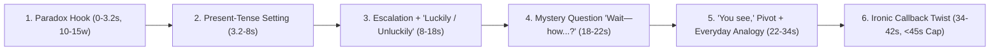

# Script Architecture — `3.7 WPS` & The `"You See,"` Pivot

> [!IMPORTANT] Measured Reference Report
> - **Source Report**: `.agents/skills/cartoon-3d-short/references/reports/CONTEXT.md`
> - **Worked Script Template**: `90 Templates & Starter Kits/cartoon-3d-short-kit/SCRIPT_example.md`

When you analyze why viral animated shorts hold **95%+ Average Percentage Viewed (APV)** while generic AI scripts drop below 50% by second 15, the secret isn't just the animation—it's a **strict 6-beat syntactic clock** operating at **`3.5–4.1 words/sec` (median `3.7 wps`)**.

---

## 1. Word Budget by Target Duration (Strict `< 45s` Cap for All Future Videos)

> [!IMPORTANT] Mandatory `< 45 Seconds` Duration Law
> All future short-form videos across every track MUST be **strictly under 45 seconds (`< 45.0s` hard ceiling; `28–42s` sweet spot)** to maximize `98%+` Average Percentage Viewed (APV) and repeat loops.

| Video Duration | Toon / Realistic 3D (`3.7 wps`) | Low-Poly HUD Explainer (`2.6 wps`) | Roblox Fast Edit (`4.0 wps`) | Number of Visual Beats |
| :--- | :--- | :--- | :--- | :--- |
| **`28–32 seconds`** | `105 – 120 words` | `75 – 85 words` | `115 – 128 words` | `8 – 10 beats` |
| **`35–40 seconds` (Sweet Spot)** | **`130 – 148 words`** | **`90 – 105 words`** | **`140 – 158 words`** | **`10 – 12 beats`** |
| **`44 seconds` (Hard Cap `< 45s`)** | `155 – 162 words max` | `110 – 115 words max` | `165 – 172 words max` | `11 – 14 beats` |

---

## 2. The 6-Beat Narrative Spine (Sentence-by-Sentence Blueprint, `< 45s`)

### Beat 1: The Paradox Hook (`0.0s – 3.5s`, `10–16 words`)
State the impossible outcome and its absurd cause as plain fact in Sentence 1.
- *Example*: *"In the 1880s, a British bridge collapsed because soldiers were too polite to march out of step."*

### Beat 2: Present-Tense Setting with Concrete Numbers (`3.5s – 9.0s`, `20–25 words`)
Switch immediately into **vivid present tense** (*"Sixty riflemen are heading back to barracks..."*) and anchor the scene with **specific numbers** (`60 soldiers`, `40-ton wagons`, `3,000 rabbits`, `212 BC`). Concrete numbers trigger visual credibility.

### Beat 3: Escalation, In-Character Mockery & The `"Luckily / Unluckily"` Double Beat (`9.0s – 20.0s`, `40–45 words`)
Never narrate dry Wikipedia facts. Inject:
1. **One short in-character line of cocky doubt** (*"'Relax, lads, it held the King's cannons—it'll hold our boots.'"*)
2. **One physical exaggeration joke** (*"Within ten seconds, the deck is bouncing like a trampoline."*)
3. **The Mandatory `"Luckily... / Unluckily..."` Reversal**:
   > *"Luckily, the river was only waist-deep. Unluckily, the general's horse landed on the general."*

### Beat 4: The Mystery Question (`20.0s – 24.0s`, `12–16 words`)
Right after the disaster hits, pause the action for `1 beat` and voice the viewer's exact confusion:
- *"Wait—how did sixty pairs of boots snap iron chains built for forty-ton wagons?"*

### Beat 5: The `"You see,"` Pivot + Everyday Physical Analogy (`24.0s – 38.0s`, `45–55 words`)
Measured across the 20 reference shorts, **14 out of 20 (`70%`) used the exact two-word transition `"You see,"`** to pivot from the story into the underlying science/history mechanism.
- **The Everyday Analogy Law**: Never explain physics with textbook jargon (*"harmonic mechanical resonance amplification"*). Translate it into a **childhood physical sensation you can animate in a separate 3D zone**:
  > *"You see, every object has a natural rhythm it wants to sway at—just like pushing a kid on a playground swing. One tiny push does nothing. But if sixty men plant their boots at the exact top of every swing, those tiny pushes stack up until solid iron snaps like a dry twig."*

### Beat 6: The Callback Twist Ending (`38.0s – 45.0s`, `18–25 words`)
Close the loop by showing how that absurd event permanently changed a modern rule—and **cut the video `<0.08s` after the final word**:
- *"Which is why to this day, every army on Earth is legally required to march like complete idiots across bridges."*
