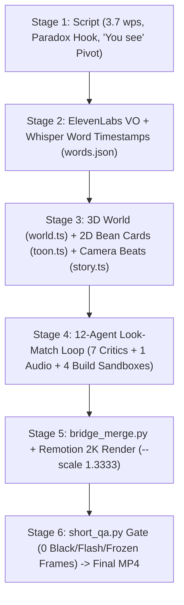

# Video 2 Teardown — How to Make Viral Animated Shorts Using Claude (Mr omi)

- **Creator**: **Mr omi** (`@mr_omix`)
- **Video URL**: [https://youtu.be/OtbLL6OBNE4](https://youtu.be/OtbLL6OBNE4)
- **Open-Source Repository**: `github.com/mromidev/claude-animated-shorts` (vendored at `.agents/skills/cartoon-3d-short/`)
- **Demo Short Built in Video**: *"The Bridge That Fell for a Song"* — The 1880s British suspension bridge (Broughton Suspension Bridge) that collapsed because 60 soldiers marched in step to a catchy tune, hitting its natural resonant frequency.

---

## 1. Why Reverse-Engineering 20 Shorts at 30fps Was Necessary

When you ask a raw LLM for *"a 2D-in-3D cartoon short like Nutshell Animations"*, it guesses:
- Spheres for heads (`3D` primitives instead of `2D` superellipse cards)
- Default Three.js `MeshStandardMaterial` (grey plastic shading instead of warm two-tone shadow bands)
- Pure black `#000000` uniform outlines (instead of `#241726` plum variable-width strokes)
- Static camera holds or nausea-inducing linear pans

To eliminate guessing, **Mr omi downloaded 20 viral reference shorts (~18 minutes of footage = ~32,000 frames at 30fps)**, extracted every scene cut, isolated voiceovers from background stems, and dispatched **8 parallel research agents** to measure the exact numbers across 7 visual domains plus script/audio.

### The 8 Measured Reports (Vendored in `.agents/skills/cartoon-3d-short/references/reports/`)
1. **`CONTEXT.md`**: Script structure, word rate (`3.5–4.1 wps`, median `3.7 wps`), `-14 LUFS`, and the `"You see,"` pivot.
2. **`characters.md`**: `3.5 head-heights` adult build, superellipse `H/W = 0.94`, `#241726` plum ink, `3:1` variable stroke width, `lidded` eyes, `4f` blink cycle.
3. **`outlines.md`**: Screen-space depth + normal `InkPass` (`5.1px` near → `2.2px` far at 1080p) running **before** DOF, with `NOINK = 3` masking character cards and sky.
4. **`lighting.md`**: Custom `shade()` `onBeforeCompile` hook, day shadow `Y ≈ 0.50`, golden-hour backlit sun (`az 6–15°, el 7–9°`) with **violet-blue shadows (`B ratio 1.35–3.0×` lit)**, and `cardShade()` (`V ≥ 0.86`).
5. **`depth.md`**: Thin-lens `LensBlurEffect` (`cInf = 10–16 px` on CU/MS, `0` on wides), `BloomEffect` (`threshold 1.0`, `intensity 0.5`), and horizon-matched linear fog.
6. **`motion.md`**: Hard cuts vs. `18–40f` smootherstep glides (`≤25 px/f` at 720p), mandatory `0.15–0.35%/f` hold creeps (`push()`), and `7f` sign-flipping impact `KICKS`.
7. **`grade.md`**: 7-knot monotone Hermite tone curve (`GradeEffect`), 3-zone saturation boost (`1.26×` midtones), and warm highlight Cr tint.
8. **`textures.md`**: Procedural `Canvas2D` surface painters (`planksHD`, `stoneHD`, `grassHD`, `waterNear/Far`, `cloudHD`) with `anisotropy = 8`.

---

## 2. The 6-Stage End-to-End Production Workflow

### Stage 1 & 2: Script & Word-Level Timing
- **The Demo Script (`SCRIPT_example.md`)**:
  - **Beat 1 (Hook)**: *"In the 1880s, a British bridge collapsed because soldiers were too polite to march out of step."* (17 words — paradox stated as plain fact).
  - **Beat 4 (`Luckily / Unluckily`)**: *"Luckily, the water was only waist-deep. Unluckily, the general's horse landed on the general."*
  - **Beat 5 (`"You see,"` Pivot + Swing Analogy)**: *"Wait — how did sixty boots snap iron chains that held forty-ton wagons? You see, every object has a natural rhythm it wants to sway at, like pushing a kid on a swing."*
  - **Beat 8 (Callback Twist)**: *"And to this day, every army on Earth is trained to march like absolute idiots on bridges."*
- **Voiceover Alignment**: Generated with ElevenLabs (`10–15%` faster energetic delivery) and aligned via `faster-whisper` so every camera cut, eyebrow raise (`2f` lead), and impact shake (`f = 584` bolt snap) lands on the exact spoken frame.

### Stage 3: Why Round 1 Always Looks Broken (And How Stage 4 Fixes It)
In Mr omi's first render of the Bridge short, several classic failure modes appeared:
1. **The Swing Attachment Bug**: The park swing rotated around its bottom seat instead of the top branch (`y = 3.55m`), making the child look like they were hanging by their neck.
2. **St. George's Cross Instead of the Union Jack**: An 1880s British barracks flew the wrong flag.
3. **Dark Unreadable Sign**: The `"BREAK STEP BY ORDER"` sign had directional `shade()` applied to its painted face, turning it muddy grey in shadow.
4. **Chest-Blocking Bridge Railings**: The suspension bridge bars cut right across the soldiers' faces.
5. **The 110 GB Disk Explosion**: Running 4 parallel Remotion agents filled `$TMPDIR/remotion-webpack-bundle-*` with `1.9 GB` per render (~110 GB total), crashing the render mid-way and leaving 8 seconds of frozen frame.

### Stage 4: The 12-Agent Look-Match & Sandbox Merge Architecture
To fix every visual gap without agents overwriting each other's files, Mr omi split the workspace into **12 specialized agents**:
- **7 Look-Match Critics** (one per report: `characters`, `outlines`, `lighting`, `depth`, `motion`, `grade`, `textures`) comparing `out/sbs_sheet.png` (side-by-side of current build vs. reference frames) and logging exact numeric diffs.
- **1 Procedural Audio Agent** synthesizing 60 boots marching (`118 BPM`), iron bolt groan/snap (`f = 584`), timber crack, river splash (`f = 626`), and general's horse splash (`f = 795`).
- **4 Isolated Build Sandboxes (`sb-cam`, `sb-world`, `sb-mat`, `sb-char`)**: Each sandbox owns a strict disjoint set of files (`story.ts`, `world.ts`, `shade.ts + lights.ts`, `toon.ts + cast.ts`) and merges cleanly via `scripts/bridge_merge.py`.

---

## 3. Bonus Revelation: Realistic 3D in Blender (End of Video 2)
At `11:08` in the video, Mr omi demonstrated that the **exact same multi-agent look-match loop works in Blender** for realistic 3D shorts:
- **Fast Viewport/EEVEE Render Trick**: Instead of waiting hours for Cycles path-tracing on every agent iteration, render fast viewport/EEVEE passes and run an **AI upscaler / enhancer pass** on the final frames, cutting render time by `10×` while keeping cinematic lighting and physics.

---

## 4. Related Vault Notes
- [[Style 1 - 2D-in-3D Toon World (Remotion + Three.js)]]
- [[The 12-Agent Look-Match & Sandbox Merge Architecture]]
- [[Readability Traps & Anti-Slop Rules]]
- [[Automated Frame & Audio QA (short_qa.py)]]
