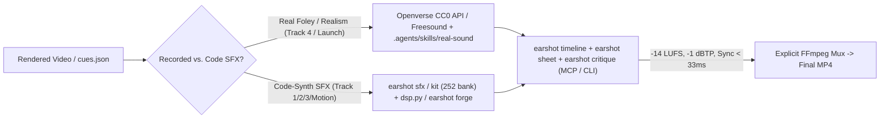

# Video 6 Teardown — Free Tools for Better Sound in Claude Videos (`Openverse API` + `Earshot`)

- **Creator**: **Rakhul Karthick**
- **Video URL**: [https://youtube.com/shorts/2yNiLmpbHl4](https://youtube.com/shorts/2yNiLmpbHl4)
- **Original Title**: *"Free tools for better sound in Claude videos"*
- **Duration**: `37 seconds`
- **Core Problem Solved**: *"Claude has now become insanely good at motion graphics and video editing, but the sound effect it adds is still stuck."*

---

## 1. The 2 Free Tools (Plus `real-sound` Skill) Revealed in the Short

| Tool / Component | What It Does | Vendored / Repo Location |
| :--- | :--- | :--- |
| **1. Openverse API** (`api.openverse.org`) | Zero-API-key search engine for **millions of CC0 / Creative Commons SFX, foley, and ambient recordings** (sourced from Freesound, Jamendo, Wikimedia). Filter `?license=cc0` so you owe zero attribution. | Documented in [[Openverse API, Real-Sound & Earshot MCP Pipeline]] |
| **2. Earshot (`Leonxlnx/earshot`)** | Open-source, **CPU-only audio intelligence & synthesis toolkit + MCP server** that gives coding agents actual "ears": inspects waveforms/transients (`timeline`, `sheet`), checks cut sync (`critique`), detects fake/synthetic sound (`realness`), and includes **`earshot forge` + `252`-sound code bank (`earshot sfx / kit`)**. | **Skill Vendored**: `.agents/skills/earshot/SKILL.md` • GitHub: `github.com/Leonxlnx/earshot` |
| **3. `real-sound` Skill** *(Shipped inside Earshot)* | End-to-end sound-supervisor skill that turns `cues.json` + Freesound/Mixkit/Openverse real recordings into a `-14 LUFS` mastered film mix with 5 parallel critic subagents and automatic `CREDITS.md` attribution. | **Skill Vendored**: `.agents/skills/real-sound/SKILL.md` |

---

## 2. Why This Short Transforms Our Vault's Audio Architecture

Before Video 6, our vault relied solely on **pure Python/NumPy DSP synthesis** (`dsp.py`, `sfx_gen.py`) from Videos 1–4. While pure code synthesis works great for `cartoon-3d-short`, **motion graphics, Blender realistic 3D (Track 4), and launch reels look even better when driven by measured acoustic feedback (`earshot`) or real CC0 Foley (`Openverse` + `real-sound`)**.

---

## 3. Key Capabilities Inside `earshot` (Highlighted at `0:17–0:32`)

1. **Give Claude Ears Against Every Cut (`earshot sheet` & `earshot timeline`)**:
   - Generates an annotated visual spectrogram + video-frame strip showing cue markers **color-coded by frame sync** (`green` = within 1 frame, `amber` = within 100ms, `red` = missing sound!). Your agent inspects the PNG directly with `read_file`.
2. **252-Sound Code Bank + Physical Forge (`earshot kit` & `earshot forge`)**:
   - Uses the exact same **code-rendered audio** philosophy as Mr omi's `sfx_gen.py`, except audited against real recordings via CLAP embeddings (`z ≥ 3.0`) and 1/3-octave spectral balance!
   - Built-in `launch` preset automatically measures the music bed 1 second before each cue (`bed_level`) and sets effect gain `3–10 dB` above it so impacts never get buried or clip.
3. **Human Taste Remains Final**:
   - As the creator notes at `0:33`: *"It won't judge taste for you. You still make the final call."*

---

## 4. Related Vault Notes
- [[Openverse API, Real-Sound & Earshot MCP Pipeline]]
- [[Procedural Python Audio Synthesis (Music & SFX)]]
- [[SFX Direction & The 2-4 Frame Lead-In Law]]
