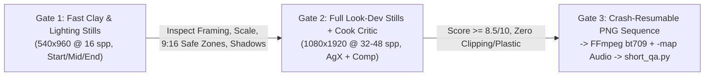

# Blender 5.3 Cinematic Rendering & Animation Mastery Bible

> [!IMPORTANT] Mandatory Entrypoint for All Blender Tracks (Tracks 4, 5 & 7)
> Every 3D Blender script, `blender` MCP session, Roblox R6/R15 render, and Undershine 3D pixel render on this machine MUST follow the **verified Blender 5.3.0 APIs** and **cinematic look-dev rules** below. Never use legacy Blender 4.2/4.x APIs that crash or produce flat, plastic CG renders.
> - **Reusable Cinema Starter Kit**: `90 Templates & Starter Kits/blender-cinema-kit/blender_cinema_lib.py`
> - **Reusable Undershine Pixel Kit**: `90 Templates & Starter Kits/undershine-blender-pixel-kit/blender_pixel_lib.py`

---

## 1. Local Blender 5.3.0 Runtime & Workstation Hardware Profile

| Component | Verified Value on This Machine | Notes |
| :--- | :--- | :--- |
| **Primary Executable** | `C:\Program Files\Blender Foundation\Blender 5.3\blender.exe` | Blender `5.3.0` (bundled Python `3.13.13`). Keep `Blender 4.2` only as legacy fallback. |
| **GPU Acceleration** | **NVIDIA GeForce RTX 2050** (`OPTIX` + `CUDA` verified) | Use `OPTIX` for Cycles hardware raytracing + GPU-accelerated `OPENIMAGEDENOISE`. |
| **CPU** | AMD Ryzen 5 5500H | Disable CPU device during OptiX GPU renders unless VRAM overflows. |
| **Verified Benchmark** | `270×480` Full Cinema Stack (Cycles OptiX + Fog + SSS + Comp): **`2.83 s`** / `540×960` Cycles OptiX `32 spp`: **`5.40 s`** / Cold EEVEE 5.3 RT: **`9.85–11.69 s`** | Fast enough for full 3-gate iterative look-dev and overnight 30fps masters. |
| **Live `blender` MCP Addon** | Currently installed under `%APPDATA%\Blender Foundation\Blender\4.2\scripts\addons\blender_mcp_addon` | To use live `blender` MCP inside Blender 5.3 GUI, copy `blender_mcp_addon` into `%APPDATA%\Blender Foundation\Blender\5.3\scripts\addons\` and enable it in Preferences. |

---

## 2. Complete Blender 4.2 → 5.3 Breaking Python API Cheat Sheet

Every item below was **probed live against local `Blender 5.3.0`**. Never write the broken legacy pattern:

| Subsystem | Legacy Blender 4.x (BROKEN / DEPRECATED in 5.3) | Verified Blender 5.3.0 API (MANDATORY) |
| :--- | :--- | :--- |
| **EEVEE Engine ID** | `scene.render.engine = 'BLENDER_EEVEE_NEXT'` *(raises `TypeError`)* | `scene.render.engine = 'BLENDER_EEVEE'` |
| **Compositor Attachment** | `scene.use_nodes = True` / `scene.node_tree` *(removed)* / `scene.compositing_node_group` *(deprecated)* | `scene.compositor_effects.clear()`, create `bpy.data.node_groups.new(name, 'CompositorNodeTree')` with `OUTPUT` `NodeSocketColor` `'Image'` on `ng.interface`, then `eff = scene.compositor_effects.new('Main'); eff.node_group = ng` |
| **Compositor Output Node** | `nt.nodes.new('CompositorNodeComposite')` *(undefined)* | `nt.nodes.new('NodeGroupOutput')` → link to `out.inputs['Image']` |
| **Render Layers Emit Socket** | `rl.outputs['Emit']` *(KeyError)* | `rl.outputs['Emission']` |
| **Compositor Math & MapRange** | `CompositorNodeMath` / `CompositorNodeMapRange` *(undefined)* | `ShaderNodeMath` / `ShaderNodeMapRange` (`.clamp = True`, output `'Result'`). *(Note: still use `CompositorNodeSeparateColor` / `CompositorNodeCombineColor`; `ShaderNodeSeparateColor` fails in Compositor.)* |
| **Compositor Output File** | `fo.base_path`, `fo.file_slots.new(...)`, `fo.format.file_format = 'PNG'` directly | `fo.directory = out_dir`; **`fo.file_name = ""`** *(otherwise prefixes `'Unsaved'`)*; **`fo.format.media_type = 'IMAGE'`** *before* `fo.format.file_format = 'PNG'`; `item = fo.file_output_items.new('RGBA', 'img_####')`; set **`item.save_as_render = False`** on `depth_` / `norm_` linear data passes! |
| **Glare Node** | `gl.glare_type = 'FOG_GLOW'`, `gl.quality = 'HIGH'` | Socket-driven: `gl.inputs['Type'].default_value = 'Fog Glow'` *(Title Case: `'Bloom'`, `'Ghosts'`, `'Streaks'`, `'Fog Glow'`, `'Simple Star'`, `'Sun Beams'`, `'Kernel'`)*, `gl.inputs['Quality'].default_value = 'High'`, `gl.inputs['Threshold']`, `gl.inputs['Strength']`, `gl.inputs['Size']` (`0.0–1.0`) |
| **Color Balance Node** | `cb.correction_method = 'LIFT_GAMMA_GAIN'`; `cb.lift = (...)` | `cb.inputs['Type'].default_value = 'Lift/Gamma/Gain'`. **CRITICAL**: `cb.inputs['Lift']` returns scalar `Base Lift`! Look up RGBA sockets by `.identifier`: `'Color Lift'`, `'Color Gamma'`, `'Color Gain'`, `'Color Offset'`, `'Color Power'`, `'Color Slope'` |
| **Lens Distortion Node** | `ld.inputs['Dispersion']` with `ld.use_fit` | `ld.inputs['Type'].default_value = 'Radial'`, `ld.inputs['Distortion']`, `ld.inputs['Dispersion']`, `ld.inputs['Fit'].default_value = True` |
| **Blur & Ellipse Mask** | `bl.size_x`, `em.width` | Socket-driven 2D vectors: `bl.inputs['Size'].default_value = (px, py)`, `em.inputs['Position'].default_value = (0.5, 0.5)`, `em.inputs['Size'].default_value = (w, h)` |
| **Sky Texture** | `sky.sky_type = 'NISHITA'`, `sky.dust_density` | `sky.sky_type = 'MULTIPLE_SCATTERING'` (or `'SINGLE_SCATTERING'`), `sky.aerosol_density` |
| **Material / World Nodes** | `mat.use_nodes = True` / `world.use_nodes = True` *(DeprecationWarning)* | Always enabled in 5.x; gate with `if bpy.app.version < (5, 0, 0): mat.use_nodes = True` |
| **Mesh Auto Smooth** | `mesh.use_auto_smooth = True` *(removed in 4.1+)* | Set `poly.use_smooth = True` + `BEVEL` + `WEIGHTED_NORMAL` (`keep_sharp = True`) |
| **Animation F-Curves** | `obj.animation_data.action.fcurves` *(removed in 5.x Slotted Actions)* | Iterate `for layer in act.layers: for strip in layer.strips: cb = strip.channelbag(ad.action_slot)` → `cb.fcurves` (use `get_action_fcurves(obj)` in `blender_cinema_lib.py`) |

---

## 3. Render Engine Selection Matrix (Speed vs. Realism)

| Track / Visual Goal | Engine | Exact Config (`blender_cinema_lib.py` / `blender_pixel_lib.py`) | Samples & Denoise | Expected Render Time (`1080×1920`) |
| :--- | :--- | :--- | :--- | :--- |
| **Track 4: Realistic Hero / Medical / Forensic / Atmospheric Volume** | **`CYCLES` (`OPTIX` GPU)** | `configure_cycles_optix(scene, samples=48, adaptive_threshold=0.02)` + `use_persistent_data = True` + `use_light_tree = True` | `32–64 spp` (`adaptive 0.02`) + GPU `OPENIMAGEDENOISE` (`RGB_ALBEDO_NORMAL`, `ACCURATE`) | `~4–9 s/frame` (`~1.5–4 min` at `540×960` draft) |
| **Track 4 / Track 5: Fast Stylized Diorama / Roblox R6-R15 / Dynamic Camera** | **`BLENDER_EEVEE` (RT + Fast GI)** | `configure_eevee_cinema(scene, samples=32, raytracing=True, fast_gi=True)` | `24–32` TAA samples, RT `SCREEN` + Fast GI `GLOBAL_ILLUMINATION` | `~1.5–3.5 s/frame` |
| **Track 7: *Undershine* 3D Pixel Art** | **`BLENDER_EEVEE` (Crisp Grid)** | `configure_undershine_eevee(scene, res_x=270, res_y=480, samples=12)` (`filter_size = 0.01`, `use_raytracing = False`) | `12` TAA samples (no RT speckle at `270×480`) | `~0.15–0.25 s/frame` |

### Cycles Bounce & Clamping Budget (Never Leave Default 12 Bounces)
For fast, firefly-free animation on an RTX 2050:
- `max_bounces = 6`, `diffuse_bounces = 3`, `glossy_bounces = 3`, `transmission_bounces = 6`, `volume_bounces = 1`, `transparent_max_bounces = 6`.
- Set `sample_clamp_indirect = 8.0` to kill single-pixel caustics/fireflies without dulling direct highlights.
- **ALWAYS set `scene.render.use_persistent_data = True`** for animations so BVH trees and textures stay resident on GPU between frames.

> [!WARNING] Cycles OptiX Shader-Raytrace Trap (`ShaderNodeAmbientOcclusion` / `ShaderNodeBevel`)
> Empirically verified on this machine's RTX 2050: connecting `ShaderNodeAmbientOcclusion` or `ShaderNodeBevel` inside a Cycles OptiX material triggers heavy `OPTIX_SHADER_RAYTRACE` PTX kernel compilation (`>200s` stall + `~2.9 GB` RAM spike). In Cycles OptiX scenes, rely on **geometric `add_cinema_bevel`** + **physical Cycles indirect bounce shadows** + **dual-frequency procedural albedo weathering** (`use_ao_node=False`, the default in `make_pbr_material`). Reserve `use_ao_node=True` strictly for EEVEE-only workflows.

---

## 4. Color Management & Exposure Law

| Visual Style | `view_transform` | `look` | Why |
| :--- | :--- | :--- | :--- |
| **Track 4 & 5 PBR / Stylized Diorama / Roblox** | **`'AgX'`** | **`'AgX - Punchy'`** *(or `'AgX - Medium High Contrast'`)* | Natural highlight roll-off, rich desaturated brights, zero harsh RGB clipping when bright lights hit saturated skin/plastic/fire. |
| **Product / Exact Brand Colors** | `'Khronos PBR Neutral'` | `'None'` | Minimal hue shift on saturated brand pigments while still compressing highlights cleanly. |
| **VFX / Compositing Pipeline** | `'ACES 2.0'` | `'None'` | Wide gamut ACEScg workflow for multi-app finishing. |
| **Track 7 Pixel Art & Flat-Ramp Toon** | **`'Standard'`** | `'None'` | `ShaderToRGB` `CONSTANT` ramps are already hand-hue-shifted in sRGB; `AgX` desaturates dark pixel shadows. |

- **Mandatory FFmpeg Tagging**: Always tag final H.264 exports with `-colorspace bt709 -color_primaries bt709 -color_trc bt709 -pix_fmt yuv420p` so Chrome, YouTube, TikTok, and iOS match Blender's frame buffer gamma exactly.

---

## 5. The 7 Laws of Cinematic 3D Lighting

Why do most AI-generated Blender renders look like cheap 2005 game cutscenes? **Flat default grey ambient world + single unshaped omni/sun light + no rim separation.** Enforce all 7 laws:

1. **Kill the Default Grey World (`#0D0D0D` Studio or Physical Sky)**:
   - Default Blender grey `(0.051, 0.051, 0.051)` fills every shadow evenly and destroys contrast.
   - **Indoors / Studio / Zack D. Cross-Sections**: Call `setup_dark_studio_world(scene, "#0c101a", strength=0.12)` so shadows hold deep cool atmospheric tone instead of muddy grey.
   - **Outdoors**: Use `ShaderNodeTexSky` with `sky_type = 'MULTIPLE_SCATTERING'` (`setup_physical_sky(...)`), low sun elevation (`8°–22°`) for long sculptural shadows, and `strength = 0.5–0.7`.
2. **Use Kelvin Temperature Contrast (`use_temperature = True`)**:
   - Never light with sterile `(1, 1, 1)` white lights. Pair a **warm Key (`3800K–4600K`)** against a **cool Fill/Sky (`6800K–8500K`)** or **warm Sunset Rim (`2800K`)** against **cool Moonlight Key (`7500K`)**.
3. **Shape `AREA` Lights with Narrow `spread` (`45°–90°`)**:
   - Default `180°` area lights flood the entire room evenly. Setting `light.data.spread = math.radians(65.0)` turns an area light into a directional softbox that pools light on the hero while leaving the background dramatic.
4. **Enforce a `3:1` to `6:1` Key-to-Fill Ratio**:
   - Place the **Key Light** `35°–55°` off-axis and `25°–40°` elevated. Keep the **Fill Light** large, soft, and `1/4` to `1/6` the key intensity on the opposite side.
5. **Mandatory Strong Rim / Back Light (`1.2×–1.8×` Key)**:
   - On 9:16 mobile screens, silhouettes fail instantly if the subject merges into the background. Place a crisp Rim `AREA` light behind the subject (`140°–165°` from camera) to carve a luminous edge along shoulders, skulls, hair, or Roblox studs.
6. **Add Practicals & Shadow Gobos**:
   - Put tiny warm point/area lights inside lanterns, computer monitors, anatomical glows, or architectural slats (`gobos` casting slatted shadows across walls) to create depth layers.
7. **Bounded `Principled Volume` Atmospheric Haze (Never World Volume)**:
   - Never attach a `Principled Volume` shader to the infinite `World` output (kills physical sky sun light and tanks render time). Instead, wrap the camera + hero set in a bounded cube (`add_bounded_fog_volume`, `density = 0.008–0.022`, `anisotropy = 0.58–0.70`) so directional lights bloom into subtle volumetric shafts and distant geometry gains aerial perspective!

---

## 6. The 6 Laws of Non-Plastic Shading & Geometry

1. **Zero Razor-Sharp CGI Edges (`add_cinema_bevel`)**:
   - Real objects never have infinitely sharp `90°` math edges. Every box, table, skull cut-edge, bridge rail, or Roblox brick MUST get a subtle `BEVEL` (`width = 0.008–0.02m`, `segments = 2`, `limit_method = 'ANGLE'`) + smooth shading + `WEIGHTED_NORMAL` (`keep_sharp = True`) so rim lights catch gleaming micro-highlights along edges.
2. **Never Leave `Roughness` at a Uniform Float**:
   - Uniform `Roughness = 0.5` is the #1 "plastic CG" giveaway. Always pipe a multi-octave procedural `ShaderNodeTexNoise` through a `MapRange` (e.g., `0.28–0.58`) into `Principled BSDF -> Roughness` AND a subtle `ShaderNodeBump` (`strength = 0.04–0.12`, `distance = 0.015`) into `Normal` (`make_pbr_material` does this automatically).
3. **Use Blender 5.3's Full `Principled BSDF` Physics**:
   - Set **`Diffuse Roughness`** (`0.4–0.7`) on chalk, stone, clay, skin, and fabric so grazing light rolls off softly instead of looking like smooth Lambertian plastic.
   - Set **`Subsurface Weight` (`0.15–0.45`)** + multi-bounce Random Walk radius `(1.0, 0.28, 0.14)` on organic tissue, wax, leaves, and stylized clay characters.
   - Use **`Coat Weight`** for wet eyes/varnished wood/glossy Roblox plastic, **`Sheen Weight`** for cloth/velvet, and **`Thin Film Thickness`** / **`Transmission Dispersion Scale`** for soap/oil/glass.
4. **Break Up Flat Albedo via Dual-Frequency Procedural Weathering (Reserve `AO` Node for EEVEE)**:
   - Never use flat single-hex albedo across large surfaces. `make_pbr_material` blends a low-frequency macro noise patina (`weathering = 0.28`) across `Base Color` alongside real geometric bevels + Cycles indirect GI (`use_ao_node=False` by default to avoid `OPTIX_SHADER_RAYTRACE` PTX stalls; pass `use_ao_node=True` only in EEVEE-only scenes).
5. **True-Scale SI Units (`1 BU = 1 Meter`)**:
   - Depth of field (`f/2.8`), SSS radius (`0.015m`), bevel width (`0.015m`), and volumetric density (`0.015`) only behave realistically when characters are `~1.7–1.8m` tall and rooms/props match real meters.
6. **Zero Floating Props — Ground Contact & Micro-Clutter**:
   - Align bases flush to floor/terrain (`min_z = floor_z`) and break up empty planar surfaces with chamfered trim, pebbles, cables, dust motes, or grass tufts.

---

## 7. Cinematic Camera, Optics & Animation Principles in `bpy`

1. **Portrait 9:16 Focal Lengths & Framing**:
   - Wide environmental establishers: `24mm–32mm` (dramatic perspective).
   - Hero narrative medium / OTS: `45mm–55mm` (natural human eye).
   - Macro anatomical / tension reaction: `75mm–100mm` (shallow compressed background).
2. **Physical Depth of Field (`use_dof = True`)**:
   - Point `cam.data.dof.focus_object` at an animated `Empty` tracking the hero's eyes or cutaway target, set `aperture_fstop = 2.4–4.0` and `aperture_blades = 7`. *(Avoid extreme `f/0.95` miniature toy blur unless intentional diorama style.)*
3. **`180°` Motion Blur (`use_motion_blur = True`)**:
   - Enable `scene.render.use_motion_blur = True` and `scene.render.motion_blur_shutter = 0.5` so swings, punches, and whip-pans blend smoothly between 30fps frames.
4. **Never Ship Linear (`LINEAR`) Animation — Use Slotted Action Curves**:
   - In Blender 5.3, F-Curves live inside `action.layers -> strips -> channelbag(action_slot).fcurves`.
   - Use `BEZIER` (`EASE_IN_OUT`) for organic weight, `BACK` (`EASE_OUT`) for snappy UI/prop pops, and `EXPO` (`EASE_OUT`) for whip camera moves (`set_keyframe_easing(obj, ...)`).
5. **The 4 Animation Lifelines (Anti-Stiff CGI)**:
   - **Anticipation → Overshoot → Settle**: Before any fast jump/punch/lever pull, wind back `3–5f`, strike across `4–6f`, overshoot `+8–12%`, then settle over `6–8f`.
   - **Volume-Preserving Squash & Stretch**: When scaling `Z` by `s`, scale `X` and `Y` by `1.0 / math.sqrt(s)` so mass stays constant.
   - **2–5 Frame Overlapping Follow-Through**: Offset capes, antennae, heads, and secondary props by `2–5` frames behind the torso/root action.
   - **Living Idle Motion + Subtle Handheld Camera Breathing**: Never freeze a character or camera. Add tiny breathing chest/head drift plus a subtle `NOISE` F-Curve modifier (`add_handheld_camera_noise`) on character-driven shots and deterministic 7-frame alternating-sign `KICKS` on impacts.
6. **Multi-Camera Cuts via `scene.timeline_markers`**:
   - Use `add_animated_shot_camera(...)` so every `1.2–3.5 s` beat cuts cleanly to a distinct angle obeying the **30° / 40% Rule** and **9:16 UI safe zones**.

---

## 8. Blender 5.3 Native Compositor Polish (`scene.compositor_effects`)

Subtle post-processing inside Blender 5.3 turns raw renders into finished film frames with **no external compositor needed**:

```python
import bpy

scene = bpy.context.scene
scene.compositor_effects.clear()
ng = bpy.data.node_groups.new("CinemaPost", "CompositorNodeTree")
ng.interface.new_socket(name="Image", in_out="OUTPUT", socket_type="NodeSocketColor")
eff = scene.compositor_effects.new("CinemaPost")
eff.node_group = ng

rl = ng.nodes.new("CompositorNodeRLayers")
out = ng.nodes.new("NodeGroupOutput")

# 1. Soft Filmic Bloom / Fog Glow
glare = ng.nodes.new("CompositorNodeGlare")
glare.inputs["Type"].default_value = "Fog Glow"
glare.inputs["Quality"].default_value = "High"
glare.inputs["Threshold"].default_value = 1.25
glare.inputs["Strength"].default_value = 0.22
glare.inputs["Size"].default_value = 0.65

# 2. Subtle Chromatic Dispersion (real camera lens feel)
lens = ng.nodes.new("CompositorNodeLensdist")
lens.inputs["Type"].default_value = "Radial"
lens.inputs["Distortion"].default_value = -0.012
lens.inputs["Dispersion"].default_value = 0.005
lens.inputs["Fit"].default_value = True

# 3. Color Balance (ALWAYS select RGBA wheels via .identifier, NOT .inputs["Lift"]!)
cb = ng.nodes.new("CompositorNodeColorBalance")
cb.inputs["Type"].default_value = "Lift/Gamma/Gain"
cb_by_id = {inp.identifier: inp for inp in cb.inputs}
cb_by_id["Color Lift"].default_value = (0.98, 0.99, 1.02, 1.0)   # Cool deep shadows
cb_by_id["Color Gamma"].default_value = (1.00, 1.00, 1.00, 1.0)
cb_by_id["Color Gain"].default_value = (1.03, 1.01, 0.98, 1.0)   # Warm sunlit highlights

ng.links.new(rl.outputs["Image"], glare.inputs["Image"])
ng.links.new(glare.outputs["Image"], cb.inputs["Image"])
ng.links.new(cb.outputs["Image"], lens.inputs["Image"])
ng.links.new(lens.outputs["Image"], out.inputs["Image"])
```

---

## 9. The 3-Gate Pre-Render Verification Workflow

Never launch a 600-frame `1080×1920` Cycles render blind. Always clear all three gates:



1. **Gate 1 — Framing & Shadow Still Pass (`540×960`, `16 spp`)**: Render Frame `0` + 1 midpoint frame per camera marker (`~1.5 s/frame`). Inspect with `read_file` to verify silhouettes, `>2m` camera clearance, grounding, and 9:16 safe zones (`x=160..880`, `y=220..1280` for subjects).
2. **Gate 2 — Full Look-Dev & Zero-Context Critic (`1080×1920`, full lighting/materials/compositor)**: Build a contact sheet (`sbs_sheet.py` / `side-by-side.mjs`) and critique per [[The Cook Loop for Autonomous Visual Polish]]. Fix flat roughness, missing bevels, or weak rim separation before animating.
3. **Gate 3 — Crash-Resumable PNG Sequence + `bt709` Mux + `short_qa.py`**:
   - Always render animations as **16-bit/8-bit PNG frame sequences** (`frames/f_####.png`), NEVER directly to `.mp4` (so a crash or adjustment never discards completed frames).
   - Encode with FFmpeg tagging `bt709` and explicit `-map 0:v:0 -map 1:a:0`, then verify with `short_qa.py` + [[Post-Completion Visual QA — What, How & Why to Fix]].

---

## See Also
- [[Fast Blender 5.3 EEVEE Rendering & 4GB VRAM Speed Playbook]] — `3×–6×` speedup settings (`configure_fast_stylized_eevee`, `ao_samples=2`, `4GB VRAM` crowd LOD, `24 fps`) for stylized/Roblox/low-poly shorts on RTX 2050.
