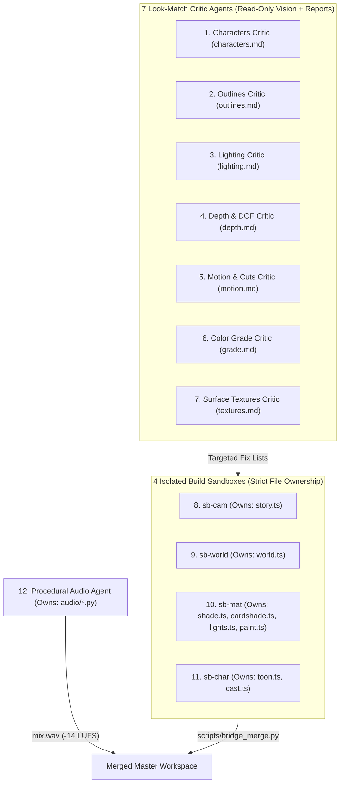

# The 12-Agent Look-Match & Sandbox Merge Architecture

> [!IMPORTANT] Vendored Merge & Comparison Scripts
> - **Sandbox Merger**: `90 Templates & Starter Kits/cartoon-3d-short-kit/scripts/bridge_merge.py`
> - **Side-by-Side Contact Sheet Builder**: `90 Templates & Starter Kits/cartoon-3d-short-kit/scripts/sbs_sheet.py`
> - **Stills Extractor**: `90 Templates & Starter Kits/cartoon-3d-short-kit/scripts/bridge-stills.mjs`

When a single agent tries to fix camera framing, 3D bridge geometry, GLSL shaders, 2D character poses, and Python sound effects in one conversation context, context rot sets in and fixing one thing breaks another.

In [[Video 2 Teardown - Viral 2D-in-3D Shorts Workflow (Mr omi)]], Mr omi solved this by orchestrating **12 specialized agents** split into **Critics**, **Audio**, and **Isolated File-Owner Build Sandboxes**.

---

## 1. Roster of the 12 Parallel Agents

---

## 2. Strict File Ownership Matrix (`bridge_merge.py`)

Why don't the 4 build agents create Git merge conflicts? Because each agent works in its own sandbox directory (`sb-cam/`, `sb-world/`, `sb-mat/`, `sb-char/`) cloned from the base project, and **each sandbox is only permitted to modify its assigned files**:

| Sandbox ID | Owned Files (Copied by `bridge_merge.py`) | Forbidden Files | Typical Fixes Assigned |
| :--- | :--- | :--- | :--- |
| **`sb-cam`** | `src/Bridge/story.ts` | `world.ts`, `toon.ts`, `shade.ts` | Fixing foreground occlusion (`>2m` clearance), smoothing glides (`18–40f`), adding `push()` hold creeps, tuning `7f` impact `KICKS`. |
| **`sb-world`** | `src/Bridge/world.ts` | `story.ts`, `toon.ts`, `shade.ts` | Fixing swing top-branch attachment (`y = 3.55m`), lowering bridge railings to chest height (`y = 0.9m`), fixing Union Jack flag geometry. |
| **`sb-mat`** | `src/Bridge/shade.ts`, `cardshade.ts`, `lights.ts`, `paint.ts` | `world.ts`, `story.ts`, `toon.ts` | Shifting golden-hour shadows to violet-blue (`#5b5173`), making sign faces `MeshBasicMaterial` + `NOINK`, sharpening wood plank grain. |
| **`sb-char`** | `src/Bridge/toon.ts`, `src/Bridge/cast.ts` | `world.ts`, `story.ts`, `shade.ts` | Tuning `#241726` plum ink width, fixing soldier shako helmets, adding `4f` blink cycle and `2f` pre-word expression lead. |
| **`sb-post`** *(optional)* | `src/Bridge/ink.ts`, `lensblur.ts`, `grade.ts`, `Bridge.tsx` | All content files | Verifying `InkPass` runs before `LensBlurEffect`, locking `NOINK = 3`, tuning 7-knot Hermite curve. |

---

## 3. Running a Look-Match Round Step by Step

1. **Render Current Build Stills (`bridge-stills.mjs`)**:
   Extracts 12–16 representative frames (`out/stills/shot_00.png` .. `shot_11.png`) covering every zone and lighting preset.
2. **Build the Side-by-Side Comparison Sheet (`sbs_sheet.py`)**:
   Pairs your rendered stills right next to the 38 real reference frames in `.agents/skills/cartoon-3d-short/references/frames/` and outputs `out/sbs_sheet.png`.
3. **Dispatch the 7 Critics in Parallel (`invoke_subagent` / `swarm`)**:
   Each critic reads its single domain report (e.g., `lighting.md`) + `out/sbs_sheet.png` and outputs **3–5 concrete code-level diffs** routed to `sb-cam`, `sb-world`, `sb-mat`, or `sb-char`.
4. **Run the 4 Sandbox Builders & Merge (`python scripts/bridge_merge.py`)**:
   `bridge_merge.py` copies each sandbox's owned files back into the main project, runs `tsc --noEmit` to verify TypeScript interfaces still align, and re-renders `sbs_sheet.png` for verification.
