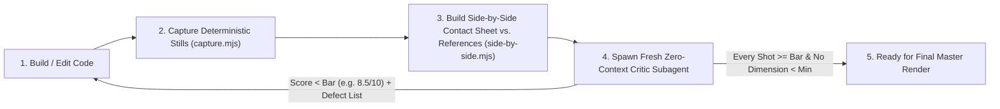

# The Cook Loop for Autonomous Visual Polish (`.agents/skills/cook`)

> [!NOTE] Vendored Skill
> - **Skill Path**: `.agents/skills/cook/SKILL.md`
> - **Helper Scripts**: `.agents/skills/cook/scripts/capture.mjs` & `side-by-side.mjs`

Whenever you want an agent to spend **1 to 8+ hours autonomously polishing a 3D world, Blender scene, or animated short** until it holds up next to top creator references, trigger the **Cook Loop** (`/cook` or *"let it cook until 9/10"*).

---

## 1. Why Single-Pass Generation Always Plateaus at `6/10`

Even the strongest model writes code blind: it imagines coordinates in its head, places a tree or light, and declares victory. The **Cook Loop** forces a strict scientific feedback cycle:

---

## 2. Workspace Artifacts Created by `cook`

Inside your project's `cook/` directory, the loop maintains four living documents:
1. **`cook/BRIEF.md`**: Target style, reference frames (`references/frames/`), resolution (`1080×1920 @ 30fps`), and numeric quality bar (default: **overall average `≥ 8.5/10`, zero dimensions `< 7.5/10`**).
2. **`cook/SHOTS.md`**: Every shot ID (`S01` .. `S12`), its exact timestamp `t`, camera framing, and reference image pair.
3. **`cook/ROUNDS.md`**: Append-only lab notebook logging what changed in Round `N`, the side-by-side contact sheet path (`cook/rounds/round-03/sbs.png`), and the critic's exact scores.
4. **`cook/NEXT.md`**: The ranked punch-list of defects to fix in Round `N+1`.

---

## 3. Why the Critic MUST Be a Zero-Context Subagent

**Never grade your own homework in the same context that wrote the code.** An agent that just spent 2,000 tokens writing a "park swing" will look at a broken floating line and hallucinate that it looks great.
- In the Cook Loop, you spawn a **fresh subagent (`invoke_subagent`)** that sees **ONLY**:
  1. `cook/rounds/round-N/sbs.png` (the side-by-side of Reference vs. Current Build)
  2. The 6 scoring rubrics (**Composition & Framing**, **Character Proportions & Expression**, **Lighting & Shadow Palette**, **Outlines & Depth Separation**, **Surface Texture & Detail**, **Readability & Zero Clipping**)
- The critic returns a brutal numeric table + coordinate-level defects. If any shot scores below the bar, the builder executes the next round automatically without stopping to ask the user.
