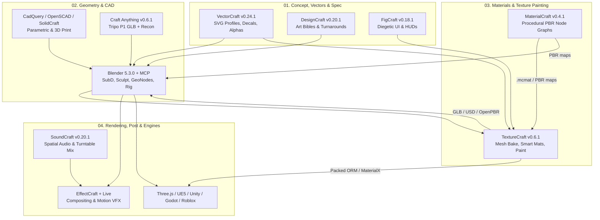

# 3D Master Vault

The complete **multi-style 3D creation, procedural material, texture painting, shader, CAD, and game/web pipeline operating system** for humans and autonomous AI agents.

> [!TIP]
> **AI Agents:** Start at [[AGENTS]] — that is the operating contract and progressive-disclosure router.
> **Visual Navigators:** Open [[3D Master Pipeline.canvas]], [[Art Styles & Engines Map.canvas]], [[Art Styles Matrix.base]], [[MCP & Skills Registry.base]], or [[Vault Index.base]].

---

## Master Production Ecosystem (Installed & Live)

---

## Interactive Vault Views (Obsidian Native Features)

| View | Purpose | Link |
|---|---|---|
| **Master Pipeline Canvas** | Visual node-flow blueprint from concept to engine delivery | [[3D Master Pipeline.canvas]] |
| **Art Styles Map Canvas** | Visual clustering of all 24 3D art styles by visual family | [[Art Styles & Engines Map.canvas]] |
| **Art Styles Matrix (Base)** | Filter all 24 styles by PBR/NPR, engine, poly budget, ArtCraft tools | [[Art Styles Matrix.base]] |
| **MCP & Skills Registry (Base)** | Search installed MCPs & 25+ vendored GitHub 3D skill suites | [[MCP & Skills Registry.base]] |
| **Vault Index (Base)** | Every note in the vault grouped by discipline with word counts | [[Vault Index.base]] |

---

## Complete Vault Map

### Contract & Quick Start
- [[AGENTS]] — **AI Operating Contract, 22 Hard Laws & Progressive Disclosure Router**
- [[01 Quick Reference]] — One-page copy-paste formulas, Blender 5.3 gotchas, PBR IOR/roughness tables, CLI commands
- [[Inbox]] — Quick capture queue (`00 Inbox/`)

### 10 Foundations & Geometry
- [[Topology & Edge Flow Mastery]] — Quads, poles, holding edges, deformation loops, manifold rules
- [[UV Unwrapping, Texel Density & UDIMs]] — Seam placement, padding, UDIM layouts, TextureCraft UV checks
- [[Scale, Units, Coordinate Systems & Pivots]] — Metric scale, Z-up vs Y-up matrices, pivot rules
- [[Hard-Surface & SubD Modeling Playbook]] — Booleans, weighted normals, bevel stacks, VectorCraft SVG extrusion
- [[Organic Sculpting, Retopology & Anatomy]] — Blockout → Voxel Remesh → Multires → Retopo → Bake
- [[Procedural Modeling & Geometry Nodes (Blender 5.3)]] — Parametric networks, scattering, procedural architecture
- [[Parametric CAD & 3D Printing (OpenSCAD, CadQuery, SolidCraft)]] — Tolerance engineering, overhangs, STEP/STL

### 20 Art Styles Encyclopedia (24 Complete Styles)
- [[00 Art Style Selection Guide]] — Master decision matrix & style mixing rules

| Photoreal & Cinematic | Stylized & Hand-Crafted | NPR, Anime & Retro | Worlds, Tactile & Technical |
|---|---|---|---|
| [[Style 01 — Photorealistic Physically-Based (ArchViz & Product)]] | [[Style 03 — Stylized PBR (Pixar - Disney - Overwatch - Fortnite)]] | [[Style 06 — Anime & Cel-Shaded NPR (Guilty Gear - Genshin - Ghibli)]] | [[Style 14 — Cyberpunk, Neon Noir & Holographic Sci-Fi]] |
| [[Style 02 — Cinematic VFX & Film Realism (ACES - AgX)]] | [[Style 04 — Hand-Painted Diffuse (Arcane - Riot - World of Warcraft)]] | [[Style 07 — 2D-in-3D Grease Pencil & Comic Ink (Ligne Claire - Manga)]] | [[Style 15 — Brutalist, Industrial Hard-Surface & Mecha]] |
| [[Style 19 — Botanical, Nature, Terrain & Biomes (Foliage - Water - Clouds)]] | [[Style 05 — Painterly Brushstroke & Spider-Verse (Halftones - Stepped Anim)]] | [[Style 10 — Low-Poly Flat-Shaded & Faceted (Monument Valley - Firewatch)]] | [[Style 16 — Dark Fantasy, Gothic & Soulsborne Atmospheric]] |
| [[Style 23 — Ceramic, Glass, Jewelry & Caustics Macro]] | [[Style 08 — Isometric Diorama & Cozy Miniature (Tilt-Shift - Clay)]] | [[Style 11 — PS1 - PS2 - N64 Retro & Vertex-Snapped Lo-Fi]] | [[Style 17 — Surreal, Liminal Space & Dreamcore]] |
| [[Style 20 — Miniature Tabletop, Kitbash & Toy Photography (Vinyl - Resin - LEGO)]] | [[Style 09 — Claymation, Stop-Motion & Plasticine (Thumbprints - SSS)]] | [[Style 12 — Voxel, Blocky & Minecraft - Blockbench Style]] | [[Style 18 — Abstract Motion Graphics, Glassmorphism & Iridescent (Cinema4D - Awwwards)]] |
| [[Style 22 — Plush, Fabric, Knitwear & Woolly Tactile 3D]] | [[Style 13 — Roblox Stylized, Stud & UGC Accessory Pipeline]] | [[Style 24 — Pixel-Art 3D (Dithered Orthographic Sprites & 2.5D HD-2D)]] | [[Style 21 — Technical Blueprint, Wireframe, X-Ray & Exploded CAD]] |

### 30 Materials, Textures & Shaders
- [[PBR Physics Reference (Albedo, Metallic, Roughness, IOR, SSS)]]
- [[MaterialCraft Mastery — Node Library & Procedural Graphs]]
- [[TextureCraft Mastery — Baking, Smart Materials & 3D Painting]]
- [[Blender 5.3 Shader Nodes & NPR Shading Recipes]]
- [[GLSL, WGSL & Three.js TSL Custom Shaders]]
- [[MaterialCraft-to-TextureCraft-to-Blender-to-Engine Bridge]]

### 40 Lighting, Cameras & Rendering
- [[Lighting Design & Three-Point to Atmospheric Cinema]]
- [[Color Management (AgX, Filmic, ACES) & Compositing]]
- [[Camera Lenses, Framing, Turntables & Product Shots]]
- [[Blender 5.3 Cycles vs EEVEE Next Optimization]]

### 50 Rigging, Animation & Simulation
- [[Character Rigging, Armatures & Weight Painting]]
- [[Animation Principles, Keyframes, NLA & Camera Motion]]
- [[Physics Simulations (Cloth, Rigid Body, Hair, Fluid, Smoke)]]
- [[Roblox R6-R15, Mixamo & Game-Ready Skeletal Export]]

### 60 Engines, Web 3D & Delivery
- [[glTF - GLB & USD Export Pipeline (Zero-Defect Rules)]]
- [[Three.js Complete Master Guide — Scenes, Loaders, Post-Processing & MCP]] — **Three.js r187 + `threejs-devtools` MCP (69 live tools)**
- [[Three.js + Blender 5.3 Live Parity & Asset Handoff]] — Exact `AgX`, FOV, Principled→Physical & NLA parity
- [[Three.js 2D-in-3D Toon, InkPass & Low-Poly Shorts Engine]] — `InkPass`, `NOINK = 3`, `shade()`, `KAZ` cameras
- [[Three.js, React Three Fiber & WebGPU Production]]
- [[Shortmaking Vault Bridge (Viral Animated Shorts Pipeline)]] — **Live Cross-Vault Bridge to `shortmaking` (`vault: "shortmaking"`)**
- [[Unreal Engine 5, Unity & Godot 4 Import Specs]]
- [[Roblox Studio 3D Pipeline (Ropilot + ForgeGUI + Blender)]]
- [[3D Printing & Fabrication Export (STL, 3MF, STEP)]]
- [[AI 3D Generation & Hybrid Workflows (Meshy, Tripo, Rodin, Hunyuan3D, Gaussian Splatting)]]

### 70 Craft Floor & Autonomous QA
- [[Craft Floor — Non-Negotiable 3D Quality Gates]]
- [[The Visual Critic & Cook Loop for 3D Assets]]
- [[Anti-Patterns — What Screams AI-Generated 3D Slop]]
- [[Automated Mesh & GLB QA Gate (mesh_qa.py)]]

### 80 Tools & MCPs
- [[ArtCraft Full Suite MCP Guide (MaterialCraft, TextureCraft, VectorCraft, EffectCraft, DesignCraft, FigCraft, SoundCraft, Craft Anything)]]
- [[3D MCP Ecosystem & Setup Guide (Blender, CAD, Game Engines, AI Gen, Assets)]]
- [[GitHub 3D Modeling Skills Index]] — **25+ Top-Starred Repos, 580+ `SKILL.md` Files Vendored Locally**
- [[Blender 5.3 API & Headless Scripting Reference]]
- [[Obsidian Agent Mastery — Using Every Vault Feature]]

### 90 Templates
- [[3D Asset Brief]] · [[Scene Production Brief]] · [[Art Style Study Template]] · [[Material Graph Recipe Template]] · [[QA Critique Report Template]]

---

## Local Environment Status

| Component | Version / Path | MCP Registered |
|---|---|---|
| **Blender** | `5.3.0` (`C:\Program Files\Blender Foundation\Blender 5.3\blender.exe`) | `blender` (`mcp-for-blender`) |
| **MaterialCraft** | `0.4.1` (`materialcraft-cli.exe` — 20 MCP tools, 29 atomic nodes) | `materialcraft` + `materialcraft-live` (:7878) |
| **TextureCraft** | `0.6.1` (`texturecraft-cli.exe` — 22 MCP tools, 177 commands) | `texturecraft` + `texturecraft-live` (:7879) |
| **VectorCraft** | `0.24.1` (`vectorcraft-cli.exe` — 33 MCP tools) | `vectorcraft` + `vectorcraft-live` (:7979) |
| **EffectCraft** | Installed (`effectcraft-cli.exe`) | `effectcraft` + `effectcraft-live` (:9877) |
| **DesignCraft** | `0.20.1` (`designcraft-cli.exe` — 26 MCP tools) | `designcraft` |
| **FigCraft** | `0.18.1` (`figcraft-cli.exe` — 19 MCP tools) | `figcraft` |
| **SoundCraft** | `0.20.1` (`soundcraft-cli.exe` — 17 MCP tools) | `soundcraft` |
| **Craft Anything** | `0.6.1` (`craft-anything-cli.exe` — 39 core / 323 full tools) | `craft-anything` |
| **Three.js DevTools MCP** | `0.5.0` (`npx -y threejs-devtools-mcp` — **69 live tools**) | `threejs-devtools` |
| **Obsidian Connected Vaults** | `3d-master` · `shortmaking` · `roblox-ui` · `awwwards` · `master` | `obsidian` |
| **Vendored GitHub Skills** | 26 repositories (`580 SKILL.md`, `2,297 .md` docs) | Local in `80 Tools & MCPs/skills/` |
