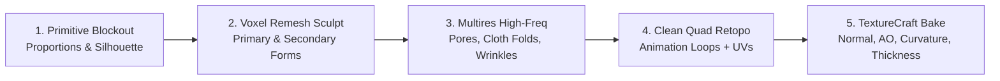

# Organic Sculpting, Retopology & Anatomy

End-to-end production pipeline for characters, creatures, statues, stylized figures, rocks, trees, and organic props.

---

## 1. The 5-Stage Organic Pipeline

1. **Stage 1 — Blockout (Metaballs / SubD Primitives):**
   - Establish anatomical landmarks first (cranial mass, ribcage egg, pelvis block, joint spheres, major limb cylinders).
   - Judge silhouette in **pure black flat shading** from front, side, and 3/4 before merging anything.
2. **Stage 2 — Voxel Remesh (`0.02 m → 0.005 m`):**
   - Join primitives, apply `Remesh (Voxel)` progressively. Sculpt primary planes first (never zoom in to pores while silhouette is muddy!).
3. **Stage 3 — Multiresolution Detail (`Subdiv 3–5`):**
   - Carve secondary/tertiary creases, muscle insertions, fabric tension folds, alphas/stamps.
4. **Stage 4 — Retopology & UVs:**
   - Rebuild clean, low/mid-poly all-quad mesh snapped via `Shrinkwrap` modifier (`wrap_method = 'PROJECT'` / `'NEAREST_SURFACEPOINT'`).
   - Follow concentric deformation loops around eyes, mouth, shoulders, elbows, knees.
5. **Stage 5 — High-to-Low Bake in TextureCraft:**
   - Export `asset_low.glb` (clean UVs) and `asset_high.glb` (decimated high-res sculpt, `500k–2M` tris).
   - In TextureCraft MCP: `mesh_import` low-poly → `bake_mesh_add` high-poly → `bake` (`normal`, `ambientOcclusion`, `curvature`, `thickness`, `position`) with matching suffixes (`_low` / `_high`).

---

## 2. Single-Image Measured Sculpting (`image-to-sculpt` Skill)

We vendored **`gokayfem/image-to-sculpt`** (`80 Tools & MCPs/skills/image-to-sculpt/SKILL.md`) for turning a single reference photo into a geometrically measured 3D sculpt:
- Register orthographic/perspective camera views against the reference image.
- Run iterative silhouette + depth/normal map-fitting passes.
- Replay deterministic Blender sculpt/displacement passes and verify against the reference photo.

---

## 3. Anatomy & Stylization Ratios

| Archetype | Head-to-Body Ratio | Silhouette Strategy |
|---|---|---|
| **Realistic Adult** | `7.5–8.0` heads | Subtle bony landmarks (clavicle, patella, malleoli, zygomatic arch) |
| **Heroic / Comic / AAA** | `8.5–9.0` heads | Broadened deltoids, tapered waist, heroic S-curve spine |
| **Stylized PBR (Pixar / Overwatch)** | `5.5–7.0` heads | Straight-against-curve limb contrasts, oversized expressive hands/eyes |
| **Chibi / Cozy / Vinyl Toy** | `2.0–3.5` heads | Massive head silhouette, simplified tapered stubs, thick soft bevels |

## Related Notes
- [[Topology & Edge Flow Mastery]]
- [[TextureCraft Mastery — Baking, Smart Materials & 3D Painting]]
- [[Character Rigging, Armatures & Weight Painting]]
- [[Style 03 — Stylized PBR (Pixar - Disney - Overwatch - Fortnite)]]
