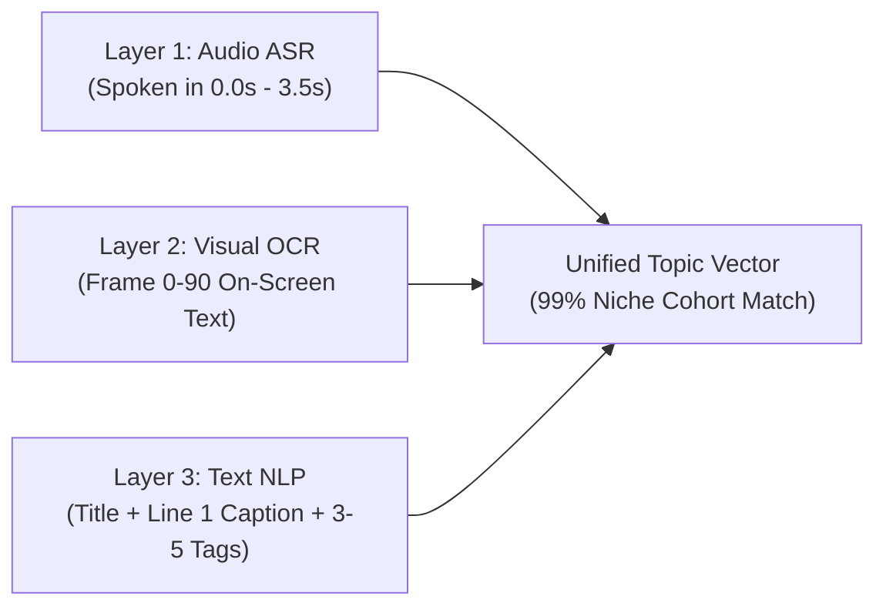

# 20 Description, Hashtag & SEO Optimization Bible

← Back to [[00 Social Publishing Home]] | [[00 Home|Shortmaking Studio Home]]

In 2026, social media algorithms do **not** rely on hashtags alone to figure out what your video is about. Every major platform (YouTube, TikTok, Instagram, Facebook, X, LinkedIn) runs a **Multimodal Classifier** across your video within minutes of upload.

> [!IMPORTANT] Standing Delivery Rule (Always Generate Title, Description & Hashtags)
> Whenever a video is completed, **ALWAYS generate and output a ready-to-paste Title, Description, and Hashtags** directly in chat AND save it into `upload.md`, `50 Upload Packages/`, and `scripts/omnichannel_manifest.json`. Never deliver a finished `.mp4` without copy-paste metadata.

---

## 1. The Universal 3-Layer Multimodal SEO Law

For the recommendation engine to lock onto the exact right initial seed cohort (`1,000–5,000` viewers who actively watch your niche), your **Primary Topic Entity** (e.g., `"Great Emu War"`, `"Surviving on Mars"`, `"Broughton Bridge Collapse"`) must align across all **3 layers simultaneously**:



| Layer | What the Platform Scans | Mandatory Engineering Rule |
| :--- | :--- | :--- |
| **Layer 1: Audio ASR** | Whisper-class automatic speech recognition of your audio track | **Speak the primary noun/entity in Sentence 1 (`t = 0.06s – 3.5s`)**. Never open with vague pronouns (*"They never expected this to happen…"*). Say the entity explicitly (*"In 1932, Australia sent soldiers…"*). |
| **Layer 2: Visual OCR** | Vision-transformer optical character recognition of video frames | **Display the topic keyword in Frame 0 (`KAZ` HUD card, Orbit title pill, or burned-in caption)** inside the safe zone (`y = 220 – 1380 px`). |
| **Layer 3: Metadata NLP** | Semantic embedding of Title, Description Line 1, and Hashtags | **Place the exact search phrase in the first `60 characters` of the Title AND the first `120 characters` of the Description/Caption**. |

---

## 2. Master Hashtag Optimization Matrix (All Platforms)

Using the wrong number or type of hashtags triggers spam heuristics or dilutes your initial test cohort:

| Platform | Optimal Count | Hard / Penalty Ceiling | Placement | Exact Formula | What to NEVER Do |
| :--- | :---: | :---: | :--- | :--- | :--- |
| **YouTube Shorts** | **`3 – 5`** | **`15`** (`>15` = YouTube ignores **all** hashtags on the video!) | Bottom of Description (optional `#Shorts` at end of Title) | `1 Format (#Shorts) + 1 Broad (#History) + 2Entity (#EmuWar #Australia) + 1 Niche (#AnimatedHistory)` | Never paste 20+ tags; never put hashtags at the start of the title. |
| **YouTube Long-Form (`16:9`)** | **`3`** | **`15`** | Very bottom of Description (renders above video title) | `1 Primary Entity (#Mars) + 1 Category (#Space) + 1 Sub-Niche (#Astronomy)` | Never include `#Shorts` on a `16:9` or `>3m` video. |
| **TikTok** | **`3 – 5`** | No hard cap, but `>6` dilutes topic vector | End of Caption | `2 Search-Intent (#emuwar #weirdhistory) + 2 Category (#historyfacts #animatedhistory) + 1 Community (#learntok)` | Never use only `#fyp #foryou #viral` (zero niche signal = random low-retention test pool). |
| **Instagram Reels** | **`3 – 5`** | **Official `5-tag` effective cap** (`30` technical max) | Bottom of Caption (never in comments—comment tags don't index for Search!) | `1 Entity (#emuwar) + 2 Niche (#historyanimation #weirdhistory) + 1 Format (#animatedshorts)` | Never paste a stale block of 30 copy-pasted hashtags across every Reel. |
| **Facebook Reels** | **`3 – 5`** | `>8` looks spammy | End of 1–2 line Caption | `1 Broad (#History) + 2 Specific (#EmuWar #HistoryFacts) + 1 Format (#Reels)` | Never put outbound URLs next to hashtags in the main caption. |
| **X (Twitter)** | **`0 – 1`** | `>2` triggers spam/bot score penalties | Inline or end of post (0 tags is often best) | Use natural plain-text keywords (`Great Emu War`, `Mars`) instead of `#` tags | Never post `#Shorts #Viral #Trending` on X—instant credibility and reach drop. |
| **LinkedIn** | **`3`** | `>5` | Bottom of post after a blank line | `1 Industry (#Engineering) + 1 Domain (#Science) + 1 Topic (#SpaceExploration)` | Never put hashtags in the first 3 lines (wastes the `"…see more"` fold). |
| **Reddit / Pinterest** | **`0`** | `0` | None | Use exact keywords in the Post Title & Description | Reddit users downvote hashtags immediately; Pinterest deprecated hashtag priority. |

---

## 3. Copy-Paste Description Templates by Track / Niche

### Template A: History / Military / Bizarre True Story (`cartoon-3d-short`, `cartoon-audio-short`, `make-3d-video`)
```text
[1-SENTENCE PARADOX HOOK WITH PRIMARY ENTITY + YEAR]
In [YEAR], [COUNTRY/PERSON] tried to [ABSURD ACTION] — and [UNEXPECTED OUTCOME].

[3-SENTENCE ENTITY-RICH MECHANISM SUMMARY]
When [INCITING INCIDENT], [PROtagonist/GROUP] deployed [SPECIFIC TOOL/WEAPON/PLAN]. Instead of working as planned, [THE "LUCKILY / UNLUCKILY" REVERSAL & "YOU SEE" PHYSICAL MECHANISM]. By the time it ended, [FINAL HISTORICAL RECEIPT / TWIST].

Subscribe to @[HANDLE] for weekly animated history, science & bizarre true stories!

Sources: [PRIMARY ARCHIVE 1], [PRIMARY ARCHIVE 2]

#Shorts #History #[SpecificEventTag] #AnimatedHistory #WeirdHistory
```

### Template B: Space Survival & Cosmic Explainer (`orbit-space-video` / `make-3d-video`)
```text
[1-SENTENCE SENSORY PARADOX HOOK]
[PLANET/PLACE] looks like [HARMLESS COMPARISON] — until [EXTREME PHYSICAL NUMBER] causes [BODILY/PHYSICAL CONSEQUENCE].

[3-SENTENCE SCIENTIFIC COUNTDOWN + KEYWORDS]
Here is the exact physical countdown of what kills you first on [PLANET/OBJECT] — from [HAZARD 1 + EXACT UNIT], to [HAZARD 2], [HAZARD 3], and [FINAL COSMIC IRONY]. Every measurement is verified against NASA, JPL, and ESA mission data.

Subscribe to @[HANDLE] for weekly space survival & cosmic scale explainers!

Science & Mission Credits:
• [INSTRUMENT / MISSION 1] — [AGENCY]
• [INSTRUMENT / MISSION 2] — [AGENCY]

#Shorts #Space #[PlanetTag] #Science #Astronomy #NASA
```

---

## 4. Pinned Comment Engineering (The `120%+` APV Dwell-Time Multiplier)

Why does the **First / Pinned Comment** matter so much on YouTube Shorts, TikTok, Instagram Reels, and X?
- When a viewer opens the comment section to read or type a reply, **the video continues looping in the background**.
- Spending `20 seconds` reading comments on a `45-second` Short adds **`+44%` Average Percentage Viewed (APV)** from that viewer alone!

### The 3 Proven Pinned Comment Formulas
1. **The "A vs. B" Bet Question** *(Proven on [[Emu War (1932) - Completed Video]])*:
   - *"Would you bet on two Lewis machine guns or 20,000 birds running 50 km/h? 👇"*
2. **The "Which Surprised You Most?" Binary Choice** *(Proven on [[Mars - What Would Kill You First (Completed Video)]])*:
   - *"Which Martian hazard surprised you most — saliva boiling at 37°C or the 22-minute radio delay? 🔴"*
3. **The "Spot the Frame Detail" Rewatch Trigger**:
   - *"Did anyone else catch what was written on the clipboard at 0:34? 👀"* (Forces viewers to close comments and rewatch `0:30–0:36`!).

---

## 5. Ready-to-Deploy Omnichannel Packages for Completed Vault Videos

### Package 1: `The Great Emu War (1932)` (`videos/emu-war/out/emu-war.mp4`)
- **Full Vault Note**: [[50 Upload Packages/Upload Package - Emu War (1932)]] | [[Emu War (1932) - Completed Video]]

| Platform | Optimized Title / Caption | Hashtags | First / Pinned Comment |
| :--- | :--- | :--- | :--- |
| **YouTube Shorts** | **Title (`41 chars`)**: `How Australia Lost a War to 20,000 Emus 😭`<br>**Desc**: In 1932, Australia sent soldiers with machine guns into a war against birds — and lost. When 20,000 emus stormed Western Australian wheat farms, Major Meredith deployed two Lewis machine guns and 10,000 rounds… | `#Shorts #History #EmuWar #AnimatedHistory #HistoryFacts` | `Would you bet on two Lewis machine guns or 20,000 birds running 50 km/h? 👇` |
| **TikTok** | In 1932, the Australian Army went to war against 20,000 emus armed with Lewis machine guns — and officially lost 😭🐦 Here is how the Great Emu War actually happened, day by day. | `#emuwar #weirdhistory #historyfacts #animatedhistory #learntok` | `986 rounds fired per bird and the emus still sit on Australia's coat of arms today 💀` |
| **Instagram Reels** | Wait until Day 6 when they mounted the machine gun on a truck… 😭👇<br><br>• Nov 2, 1932: Major Meredith deploys 2 Lewis guns & 10,000 rounds to Campion, WA.<br>• Emus split into small units, post tall lookouts, and sprint at 50 km/h.<br>• Result: Undefeated emus. | `#emuwar #historyanimation #weirdhistory #historyfacts #animatedshorts` | `Who wins a rematch — modern drones or 20,000 emus? 👇` |
| **X (Twitter)** | In 1932, Australia sent soldiers armed with two Lewis machine guns and 10,000 rounds of ammunition to fight 20,000 emus.<br><br>After 6 days of jammed guns, guerrilla bird tactics, and a crashed truck… the army withdrew in defeat: | *(0 hashtags)* | `Full HD breakdown + primary sources on YouTube: https://youtube.com/@Warp_Scale` |

### Package 2: `What Would Kill You First On Mars?` (`videos/mars-orbit/out/mars_final.mp4`)
- **Full Vault Note**: [[50 Upload Packages/Upload Package - Mars What Would Kill You First]] | [[Mars - What Would Kill You First (Completed Video)]]

| Platform | Optimized Title / Caption | Hashtags | First / Pinned Comment |
| :--- | :--- | :--- | :--- |
| **YouTube (`16:9` & Shorts)** | **Title (`45 chars`)**: `What Would Actually Kill You First on Mars?`<br>**Desc**: Mars looks like a freezing red desert — until the air pressure drops below 1% of Earth's and the water on your tongue starts to boil at body temperature… | `#Mars #Space #Astronomy` *(16:9)* / `#Shorts #Mars #Space #Science #NASA` *(9:16)* | `Which Martian hazard surprised you most — boiling saliva at 37°C or the 22-minute signal delay? 🔴` |
| **TikTok** | What would actually kill you first if you stepped onto Mars without a spacesuit? 🚀 It isn't the -60°C cold — it's the 6 millibars of atmospheric pressure boiling the saliva on your tongue at 37°C. | `#marssurvival #planetmars #spacefacts #astronomy #learntok` | `Which planet or moon should we test next — Venus, Titan, or Europa? 👇` |
| **Instagram Reels** | Mars looks like a cold desert… until your tongue starts to fizz at 37°C 🚀👇<br><br>1️⃣ Pressure (0.006 bar): Ebullism boils body surface moisture.<br>2️⃣ Atmosphere: 95% CO₂ suffocation in <2 mins.<br>3️⃣ Dust: Toxic perchlorates (`ClO₄⁻`). | `#planetmars #spaceexploration #astrophysics #spacefacts #orbitoddities` | `Comment "EUROPA" if you want to see what happens under Jupiter's ice crust next 👇` |
| **X (Twitter)** | Mars looks like a cold Utah desert — and deserts don't kill astronauts instantly.<br><br>Until the atmospheric pressure drops to 0.006 bar (below the Armstrong limit) and the water on your tongue begins to boil at normal body temperature.<br><br>The exact physical countdown of what kills you first on Mars: | *(0 hashtags)* | `Verified against NASA Phoenix Lander, Curiosity RAD & JPL mission data. Watch in full 1080p on YouTube: https://youtube.com/@OrbitOddities` |
