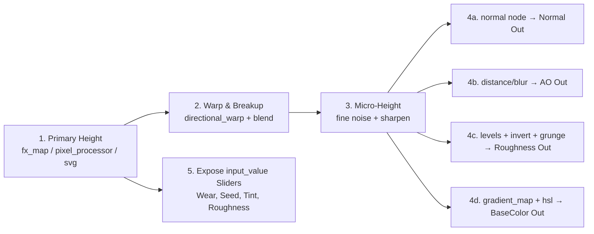

# MaterialCraft Mastery — Node Library & Procedural Graphs

**MaterialCraft v0.4.1** (`storytold/materialcraft`, pure Rust) is your agent-native procedural PBR material designer (clean-room Substance Designer equivalent). It natively reads/writes **`.sbs` / `.mcraft`** packages, cooks on parallel CPU cores with content-addressed caching, renders headless beauty previews (`material_ball`, `rounded_cube`, `sphere`, `cylinder`, `plane`, `torus`), and exports **`.mcmat`** portable materials directly into **TextureCraft**!

---

## 1. Registered MCP Servers & Paths

- **Binary:** `C:\Program Files\MaterialCraft\materialcraft-cli.exe` (GUI: `materialcraft.exe`)
- **Headless MCP:** `materialcraft` (`--read-root C:\Users\AFADAZIO --write-root C:\Users\AFADAZIO`)
- **Live Bridge MCP:** `materialcraft-live` (`--bridge 7878` → launch GUI with `materialcraft.exe --control 7878`)
- **Full machine-readable dumps in vault:**
  - `80 Tools & MCPs/artcraft-catalog/materialcraft-mcp-tools.json` (20 MCP tools)
  - `80 Tools & MCPs/artcraft-catalog/materialcraft-nodes.json` & `materialcraft-library.json` (29 atomic nodes + graph items)
  - `80 Tools & MCPs/artcraft-catalog/materialcraft-commands.json`

---

## 2. All 20 Live MCP Tools (Verified)

| Category | Tools |
|---|---|
| **Package & Graph** | `package_open`, `package_save`, `graph_new`, `session_inspect`, `library_list` |
| **Node Authoring** | `node_add`, `node_connect`, `node_param`, `bitmap_import` |
| **Batch & Commands** | `command_list`, `command_run`, `command_batch` |
| **Rendering & Export** | `view_render` (headless 2D node or 3D material ball PNG!), `material_export` (`.mcmat` for TextureCraft!), `outputs_export` (full PBR PNG/EXR/TIFF maps) |
| **Live GUI Bridge** | `ui_inspect`, `ui_input`, `ui_menu_invoke`, `ui_screenshot`, `view_screenshot` |

---

## 3. Verified Atomic Node Library (29 Nodes)

### Generators & Sources
- `uniform` — Constant color or grayscale value
- `bitmap` — Imported image texture (`bitmap_import`)
- `svg` — Procedural vector graphic rasterizer (pair with **VectorCraft**!)
- `text` — Procedural typography/stencils/serial numbers
- `fx_map` — Iterative quadrant/splatter/tile/noise fractal engine (bricks, pebbles, wood rings, woven cloth, organic cells!)
- `pixel_processor` — Per-pixel mathematical shader expression node (custom procedural noises, Voronoi, Perlin, SDFs, patterns!)
- `value_processor` — Scalar/vector parameter expression evaluator

### Filtering, Height & Warping
- `blend` — Multi-mode compositing (`Copy`, `Add`, `Sub`, `Multiply`, `Screen`, `Overlay`, `Max`, `Min`, `Switch`) with opacity mask
- `levels` / `curve` — Contrast, histogram tightening, height shaping
- `blur` / `directional_blur` / `sharpen` — Multi-scale height softening & directional grain (brushed metal, wood fibers!)
- `warp` / `directional_warp` — Break up CG perfection with organic distortion & height-guided flow
- `distance` — Euclidean Voronoi / beveled cell propagation (cracked mud, stone tiles, scales!)
- `emboss` — Directional bevel shading
- `transformation` — 2D affine tiling, offset, rotation, quadrant mirror

### Color & PBR Conversion
- `normal` — Sobel/height-to-tangent-space Normal map generator
- `gradient_map` / `gradient_dynamic` — Remap grayscale height/noise to multi-stop Albedo color ramps
- `grayscale_conversion` — Luminance/channel extraction
- `hsl` — Hue/Saturation/Lightness tuning
- `channels_shuffle` — Pack ORM (`R=AO, G=Roughness, B=Metallic`) in a single node!

### Graph I/O Items
- `input_color`, `input_grayscale`, `input_value` (exposed parameters that become live sliders inside **TextureCraft**!)
- `output` (`baseColor`, `normal`, `roughness`, `metallic`, `height`, `ambientOcclusion`, `emissive`)
- `dot` (clean graph routing)

---

## 4. Standard Procedural Material Graph Architecture

Build EVERY procedural material in this exact 5-tier flow (Height-First Methodology):

> [!TIP]
> **Height-First Golden Rule:** Spend 70% of your graph building a rich, multi-frequency **Height** map (macro shapes + medium chips/warps + micro grain). Once Height looks real in `view_render --view 2d`, Normal, AO, Curvature, Roughness, and Base Color all derive coherently from the SAME height foundation!

---

## 5. Agent Workflow Example (MCP + Headless Preview)

1. `graph_new` from `pbr` template (`size: 2048`).
2. `node_add` + `node_connect` + `node_param` (or `command_batch`) to construct height → warp → normal → gradient_map → roughness → outputs.
3. Call `view_render` (`scene: "material_ball"`, `hq: true`) and inspect the PNG visually with `read_file`.
4. Iterate parameters until specular breakup and height relief pass visual critique.
5. Call `material_export` → saves portable `.mcmat` for [[TextureCraft Mastery — Baking, Smart Materials & 3D Painting]] AND `outputs_export` → saves 16-bit PNG/EXR maps for Blender 5.3 / Three.js / UE5.

## Related Notes
- [[TextureCraft Mastery — Baking, Smart Materials & 3D Painting]]
- [[MaterialCraft-to-TextureCraft-to-Blender-to-Engine Bridge]]
- [[PBR Physics Reference (Albedo, Metallic, Roughness, IOR, SSS)]]
- [[Material Graph Recipe Template]]
