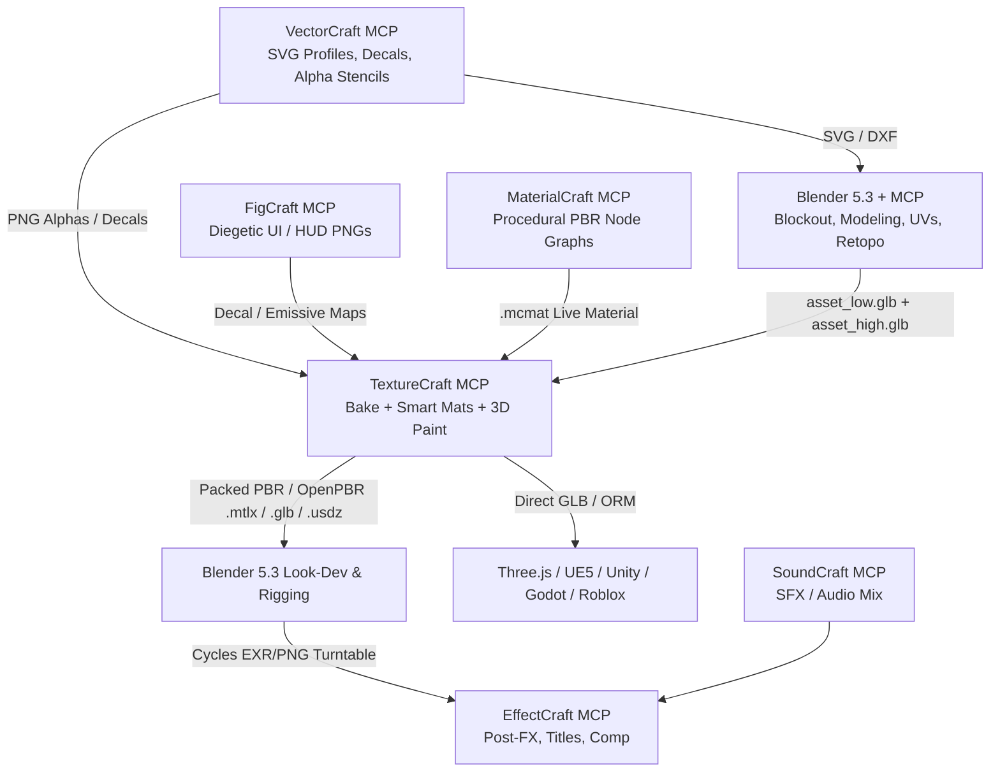

# MaterialCraft → TextureCraft → Blender → Engine Bridge

This is the **flagship end-to-end ArtCraft + Blender 5.3 pipeline** that connects every installed MCP on your machine into a single seamless, zero-friction loop.

---

## 1. Visual Data Flow

---

## 2. Exact Hand-Off Formats & Contracts

| Hand-Off | Format | Critical Settings |
|---|---|---|
| **VectorCraft → Blender** | `.svg` (`--outline-text --decimals 4`) | Convert curve to mesh, merge vertices, apply scale |
| **VectorCraft / FigCraft → TextureCraft** | `.png` (16-bit transparent) | Import via `resource_import`, apply via `layer.add.decal` or `tool.brush { alpha: { image } }` |
| **Blender → TextureCraft (Low Poly)** | `.glb` (`export_yup=True`, `export_apply=True`) | Clean non-overlapping UVs inside `[0,1]` (or UDIMs), one material per texture set |
| **Blender → TextureCraft (High Poly)** | `.glb` or `.fbx` | Same world position & metric scale as low-poly; match `_high` / `_low` naming |
| **MaterialCraft → TextureCraft** | `.mcmat` (`material_export`) | Preserves exposed `input_value` / `input_color` sliders so TextureCraft re-cooks live with `material.link.set`! |
| **TextureCraft → Blender 5.3** | `.glb` (`mesh_export`) OR `OpenPBR` `.mtlx` + 16-bit PNGs | `normalFormat: "openGl"`, `colorSpace: "sRGB"` (or `ACEScg` for EXR film), `padding: "dilation"` |
| **TextureCraft → Unreal Engine 5** | Packed ORM PNG + DirectX Normal | `normalFormat: "directX"`, `R=AO, G=Rough, B=Metal` (disable sRGB on ORM in UE5!) |
| **TextureCraft → Three.js / Godot** | `.glb` (`mesh_export`) | glTF ORM auto-packed (`openGl` normals), compress textures to WebP/KTX2 for web |
| **TextureCraft → Roblox Studio** | 4 separate PNGs (`1024×1024`) | `ColorMap`, `MetalnessMap`, `NormalMap` (`openGl`), `RoughnessMap` → `SurfaceAppearance` |

---

## 3. Common Pipeline Pitfalls (and Instant Fixes)

1. **Inverted bumps / inside-out lighting in UE5 vs Blender:** Normal map green channel flipped (`OpenGL` vs `DirectX`). Fix at export via `file.exportTextures { "normalFormat": "directX" }` (UE5) or `"openGl"` (Blender/Three.js/Godot/Roblox).
2. **Dark seams along UV borders in Three.js:** Missing UV dilation padding. Fix via `padding: "dilation"` or `"infinite"` in TextureCraft export.
3. **MaterialCraft material looks stretched on curved mesh in TextureCraft:** Switch layer projection from `uv` to `triplanar` (`layer.fill.projection { "projection": "triplanar", "sharpness": 12 }`).
4. **Painted strokes lost after tweaking mesh topology in Blender:** Re-export updated mesh and run `mesh_reimport { "preserveStrokes": true }` in TextureCraft — it re-projects all strokes onto the updated surface!

## Related Notes
- [[ArtCraft Full Suite MCP Guide (MaterialCraft, TextureCraft, VectorCraft, EffectCraft, DesignCraft, FigCraft, SoundCraft, Craft Anything)]]
- [[glTF - GLB & USD Export Pipeline (Zero-Defect Rules)]]
- [[3D Master Pipeline.canvas]]
