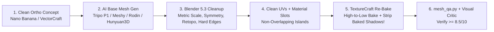

# AI 3D Generation & Hybrid Workflows (Tripo, Meshy, Rodin, Hunyuan3D, Gaussian Splatting)

> [!IMPORTANT]
> **Law #20:** Raw AI-generated 3D meshes are **base clay**, never final production assets. The studio advantage comes from combining **AI 3D speed for complex organic/prop base meshes** with **Blender 5.3 cleanup + MaterialCraft/TextureCraft relighting & PBR mastery**!

---

## 1. Installed AI 3D Tools Ready Right Now
- **`craft-anything` MCP (`assets_model_generate`):** Generates game-ready low-poly `.glb` models directly via **Tripo P1** (`fal.ai`) from text or reference image! Also includes `assets_image_generate` (**Nano Banana Pro**) for concept turnarounds and textures!
- **`blender` MCP (`generate_3d` / `generate_gaussian_world` / `search_assets` / `import_asset`):** Directly generates 3D assets, Gaussian Splatting worlds, and imports Poly Haven / Sketchfab assets straight into Blender!
- **`scenario-labs-3d-skills` (vendored, ★3,929):** Multi-model routing, cost estimation, and consistent character/asset pipelines.
- **`forge3d-multi-engine` (vendored):** Unified routing across Meshy, Tripo, Rodin, OpenSCAD, CadQuery, and Blender!

---

## 2. The 6-Step AI-to-Production Cleanup Pipeline

### Why Step 5 (Delighting & Re-Texturing in TextureCraft) Is Non-Negotiable
AI 3D generators bake ugly dark lighting/specular highlights directly into the Albedo texture and output muddy `Roughness = 0.8` everywhere!
1. Import raw AI GLB as the **High-Poly** mesh in Blender/TextureCraft (or re-bake onto a clean retopologized low-poly mesh).
2. In **TextureCraft**, bake fresh clean `Normal`, `AO`, `Curvature`, `Position` maps.
3. Replace muddy AI albedo/roughness with crisp **MaterialCraft `.mcmat`** layers + smart masks so the asset responds authentically to dynamic lighting in Cycles, Three.js, UE5, or Roblox!

---

## 3. 3D Gaussian Splatting (3DGS) Workflows
- Best for **photorealistic scanned environments, real-world products, and cinematic backdrops** (`blender` MCP `generate_gaussian_world`, `openreality-mcp` phone-video-to-3D).
- Note: Gaussian Splats (`.ply` / `.splat` / `.spz`) do NOT natively deform with armatures or cast standard mesh physics colliders — pair a Gaussian Splat background with clean proxy collision meshes + traditional hero PBR meshes in the foreground!

## Related Notes
- [[Craft Floor — Non-Negotiable 3D Quality Gates]]
- [[Anti-Patterns — What Screams AI-Generated 3D Slop]]
- [[TextureCraft Mastery — Baking, Smart Materials & 3D Painting]]
- [[3D MCP Ecosystem & Setup Guide (Blender, CAD, Game Engines, AI Gen, Assets)]]
