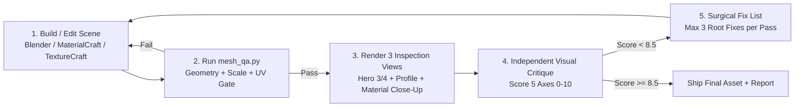

# The Visual Critic & Cook Loop for 3D Assets

Inspired by **`achimala/dream-loop`** (★2,450, vendored in `80 Tools & MCPs/skills/dream-loop-blender-critic/`) and **Cook** (build → judge → refine loop with independent critics).

> [!IMPORTANT]
> **Never grade your own 3D geometry purely by reading Python code.** Code that looks mathematically clean routinely produces inside-out caps, colliding handles, dark lighting, or awkward proportions. **Render → Inspect → Score → Fix → Re-Render** until `≥ 8.5 / 10`.

---

## 1. The 5-Step Autonomous Visual Cook Loop

---

## 2. The 5-Axis Visual Critic Rubric (Out of 10)

| Axis | Weight | What the Visual Critic Inspects |
|---|---|---|
| **1. Silhouette & Proportions** | `25%` | Immediately recognizable at thumbnail size? Accurate real-world / stylized ratios? Zero floating/clipping parts? |
| **2. Geometry & Edge Craft** | `20%` | Clean bevels catching highlights? Smooth curvature with zero pinching/faceting errors? Solid contact with ground? |
| **3. Materials & Texture Storytelling** | `25%` | Plausible roughness breakup? Edge wear/crevice AO grounding? Sharp UVs with zero stretching or seam scars? |
| **4. Lighting & Exposure** | `15%` | Clear key-to-fill contrast? Rim separation? Proper `AgX` exposure with zero blown-out white clipping or crushed black mud? |
| **5. Style Fidelity & Zero Slop** | `15%` | 100% faithful to the locked `Style XX` note? Zero tells from [[Anti-Patterns — What Screams AI-Generated 3D Slop]]? |

---

## 3. Rules for Running the Loop Effectively
- **Cap iterations at 3–4 focused passes** (Pass 1: silhouette/placement; Pass 2: material/roughness/wear; Pass 3: lighting/framing/polish).
- **Use an independent critic perspective** (or subagent with fresh eyes + [[QA Critique Report Template]]) so the builder doesn't rationalize away obvious defects!
- **Compare against reference:** If the user supplied a reference photo/concept, place rendered stills side-by-side and audit silhouette angles, material sheen, and color palette quantitatively.

## Related Notes
- [[Craft Floor — Non-Negotiable 3D Quality Gates]]
- [[Anti-Patterns — What Screams AI-Generated 3D Slop]]
- [[Automated Mesh & GLB QA Gate (mesh_qa.py)]]
- [[QA Critique Report Template]]
