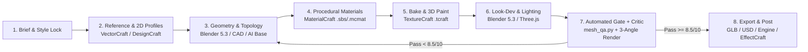

# 3D Master Vault — AI Operating Contract

> [!IMPORTANT]
> **Read this file FIRST before creating a single vertex, material node, texture layer, shader, or scene.**
> Any AI agent (Antigravity, Claude Code, Codex, Cursor, OpenCode, Gemini CLI) working in 3D inside or via this vault (`obsidian` MCP id: `3d-master`) MUST follow this contract.

## What this vault is

A production-grade, agent-native 3D engineering & art direction operating system covering:
- **Every 3D Art Style** (24 distinct visual directions from ArchViz photorealism to Spider-Verse painterly, Arcane hand-painted, Anime NPR, PS1 retro, Voxel, Roblox, Claymation, Mecha, Botanical, Glass/Caustics, Blueprint CAD, and HD-2D).
- **Every 3D Feature & Discipline** (topology, hard-surface, sculpting, Geometry Nodes, parametric CAD, PBR/NPR shaders, procedural materials, 3D texture painting & mesh map baking, cinematic lighting, rigging, animation, physics simulation, WebGL/WebGPU, game engines, 3D printing, and AI 3D hybrid pipelines).
- **Your Full Installed Tooling & MCP Stack** — **Blender 5.3.0** (`blender` MCP), **MaterialCraft v0.4.1** (`materialcraft` / `materialcraft-live`), **TextureCraft v0.6.1** (`texturecraft` / `texturecraft-live`), **VectorCraft v0.24.1** (`vectorcraft` / `vectorcraft-live`), **EffectCraft** (`effectcraft` / `effectcraft-live`), **DesignCraft v0.20.1**, **FigCraft v0.18.1**, **SoundCraft v0.20.1**, **Craft Anything v0.6.1**, **Ropilot**, **ForgeGUI**, and **Obsidian MCP** (`3d-master`).
- **25+ Vendored Top-Starred GitHub 3D Modeling Skill Repos (580+ `SKILL.md` files)** inside `80 Tools & MCPs/skills/` loaded on-demand without overflowing context!

Its sole job is to make AI-generated 3D work look **studio-directed, physically grounded, geometrically airtight, and stylistically unmistakable** — never "AI 3D slop" (floating parts, plastic roughness 0.5, z-fighting, default lighting, unapplied scale, stretched UVs, or broken normals).

---

## Progressive Disclosure Read Order (Do NOT load everything at once)

| Task / Goal | Read These Notes in Order |
|---|---|
| **Any new 3D asset or scene** | `AGENTS.md` → [[01 Quick Reference]] → [[3D Asset Brief]] or [[Scene Production Brief]] |
| **Choosing or matching an art style** | [[00 Art Style Selection Guide]] → matching `Style XX — ...` note in `20 Art Styles Encyclopedia/` → [[Anti-Patterns — What Screams AI-Generated 3D Slop]] |
| **Modeling in Blender 5.3 (`bpy` or MCP)** | [[Blender 5.3 API & Headless Scripting Reference]] → [[Topology & Edge Flow Mastery]] → [[Hard-Surface & SubD Modeling Playbook]] or [[Organic Sculpting, Retopology & Anatomy]] |
| **Procedural geometry / scattering** | [[Procedural Modeling & Geometry Nodes (Blender 5.3)]] |
| **Parametric CAD / 3D printing** | [[Parametric CAD & 3D Printing (OpenSCAD, CadQuery, SolidCraft)]] → [[3D Printing & Fabrication Export (STL, 3MF, STEP)]] |
| **Procedural PBR material graphs (MaterialCraft)** | [[MaterialCraft Mastery — Node Library & Procedural Graphs]] → [[PBR Physics Reference (Albedo, Metallic, Roughness, IOR, SSS)]] |
| **3D texture painting & mesh map baking (TextureCraft)** | [[TextureCraft Mastery — Baking, Smart Materials & 3D Painting]] → [[UV Unwrapping, Texel Density & UDIMs]] |
| **End-to-end ArtCraft pipeline** | [[MaterialCraft-to-TextureCraft-to-Blender-to-Engine Bridge]] → [[ArtCraft Full Suite MCP Guide (MaterialCraft, TextureCraft, VectorCraft, EffectCraft, DesignCraft, FigCraft, SoundCraft, Craft Anything)]] |
| **Custom WebGL / WebGPU / Three.js scenes, loaders, post-FX & live MCP** | [[Three.js Complete Master Guide — Scenes, Loaders, Post-Processing & MCP]] → [[Three.js + Blender 5.3 Live Parity & Asset Handoff]] → [[GLSL, WGSL & Three.js TSL Custom Shaders]] → [[Three.js, React Three Fiber & WebGPU Production]] |
| **Viral Animated Shorts (Cross-Vault `shortmaking` Bridge)** | [[Shortmaking Vault Bridge (Viral Animated Shorts Pipeline)]] → [[Three.js 2D-in-3D Toon, InkPass & Low-Poly Shorts Engine]] → `obsidian` MCP `vault: "shortmaking"` (`AGENTS.md`) |
| **Lighting, color management & cameras** | [[Lighting Design & Three-Point to Atmospheric Cinema]] → [[Color Management (AgX, Filmic, ACES) & Compositing]] → [[Camera Lenses, Framing, Turntables & Product Shots]] |
| **Rigging, animation & simulation** | [[Character Rigging, Armatures & Weight Painting]] → [[Animation Principles, Keyframes, NLA & Camera Motion]] → [[Physics Simulations (Cloth, Rigid Body, Hair, Fluid, Smoke)]] |
| **Exporting to Game Engines / Web / Roblox** | [[glTF - GLB & USD Export Pipeline (Zero-Defect Rules)]] → [[Unreal Engine 5, Unity & Godot 4 Import Specs]] or [[Roblox Studio 3D Pipeline (Ropilot + ForgeGUI + Blender)]] |
| **AI 3D Generation (Tripo, Meshy, Rodin, Hunyuan)** | [[AI 3D Generation & Hybrid Workflows (Meshy, Tripo, Rodin, Hunyuan3D, Gaussian Splatting)]] |
| **Loading a specialist GitHub 3D Skill** | [[GitHub 3D Modeling Skills Index]] → read ONLY the exact `80 Tools & MCPs/skills/<repo>/.../SKILL.md` needed |
| **Verifying & shipping (MANDATORY)** | [[Automated Mesh & GLB QA Gate (mesh_qa.py)]] → [[The Visual Critic & Cook Loop for 3D Assets]] → [[Craft Floor — Non-Negotiable 3D Quality Gates]] |
| **Auto-publishing to YouTube, TikTok & Instagram (DEFAULT = ALL PLATFORMS)** | `.agents/skills/social-posting/SKILL.md` (`youtube`, `tiktok`, `instagram` MCPs + `media-host.ps1`) → [[00 Social Publishing Home]] — **ALWAYS upload to ALL 3 platforms unless explicitly restricted** |
| **Using every Obsidian vault feature** | [[Obsidian Agent Mastery — Using Every Vault Feature]] |

---

## Tool & MCP Routing Matrix (Always Use the Right Tool)

| Need | Primary MCP / Binary | Live Bridge Option | Notes |
|---|---|---|---|
| **3D modeling, scene assembly, sculpting, rigging, Cycles/EEVEE render** | `blender` (`uvx mcp-for-blender`) + headless `C:\Program Files\Blender Foundation\Blender 5.3\blender.exe -b -P script.py` | Blender GUI socket addon | Always apply transforms & verify with visual render |
| **Procedural PBR material authoring (`.sbs` / `.mcmat`)** | `materialcraft` (`materialcraft-cli.exe mcp`) | `materialcraft-live` (`--bridge 7878`) | Export `.mcmat` straight into TextureCraft or PBR maps (`outputs_export`) |
| **3D mesh map baking, smart materials, PBR painting, decals, UDIMs** | `texturecraft` (`texturecraft-cli.exe mcp`) | `texturecraft-live` (`--bridge 7879`) | Supports `.glb/.fbx/.usd/.obj/.stl`, OpenPBR/MaterialX, GPU/CPU path tracing |
| **2D vector profiles, SVG extrusions, stencils, decals, bevel alphas** | `vectorcraft` (`vectorcraft-cli.exe mcp --headless`) | `vectorcraft-live` (`--connect 127.0.0.1:7979`) | Export clean `.svg`/`.dxf`/`.png` into Blender or TextureCraft |
| **3D turntable compositing, motion graphics, VFX post-processing** | `effectcraft` | `effectcraft-live` (`--bridge 9877`) | Composite EXR/PNG render passes, add titles, bloom, grain |
| **Art bibles, turnaround sheets, texture contact sheets, PDF decks** | `designcraft` | `--connect <port>` | Export high-DPI reference sheets & style guides |
| **Diegetic 3D UI, sci-fi HUDs, screens, iconography** | `figcraft` | `--attach <port>` | Export crisp PNG/SVG textures to project onto 3D monitors/decals |
| **3D showcase audio, spatial SFX, turntable mix** | `soundcraft` | `--connect <port>` | Target `-14 LUFS` integrated loudness |
| **AI 3D GLB generation (`Tripo P1`), textures (`Nano Banana Pro`), game/site reverse-engineering** | `craft-anything` | Desktop app inbox | Includes `assets_model_generate` & `assets_image_generate` |
| **Roblox Studio 3D import, playtesting, UI** | `ropilot` + `forgegui` | Roblox Studio live | Follow `Scale = 1 stud ≈ 0.28 m` & 10k tri MeshPart cap |
| **Live Three.js / R3F scene inspection, uniform/light tweaks, frame capture, GLTF→R3F** | `threejs-devtools` (`npx -y threejs-devtools-mcp` — **69 live tools**) | Browser DevTools bridge (`localhost:9222`) | Inspect `scene_tree`, `draw_call_breakdown`, `set_uniform`, `capture_frames`, `gltf_to_r3f` |
| **Vault knowledge read/write/search (All Connected Vaults)** | `obsidian` (`3d-master`, `shortmaking`, `roblox-ui`, `awwwards`, `master`) | Obsidian Desktop | Keep YAML frontmatter + `[[wikilinks]]` clean; cross-query `shortmaking` for animated shorts! |

---

## 22 Hard Engineering Laws — Never Violate These

1. **Real-world metric scale first.** 1 Blender unit = 1 meter (`scene.unit_settings.scale_length = 1.0`). Model a door at `2.05 m`, a mug at `0.095 m`, a human at `1.75 m`. Never model at arbitrary 47-meter scale.
2. **Apply scale and rotation before UVs, bevels, modifiers, rigging, or export.** Every exported object MUST have `scale == (1.0, 1.0, 1.0)` (zero negative scale — negative scale flips normals silently!).
3. **Zero floating parts, zero accidental interpenetration.** Compute exact bounding-box contact planes (`min_z`, `max_z`, attachment sockets) mathematically before placing child parts. Never eyeball placement.
4. **Right-handed coordinate translation awareness.** Blender is **Z-up**; glTF/GLB, Three.js, Maya, and Roblox are **Y-up**; Unreal is **Z-up left-handed (cm)**; Unity is **Y-up left-handed**. Always rely on the exporter's axis conversion (`export_yup=True` in glTF) rather than manual 90° hacks.
5. **Outward-facing manifold normals.** Recalculate normals outside (`bpy.ops.mesh.normals_make_consistent(inside=False)`) on every non-sheet mesh. Zero inside-out faces.
6. **Clean topology & bevel discipline.** Every hard-surface edge in reality catches light — add a bevel (`0.002 m`–`0.015 m`, 2–3 segments, hardened/weighted normals) unless the target art style explicitly mandates faceted flat-shading ([[Style 10 — Low-Poly Flat-Shaded & Faceted (Monument Valley - Firewatch)]] or [[Style 11 — PS1 - PS2 - N64 Retro & Vertex-Snapped Lo-Fi]]).
7. **Physically plausible PBR ranges (unless NPR).**
   - Dielectric base color luminance: `0.03–0.85` (never pure `0.0` charcoal black or `1.0` chalk white; snow is ~0.82, charcoal is ~0.04).
   - Metallic is **binary** (`0.0` dielectric or `1.0` bare metal) — only use intermediate values in soft transition edges (rust/paint chips) or dust masks.
   - Never leave `Roughness` at flat `0.5` across an asset! Vary roughness with micro-detail maps (`±0.08–0.25` variation).
8. **Correct normal map handedness.** Blender, TextureCraft default, Three.js, Godot, and Unity use **OpenGL (+Y green)**; Unreal Engine and DirectX use **DirectX (-Y green)**. Always verify `normalFormat: "openGl" | "directX"` in TextureCraft `file.exportTextures`.
9. **Non-color data space for data maps.** Normal, Roughness, Metallic, AO, Height, Curvature, and Opacity maps MUST use `Linear` / `Non-Color` color space — NEVER `sRGB`. Only Base Color / Albedo / Emissive use `sRGB` (or `ACEScg` in EXR film pipelines).
10. **UV islands need padding and consistent texel density.** Margin ≥ `4 px` at 512, `8 px` at 1K, `16 px` at 2K, `32 px` at 4K to prevent mipmap seam bleeding. Never auto-unwrap a hero asset with `0.0` margin.
11. **Bake mesh maps before smart materials.** In TextureCraft, ALWAYS run `bake` (`normal`, `ambientOcclusion`, `curvature`, `position`, `thickness`, `worldNormal`) BEFORE applying generators (`edgeWear`, `dirt`, `cavity`) or smart materials.
12. **Use MaterialCraft → TextureCraft → Blender/Engine for hero PBR.** Build tileable/procedural material logic in MaterialCraft (`.sbs` → `.mcmat`), import into TextureCraft (`material.load`), drive masks with baked curvature/AO, then export packed ORM/PBR textures or GLB.
13. **Blender 5.3 API compliance.** Never use removed legacy APIs (`Principled BSDF` uses `Specular IOR Level`, `Subsurface Scale`, `Coat Weight`, `Transmission Weight`, `Emission Strength`; EEVEE Next engine name is `'BLENDER_EEVEE'` or `'BLENDER_EEVEE_NEXT'` — check `bpy.context.scene.render.engine` enum dynamically; `use_auto_smooth` was removed in 4.1+ in favor of Smooth by Angle modifier / `mesh.shade_smooth()`).
14. **AgX color management for photoreal & stylized PBR; Standard only for exact-hex NPR/UI.** Set `view_settings.view_transform = 'AgX'` with `look = 'AgX - Punchy'` or `'AgX - Medium High Contrast'` so highlights desaturate naturally instead of clipping into neon plastic.
15. **Never rely on default gray world lighting.** Always build a purposeful lighting rig (HDRI + key/fill/rim or three-point + shadow catcher + calibrated exposure) matched to the chosen Art Style note.
16. **Visual verification is MANDATORY (never ship blind).** Render at least **3 camera angles** (3/4 hero, silhouette/side, close-up material detail) and inspect them visually via `read_file` / Cook critic loop before declaring done!
17. **Run the automated QA gate (`mesh_qa.py`) on every exported mesh.** Zero NaN vertices, zero unindexed degenerate faces, verified triangle budget, real-world bounding box, UV presence, and texture size caps.
18. **LODs & draw-call discipline for real-time targets.** Web/Three.js hero asset ≤ `50k` tris, ≤ `2K` KTX2/WebP textures, ≤ `5 MB` compressed GLB. Roblox MeshPart ≤ `10k` tris (hard platform limit `20k` on newer meshes, `10k` safest universal cap). Mobile prop ≤ `3k` tris.
19. **Match the art style across ALL 4 pillars simultaneously.** Silhouette/proportion + Topology/bevel + Material/roughness response + Lighting/color grading must all agree. Mixing photoreal PBR textures onto blocky untextured geometry looks broken.
20. **AI-generated 3D meshes are raw clay, never final assets.** Anything from Tripo/Meshy/Rodin/Hunyuan3D MUST pass through cleanup (remesh/decimate/retopo, clean UVs, TextureCraft re-bake, scale normalization, `mesh_qa.py`) before shipping.
21. **Non-destructive files first.** Keep editable source files (`.blend`, `.sbs`, `.tcraft`, `.vectorcraft`, `.scad`, `.py`) alongside compiled exports (`.glb`, `.fbx`, `.usdz`, `.stl`, `.png`).
22. **Log findings back to this vault.** When you discover a new Blender 5.3 gotcha, a winning MaterialCraft node recipe, or a killer shader trick, record it in the appropriate vault folder with proper YAML frontmatter and `[[wikilinks]]`.

---

## Standard End-to-End Execution Loop

---

## Output Contract — Every Delivered 3D Asset Must Satisfy

- [ ] Matches the locked Art Style note from `20 Art Styles Encyclopedia/`.
- [ ] Correct real-world metric dimensions, origin/pivot seated cleanly (bottom-center for props/characters, center for floating pickups), applied transforms (`scale = 1,1,1`).
- [ ] Outward normals, zero non-manifold holes (for solid meshes), zero z-fighting, zero floating components.
- [ ] Clean non-overlapping UVs (unless procedural/triplanar shader-only) with proper padding.
- [ ] Physically grounded PBR maps or intentional NPR shader graph — zero flat `Roughness = 0.5` plastic look.
- [ ] Passed `python "80 Tools & MCPs/gate/mesh_qa.py" <export.glb>` with zero fatal errors.
- [ ] Visually inspected across **3+ rendered angles** via the [[The Visual Critic & Cook Loop for 3D Assets]].

## Active Token-Saving Mode (`ponytail` — Situational Auto-Routing: `lite` | `full` | `ultra`)

The 6-skill Ponytail suite in `.agents/skills/ponytail*/` (`ponytail`, `ponytail-review`, `ponytail-audit`, `ponytail-debt`, `ponytail-gain`, `ponytail-help` — each with `lite.md`, `SKILL.md` [`full`], and `ultra.md`) is **active by default** until the user says `"stop ponytail"` or `"normal mode"` (override with `/ponytail lite|full|ultra|auto|off`).

### Situational Auto-Selection Matrix (Agent Picks Tier Automatically)
| Skill | Use **`lite.md`** when... | Use **`SKILL.md` (`full` default)** when... | Use **`ultra.md`** when... |
| :--- | :--- | :--- | :--- |
| **`ponytail`** | Exact explicit spec, creative/UI polish, rapid prototype, or tiny `<25`-line edit | Standard feature, bug fix, refactor, script, or dependency choice | Vague/over-scoped ask, new framework/wrapper/abstraction, bloated repo, or max token savings |
| **`ponytail-review`** | Tiny `<40`-line diff, hotfix, CSS/copy tweak (`<=5`-bullet verdict) | Standard PR, feature branch, or multi-file commit | Auth/money/data-migration PR, release gate, or large bloated AI diff |
| **`ponytail-audit`** | 60-second onboarding triage or tight token cap (top 5 hits) | Full repo health check (`<=20` ranked findings) | Pre-launch security/scale gate or rescuing a sprawling repo (phased cut-list) |
| **`ponytail-debt`** | Quick pre-commit count + `file:line` list | Release prep grouped ledger + `no-trigger` rot flags | Scaling milestone (`git blame` age + live ceiling-breach check) |
| **`ponytail-gain`** | Inline 2-line citation | Full ASCII benchmark scoreboard | Team/agent token-stack ROI & tier trade-offs |
| **`ponytail-help`** | 6-line command cheat sheet | Standard reference card | Full auto-routing & escalation guide (`ponytail/ROUTER.md`) |

- **Smallest complete change:** reuse existing code/stdlib/installed deps; zero unrequested abstractions, wrappers, options, boilerplate, or extra files.
- **Progressive disclosure:** read only the exact vault notes and tier file (`lite.md` / `ultra.md`) needed for the current task.
- **Concise 1-read replies:** end with 1–2 lines noting what was skipped/not checked and any risk. **Never cut** trust-boundary validation, data-loss error handling, security, accessibility, hardware/render calibration, or explicit user requirements.

<!-- TOKEN-SAVING-VAULT-BRIDGE -->
## Zero-Quality-Loss Token Discipline (`Token-Saving-Vault` + `token-guard`)
- **Master Reference:** `C:\Users\AFADAZIO\Obsidian\Token-Saving-Vault\00 Home.md` & local [[Token-Saving Vault Bridge]] (7-layer zero-quality-loss stack: `-47.0%` to `-64.3%` verified total tokens saved at `100%` test pass rate).
- **Active Guard:** `.agents/skills/token-guard/SKILL.md` (`graphify`/`rg` -> line-range `StartLine`/`EndLine` reads -> parallel tool batching -> quiet/filtered CLI logs via `shell_trim.py`/`rtk` -> surgical `edit_file` diffs -> append-only KV cache prefix -> `flash` subagents for noisy exploration -> `context-diet` `HANDOFF.md` at commit boundaries).
- **Never Cut:** correctness, security, validation, tests on non-trivial logic, or creative deliverable quality.
